# The Claude Agent Team — User Manual

> **Status:** active · **Owner:** `tico` · **Tracks:** —

## Who this is for

Anyone directing work in this repo through Claude Code: a stakeholder asking for a feature, a
developer who wants a plan reviewed, or someone trying to work out **which agent to talk to**. It
also explains what you will see while the team works — the documents that appear, the approval
prompts you get, and where to look to know where a piece of work stands. You don't need to know
how any agent is built to use it.

## Overview

The team is a roster of thirteen agents in `claude/`. They cooperate on any product in this repo
through three things:

1. **People with narrow jobs.** Each agent does one discipline and, for most of them, can only
   write its own kind of output.
2. **A fixed set of document kinds.** Every step of a feature leaves a document behind, and the
   next agent is handed that document's **path**, never a retelling of it.
3. **Three layers of tracking.** A backlog for what's next, a coordination ledger for what's in
   flight, and a history log for what's done — plus a read-only index over them
   (`coordgraph`) that answers "what's in flight / waiting on me / planned next" in one command.

### Who's on the team

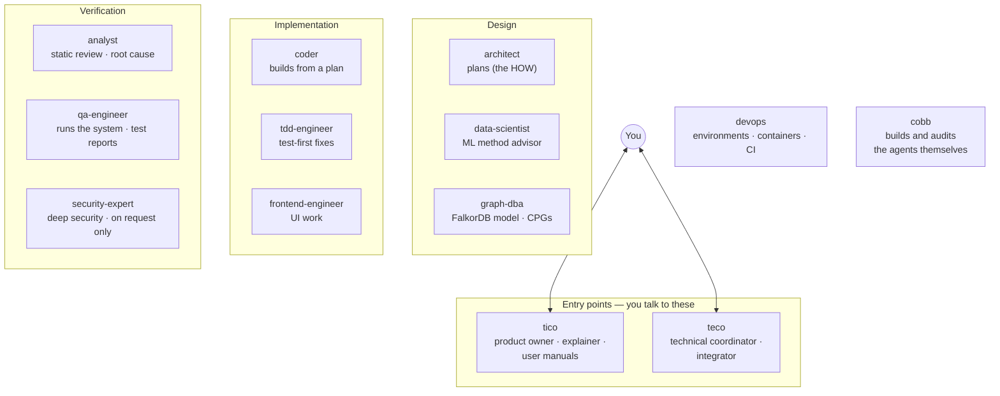

- **`tico`** — talk to it with a raw idea, a complaint, a "how does this work?", or a manual that
  needs writing. Launch it as its own session: `claude --agent tico`.
- **`teco`** — talk to it when the work has several steps or disciplines: a whole feature, a
  bug that needs diagnosing *and* fixing, a milestone close. Launch it with `claude --agent teco`
  to be asked decisions live; it also works when another session hands it a task.
- **Specialists** — normally pulled in by `teco` (or, for review and advice, by `tico`). You can
  address one directly for a single, well-scoped ask ("architect, plan X"); once a job has more
  than one moving part, routing it through `teco` is what keeps steps and reviews from being
  dropped.
- **`cobb`** — doesn't build product features. It writes, edits and audits the other agents.

### Who calls whom

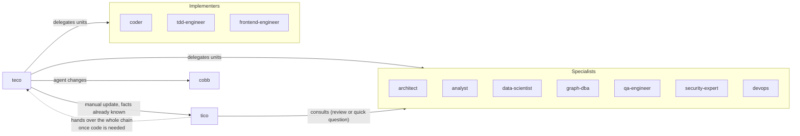

*Reading it:* a **solid arrow** is a live call — one agent sends another a self-contained brief
and gets a result back. A **dotted arrow** is a handover of work already done.

The line that never moves: **`tico` never calls an implementer.** Anything that would change
source code, tests or configuration belongs to `teco`.

## How a feature moves through the team

### The path

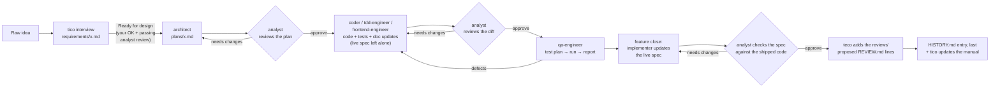

Two terms in that picture. A **live spec** is the set of documents that describe how a component
behaves *right now* (for falkor-chat: its design, server and query docs). A **`REVIEW.md`** is a
component's standing checklist for reviewers. Build work leaves the live spec alone; it is
updated once, when the feature closes, and checked against what actually shipped. A component
without a live spec skips the two spec steps.

Side roles join as needed: `data-scientist` advises on, and reviews, anything involving model
choice or evaluation; `graph-dba` designs graph-data changes; `devops` unblocks environments;
`security-expert` runs a deep security pass when someone asks for one.

**Independent review is the default.** Nobody signs off their own work:

| What was produced | Who reviews it |
|---|---|
| A plan or a code change | `analyst` |
| ML methodology | `data-scientist` |
| Behaviour (does it actually work?) | `qa-engineer` |
| A user manual | split — `qa-engineer` walks the steps, `analyst` checks the facts |

Ceremony scales with the task, and a genuinely trivial one-line fix can skip a step — but the
review gate is the *last* thing dropped, not the first, and skipping it is said out loud.

### One name per feature

Every document a feature produces shares one name, the **slug**. For a feature called `x`:

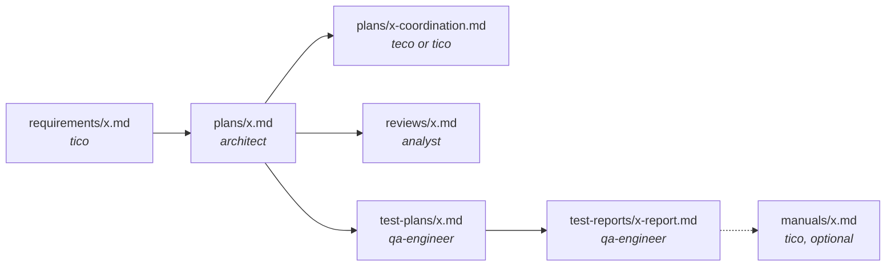

Specialist notes add a suffix to the same slug: `plans/x-ml.md` (data-scientist),
`plans/x-graph.md` (graph-dba), `reviews/x-rca.md` (a root-cause analysis), `reviews/x-impl.md`
(a review of the implementation). They live under the component's own `docs/` folder —
`falkor-chat/docs/plans/x.md`. A feature that spans several components uses the repo-root
`docs/` folder instead (e.g. `docs/requirements/salesperson-ui.md`).

To see a feature's entire paper trail, run this from inside the component's folder, with the
feature's slug in place of `x`:

```bash
find docs -regextype posix-extended -regex '.*/x(-(coordination|ml|graph|rca|impl|report))?\.md'
```

(A simpler `find docs -name 'x*'` also works, but it picks up any *other* topic whose name
merely starts with the same word.)

## How work is orchestrated

### teco's working loop

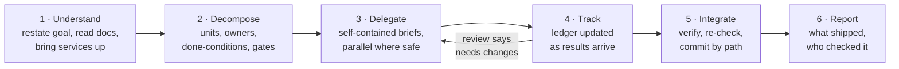

What's worth knowing about each step:

- **Understand.** teco starts FalkorDB and the team's learnings server if they're down (it never
  restarts one that's running) and warns if a code graph it may need is stale.
- **Decompose.** Each unit gets an owner, a "done" condition and a review gate. **Doc updates are
  written into the done condition** — code that works but leaves its README stale is unfinished.
  The live spec is the exception: build units leave it alone, and teco lists the affected
  sections for the feature close instead.
- **Delegate.** Each specialist starts with an empty head, so its brief carries everything:
  the goal, the upstream document *by path*, constraints, and where to write its result.
- **Integrate.** teco checks instead of trusting: it re-checks numbers a delegate reports, opens
  every doc said to be updated, and may deliberately break the new code to confirm the tests
  notice.

### The coordination ledger

Once a job has **three or more units, any review gate, or any unit that stops to ask you
something**, the coordinator opens `<component>/docs/plans/<slug>-coordination.md`. Its core is
one table, one row per unit:

| Unit | Owner | Agent id | Status | Deliverable | Gate → verdict | Cost |
|---|---|---|---|---|---|---|
| U1 | `architect` | `a1b2…` | accepted | `docs/plans/x.md` | `analyst` → approve | 180k tok |
| U2 | `coder` | `c3d4…` | in-flight | — | `analyst` → — | — |
| U3 | `coder` | `e5f6…` | paused | ⏸ "backfill NULLs to 0, or reject the row?" — asked 2026-10-20 | — → — | — |

**The ledger is the memory, not the coordinator's head.** If a session crashes or runs out of
room, the next one reads the ledger and carries on rather than redoing work. The **Agent id** is
what lets the coordinator go back to the *same* agent — with everything it already knows — to
fix a review finding or continue after a pause, instead of briefing a new one from scratch.

Each unit moves through these states:

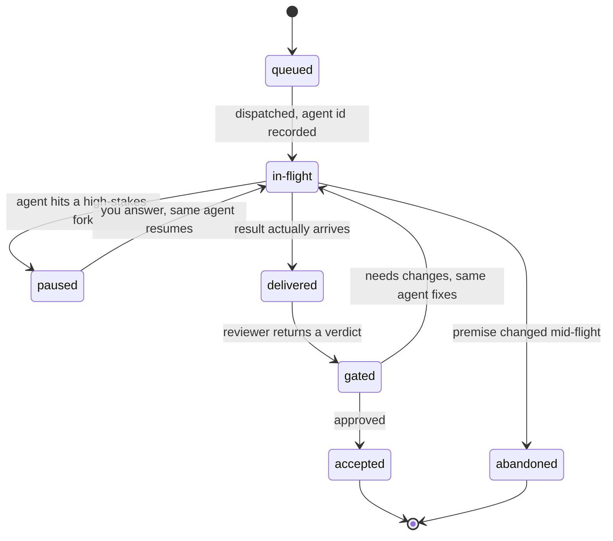

**Paused is how you stay in control.** A delegated agent can't talk to you mid-run, so it makes
ordinary judgment calls itself. But if a wrong guess would change the scope, do something
irreversible, or waste a lot of later work, it stops and returns the question instead. The
coordinator brings that question to you and parks only that unit — everything unrelated keeps
moving. There's no deadline: a paused unit waits for your answer.

### Two coordinators, one boundary

| | `tico` coordinates | `teco` coordinates |
|---|---|---|
| **What** | Docs-only chains: requirements → plan → review → revision | Anything that touches code, tests or config |
| **Ledger** | Same file, same table | Same file, same table |
| **When it ends** | The moment a unit would need an implementer, tico hands the **whole remaining chain** to teco | Through to delivery |

teco picks up tico's ledger as its starting point — nothing already done gets redone.

## How tasks are tracked

### Three layers

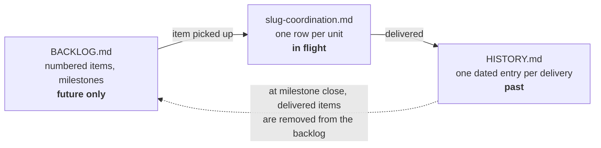

| Layer | Where | Rules worth knowing |
|---|---|---|
| **Backlog** | `<component>/docs/BACKLOG.md` | Items are numbered (`K-0NN` in most components, `C-NNN` in `cpg/`), grouped into milestones (M1, M2…). Markers: 🔵 proposed · 🟡 in progress · ✅ delivered · ⚪ rejected/deferred. **Forward-looking only** — an item may sit at ✅ briefly, but it is removed when its milestone closes, once its `HISTORY.md` entry is confirmed. An item revisited is rewritten as one current statement, never stacked with "Update:" notes. |
| **Ledger** | `<component>/docs/plans/<slug>-coordination.md` | Live state of one piece of work; see above. |
| **History** | `<component>/docs/HISTORY.md` | One dated entry per delivered change, written as part of delivering it. Only ever grows. |

Numbers are local to the backlog that holds them: `K-069` in `falkor-chat/docs/BACKLOG.md` and
`K-001` in an agent's plan are unrelated. One location trap: the repo-root `docs/BACKLOG.md` and
`docs/HISTORY.md` belong to the `cpg/` component, not to the whole repo.

**The agent team tracks itself in two places.** `claude/` has no `BACKLOG.md`. Improvements to a
single agent live in `claude/<name>/kaizen/plan.md` (that agent's backlog) and `history.md` (what
changed in it, and why). Team-wide changes go through the same documents as any feature, in
`claude/docs/` — requirements, plans, coordination ledgers, reviews (e.g.
`claude/docs/requirements/mid-run-escalation.md`).

### Document status, and closing a milestone

Every document opens with a one-line header carrying its status. This lifecycle applies to the
documents a piece of work produces — requirements, plans, ledgers, reviews, test plans and
reports. **Living documents** (backlog, history, design docs, READMEs) never freeze: they stay
`active` and are edited in place. **Manuals** stay `active` too, until the feature they describe
is removed or a new manual replaces them.

```markdown
> **Status:** active · **Owner:** `architect` · **Tracks:** K-069 (M7)
```

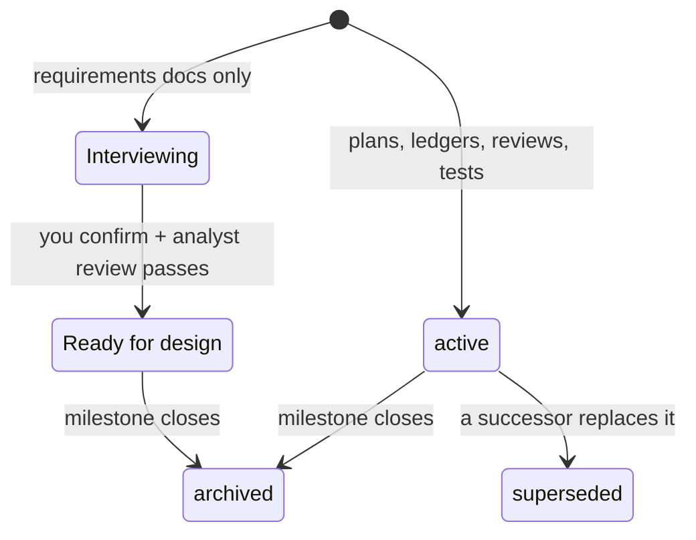

When a milestone closes, `teco` flips that milestone's documents to `archived`. **Nothing is
moved or deleted** — a frozen document stays where it is. teco also *lists* the delivered items
to drop from the backlog, but **you apply that list**: removing items is your call, and each one
is checked against `HISTORY.md` first.

A useful one-liner to see where every plan in a component stands:
`grep -m1 -H 'Status:' docs/plans/*.md`.

### Asking "what's going on?" across the whole repo

Reading ledgers and backlogs one by one gets slow. A tool called **`coordgraph`** keeps a
read-only copy (a *mirror*) of all of them — ledgers, reviews, requirements, every component's
backlog, each agent's `kaizen/plan.md` — and answers the common questions in one command. **The
files stay the truth**: the mirror is never edited by hand, and where the two disagree, the file wins.

**First time only:** run `coordination-graph/setup.sh` once (it creates the tool's own Python
environment; `coordgraph.sh` stops and tells you to do this if it is missing). Then run it from
the repo root. Add `--confirm coordination` to each command (it is the "yes, I mean the
shared copy" switch); `export COORDGRAPH_SHARED_CONFIRM=coordination` once per terminal does the same.

| You want to know | Run |
|---|---|
| What is in flight — open coordinations, verdicts, requirements | `coordination-graph/coordgraph.sh inflight --confirm coordination` |
| **What is waiting on me** — questions paused units have asked you | `coordination-graph/coordgraph.sh inflight --waiting --confirm coordination` |
| One piece of work: each unit's status, agent, deliverable, open question | `coordination-graph/coordgraph.sh unit <ledger-slug> [U3] --confirm coordination` |
| What is planned next for a component or agent | `coordination-graph/coordgraph.sh planned <component> --confirm coordination` (add `--all` to include deferred and rejected items) |
| A suggested grouping of that backlog into milestones | `coordination-graph/coordgraph.sh propose <component> --confirm coordination` (add `--per-milestone N`; default 6 items each) |

`unit` also accepts a work-item ID instead of a slug. `propose` is **only a suggestion**: it
changes nothing; accepting a milestone plan is still a decision you take with `teco`. A lookup that
finds nothing exits non-zero rather than printing an empty answer.

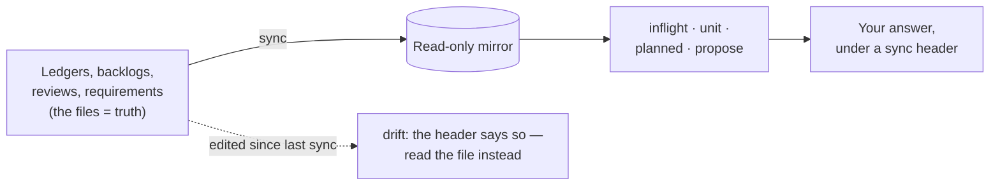

**Reading the sync header.** Every answer starts with three lines:

```
Synced: <oldest>Z – <newest>Z (<n> sources) · Hook: active|disabled
Registry: <n> items · last event <date> · <m> unflushed journal events
Drift: none
```

- **Synced** — how old the copy is (oldest to newest source). `never` means some file has not been
  copied at all.
- **Drift** — files that changed after they were copied. Each is listed with a state (`changed`,
  `unsynced`, `gone`, or `stale-parser`) and "file wins". An answer row marked `⚠ drift` comes
  from a file that moved since the copy: **do not trust that row; open the file.** Anything not
  flagged is current. `coordgraph drift` prints just this check and exits non-zero when it finds any.
- **Registry** — only matters if it says `unavailable`: then work-item IDs were compared as
  written, not resolved, so the same item under two spellings may show twice.
- **Hook** — see below. `active` does **not** by itself mean the hook is installed; it means it
  has not been switched off.

**Bringing the copy up to date.** `coordination-graph/coordgraph.sh sync --changed --confirm coordination`
copies every file that changed; `sync <path>` copies one; `sync --all` also drops entries for files
that no longer exist. Run `drift` afterwards: it should say `Drift: none`. Agents can run these
too; you rarely need to.

**The post-edit hook (optional, set up by you).** Once registered, the hook copies a ledger, backlog
or other covered file into the mirror right after an agent edits it, so the answers above stay
current without anyone remembering to run `sync`. It is **not registered yet**: it takes one
paste of a settings block, which only you apply by hand
(`coordination-graph/docs/hook-settings.md` has the block and the go-live steps). Whether it fires
inside every kind of agent session (background subagents, worktrees) has not been checked yet; where
it is silent you fall back to the header and `sync` by hand — nothing breaks.

- **Before it is registered:** everything above works; the copy is only as fresh as the last
  `sync`, and `Drift:` tells you how stale.
- **After it is registered:** a quiet edit costs a few milliseconds. If an edited file could not be
  copied (database down, say), the agent is told "this update is not complete" and should say so
  to you; every further edit repeats that warning, and failed files are retried automatically with
  growing delays. Anything it misses (an edit made outside Claude Code, a deleted file) shows up
  as drift.
- **Turn it off, instantly:** `touch coordination-graph/.state/disabled` (or set
  `COORDGRAPH_HOOK_DISABLED=1`); the header then reads `Hook: disabled`. `rm` the file to turn it
  back on — edits made meanwhile are copied on the next hook call, or at once with `sync --all`.
  To remove it for good, delete the two `hooks` entries from the settings file.

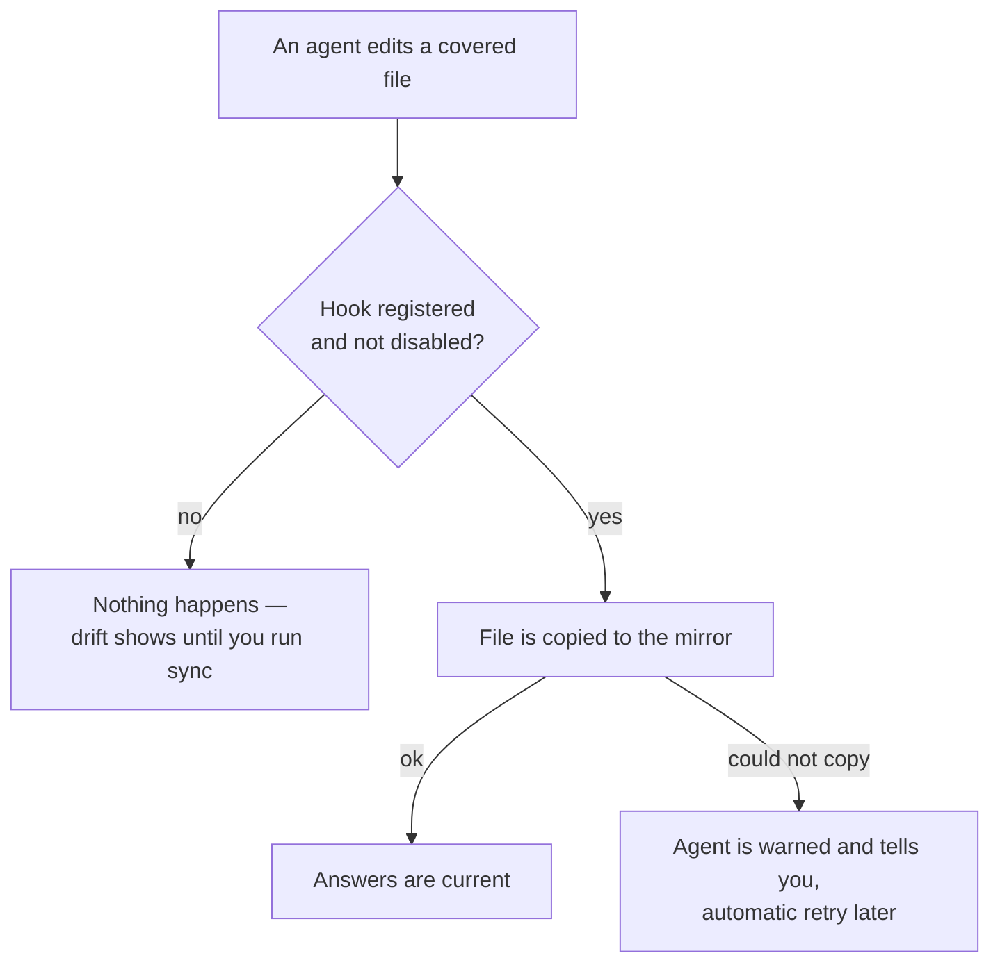

**What the answers look like** (trimmed; the sync header comes first each time):

```
$ coordgraph unit coordination-graph
claude/docs/plans/coordination-graph-coordination.md · docStatus: active
  U4 Independent review of U2+U3
    status: gated
    agent: a4a42445657f6f008
    deliverable: `claude/docs/reviews/coordination-graph.md` (Pass 1)
  ...one block per unit; "agent: —" means none was recorded

$ coordgraph inflight --waiting
Waiting on the stakeholder (1)
  <component>  <ledger path>  <unit>  asked 2026-11-20  <the question>

$ coordgraph planned falkor-chat
Backlog falkor-chat/docs/BACKLOG.md	(48 items)
Planned (proposed / in progress) (48)
  GAL-I02-K0002	🔵 proposed	-	-	<title>	falkor-chat/docs/BACKLOG.md
  falkor-chat:K-079	🟡 in-progress	-	-	<title>	falkor-chat/docs/BACKLOG.md

$ coordgraph propose falkor-chat
Milestone M2.5 (approved, as recorded)
    falkor-chat:K-016  <title>  [falkor-chat/docs/BACKLOG.md]
Carried — in progress:
  falkor-chat:K-079  <title>  [...]
Not plannable yet:
  falkor-chat:K-082  <title>  [...] — missing Priority, Depends on, Touches
```

- **`unit`** with only the ledger slug lists every unit; add a unit label (`U4`) for one. A label
  the ledger does not have prints "no unit matches ..." and exits 1 (for example `unit
  coordination-graph S9` finds nothing: that ledger's units are labelled `U<n>`).
- **`inflight --waiting`** has one row per question a paused unit has put to you: component,
  ledger, unit, `asked <date>` (or `asked unknown`), then the question. Rows are separated by tabs.
  When nothing is waiting it prints `(none)`. (The example above shows the row format; no question
  was waiting when this was written.)
- **`planned`** gives one line per open item: its ID (older items look like `falkor-chat:K-079`,
  newer ones like `GAL-I02-K0002`), 🔵 proposed or 🟡 in progress, **Priority**, **Milestone**
  (each `-` when the backlog item records none), the title, and the backlog file.
- **`propose`** groups items into milestones already approved ("as recorded"), items carried
  because they are in progress, and **"Not plannable yet"**: items whose backlog entry lacks a
  Priority, a Depends-on, or a Touches line, so the tool can't rank them. Today most of
  `falkor-chat`'s open items land there; filling in those three fields on an item is what lets a
  future `propose` slot it into a milestone.

**Learnings store.** `coordination-graph/coordgraph.sh kb-status --confirm coordination` reports
how far the shared learnings store (`ws:agent-team`) has caught up with the registered
knowledge-base files. The copy is loaded: the command prints `KB mirror: last sync <time>` and then one row per
flagged section. A row looks like
`degraded  <file> § <section>  <document id>: extraction failed, still searchable`:

- **`degraded`** — informational. The store couldn't extract entities from that section, but the text
  is still found by searches. Nothing to do.
- **`failed-doc`** — act on it: that section is **not** searchable. Ask the knowledge-base maintainer, `cobb`, to re-run the KB sync, which retries it.
- Other flags (`stale`, `pending`, `unmirrored`, duplicate claims) mean the store is behind the
  files; the same sync catches it up (also `cobb`'s). The command exits 0 when the only rows are `degraded`, so
  they do not count as a problem.

## Technical documentation vs. user documentation

| | Technical (engineering) docs | User manuals |
|---|---|---|
| **Audience** | People building the system | People using it |
| **Kinds** | requirements, plans, reviews, test plans, test reports, backlog, history, design docs | `docs/manuals/<slug>.md` |
| **Written by** | The producing specialist (table above) | `tico` |
| **Content** | Decisions, designs, findings, evidence | Screens, workflows, recovery from mistakes — never internals |
| **Kept current by** | The unit that changes the thing also updates its docs; teco checks | tico, whenever an explanation or interview reveals a stale or missing manual |

A few rules apply to all of them:

- **Cite, don't copy.** A document points to another by its path from the repo root rather than
  restating it — copies drift apart.
- **An approved work document is frozen.** Once a requirements doc, plan, test plan or similar
  has been approved or acted on, a change becomes a new document (`x2.md`) that points back to
  it, rather than an edit. Reviews are the exception: a re-review is added as `## Pass 2` in the
  same file. Living documents and manuals are simply kept up to date in place.
- **Manuals describe only what has shipped.** A feature still being designed gets a requirements
  doc or a plan, not a manual.

## Walkthroughs

### Starting from a raw idea

1. Run `claude --agent tico` and describe the idea in your own words.
2. tico asks one question at a time and writes the answers into
   `<component>/docs/requirements/<slug>.md` as you go — open it any time to see where you are.
   Settled answers go into its decision log, so nothing is asked twice.
3. If a question needs an expert (does the database support this today?), tico **says who it's
   asking and why, then asks** — you can stop it, but it won't wait for permission.
4. tico reads the whole document back to you and has `analyst` review it. It flips to **Ready for
   design** only once you confirm and the review's latest verdict is not "needs changes".
5. tico gives you the path and offers to hand it to `architect`. That offer *does* wait for your yes.

### Getting something built end-to-end

1. Run `claude --agent teco` and ask for the outcome ("deliver the feature in
   `falkor-chat/docs/requirements/x.md`"). teco doesn't see your conversation with tico, so give it
   the path.
2. teco breaks the work into units and opens the ledger. Follow progress there.
3. When a unit pauses, teco asks you a specific question, with options and its recommendation.
4. At the end, teco reports what shipped, who reviewed what, and what it verified itself versus
   what it took on a specialist's word — every deliverable by path.

### Taking an idea all the way to an approved plan, without code yet

Ask tico. It can run the docs-only chain itself — your interview, then architect's plan, then
analyst's review, then revisions — tracked in the same kind of ledger. When you're ready to build,
tico hands the chain to teco.

### Asking "how does X work?" or "why was Y built that way?"

Just ask tico — no interview. It reads the real docs and code first, answers in plain language,
and draws a diagram when that's quicker than prose. It may offer a live demo (set up and torn
down by `devops`, teardown only after you agree). If the answer exposes a gap, it will say so and
offer to fix the manual or open a requirements interview.

### Getting a plan or a change double-checked

Ask `analyst`. It returns severity-ranked findings and a verdict — *approve*, *approve with
suggestions*, or *needs changes* — in `docs/reviews/<slug>.md`, and never edits what it reviews.
For a bug with an unknown cause, ask analyst for a root-cause analysis before anyone fixes it;
`tdd-engineer` then starts from a test that reproduces the bug. For a security-focused pass, ask
`security-expert` explicitly — it's never automatic.

### Picking up work after a crash or a new day

Open the ledger (`<component>/docs/plans/<slug>-coordination.md`) and ask teco to resume it. teco
treats the ledger as the truth, checks it against what's actually in git, and continues from the
first unfinished unit. If a previous session crashed mid-way, expect some uncommitted documents
in `git status` — a docs-only chain commits everything together only when it finishes.

### Closing a milestone

Ask teco to close it. It flips that milestone's documents to `archived` and gives you a list of
delivered backlog items to remove. Check the list and apply it yourself.

### Proposing a new team member

Start with tico, not cobb. tico interviews you about the new agent's job and its boundaries with
the existing team (`claude/docs/requirements/<slug>.md`); once that's Ready for design, cobb
builds the agent from it.

## What you'll be asked to approve

Most agents are fenced in by small scripts that run before an action and ask you when it's out of
bounds. When a prompt appears, it's usually one of these:

| You're asked because… | Typical agents |
|---|---|
| An agent wants to write outside its own document kind | `architect`, `analyst`, `data-scientist`, `security-expert`, `cobb` |
| A builder wants to edit another specialist's document, an agent definition, or a backlog | `coder`, `tdd-engineer` |
| A destructive operation — deleting a graph, flushing the database, wiping volumes | `devops`, `graph-dba`, `qa-engineer`, `coder`, `tdd-engineer` |
| An active exploitation attempt against a local system — asked fresh every time | `security-expert` |
| A coordinator wants to write outside the repo, or a delegation forgot to name its agent | `teco`, `tico` |

`frontend-engineer` has no such fence; it relies on its instructions and your normal Claude Code
permission settings.

**Commits.** No agent ever pushes, rewrites history, or commits "everything" — every commit names
its files.

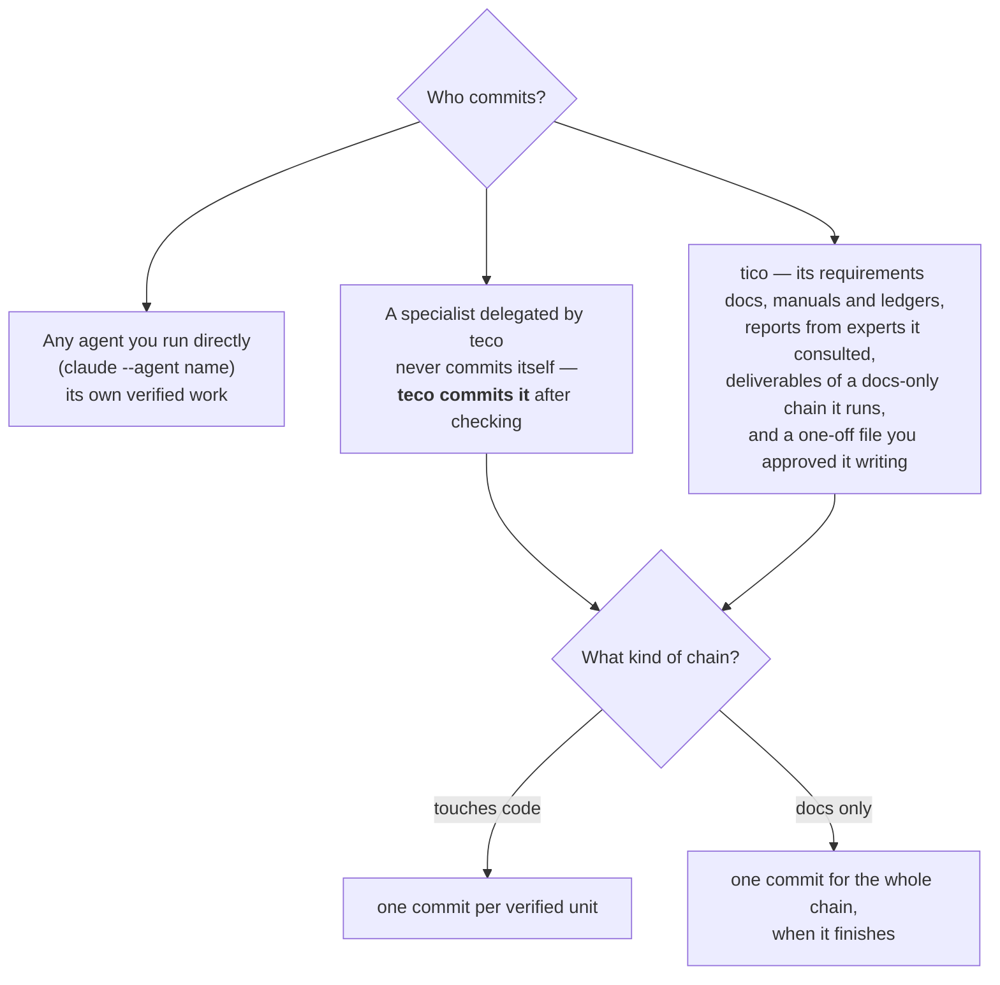

## How the team gets better over time

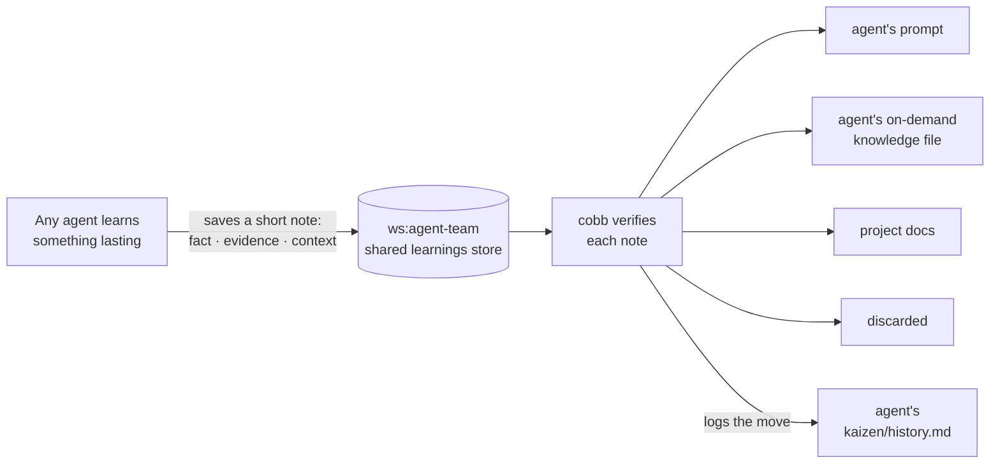

Agents never promote their own notes into their instructions — cobb reviews each one first. cobb
also runs `claude/scripts/audit-team.sh` to check the agent definitions still agree with each
other (rosters, handoffs, fences).

## FAQ / troubleshooting

**Can I talk to a specialist directly instead of going through teco?**
Yes, for one well-scoped ask. Once a job has several steps or disciplines, use teco — that's what
keeps a review gate from being skipped without anyone noticing.

**Why won't teco run a requirements interview for me?**
An interview needs your answers turn by turn, and a delegated agent can't talk to you. teco will
tell you to run `claude --agent tico` instead. The exception is a manual update where the facts
are already known — that doesn't need a conversation, so teco can hand it to tico directly.

**Who checks tico's manuals?**
For a new or heavily rewritten manual, tico calls the check itself and tells you it's doing so:
`qa-engineer` for the step-by-step parts, `analyst` for the factual claims. Small edits don't get one.

**`git status` shows uncommitted documents I didn't write. Is something broken?**
Usually not. A docs-only chain that's still waiting on a review deliberately holds its documents
until it finishes — check the matching ledger's status. Other sessions can also be working in the
same folder at the same time.

**teco says the learnings server came up but agents can't reach it.**
The server started after Claude Code had already tried to connect. Run `/mcp` and reconnect
`falkor-chat-agent-team`.

**Where do I find out what's still open for a component?**
Its `docs/BACKLOG.md`, or `coordgraph planned <component>` for the same list with the sync header.
For something in flight, the matching `docs/plans/<slug>-coordination.md`, or `coordgraph inflight`
across all of them. For what already shipped, `docs/HISTORY.md`.

**`inflight --waiting` says nothing is waiting, but I think an agent asked me something.**
Check the header's `Drift:` list first: if that ledger is listed, the copy is stale. Open the
ledger itself and look for a `paused` row — the file is the truth.

**A command says "refused" or can't reach the database.**
Add `--confirm coordination` (or set `COORDGRAPH_SHARED_CONFIRM=coordination`); without it the tool
only talks to a throwaway test database. If it is still unreachable, FalkorDB is down: ask `teco`
or `devops` to bring it up. Views and `sync` do not work until it is.

**An agent told me "this update is not complete" after editing a ledger (hook registered).**
The edit is safe in the file; only the mirror copy failed. Run `coordgraph sync <that file>
--confirm coordination`, then `coordgraph drift`. The hook also retries on its own; if it keeps
failing, switch the hook off (above) and ask `teco` to look. A message saying the hook was
**"refused by the guard"** is a configuration fault, not an outage, and is not retried for about 15
minutes: fix the setting, or run `sync --all`.

**The header says `Hook: active` but nothing seems to sync automatically.**
That word only means the kill switch is off. Until you register the settings block, nothing
fires the hook — use `sync`.
