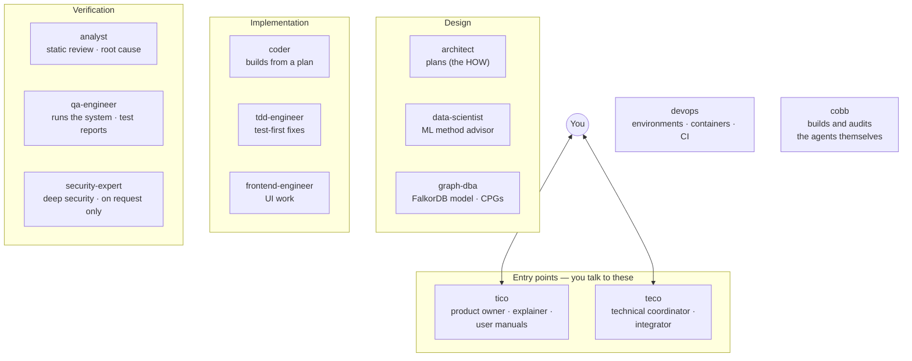
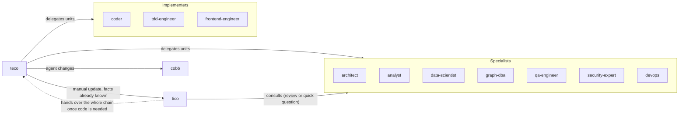
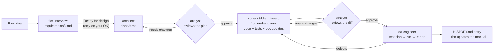
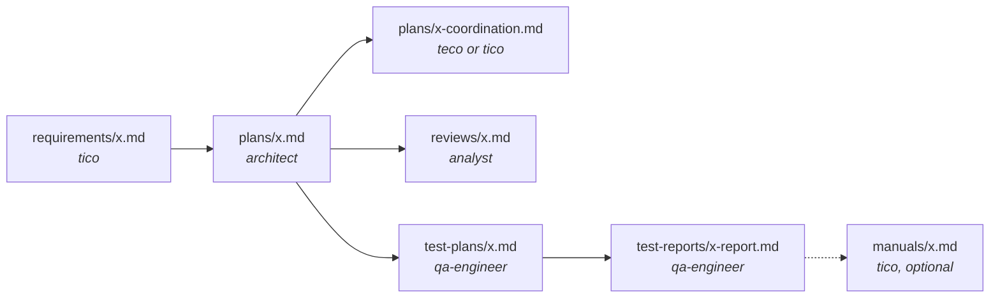
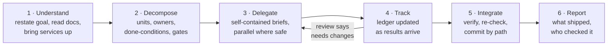
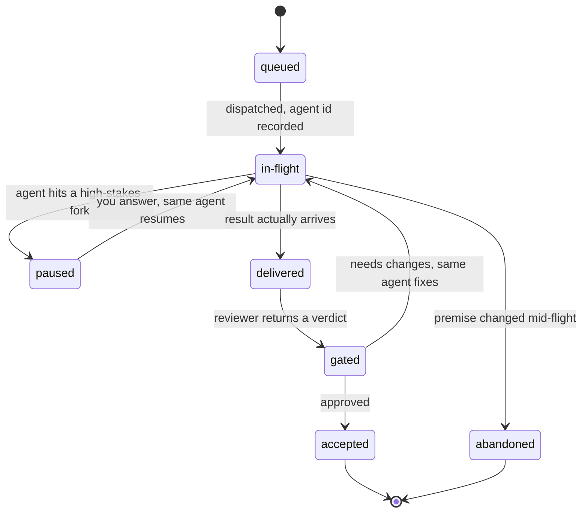
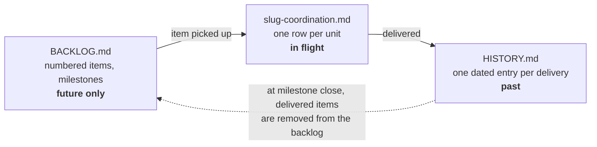
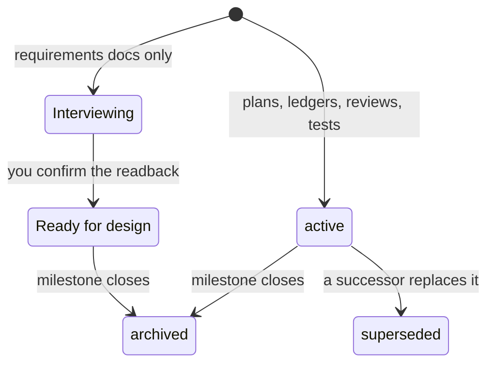
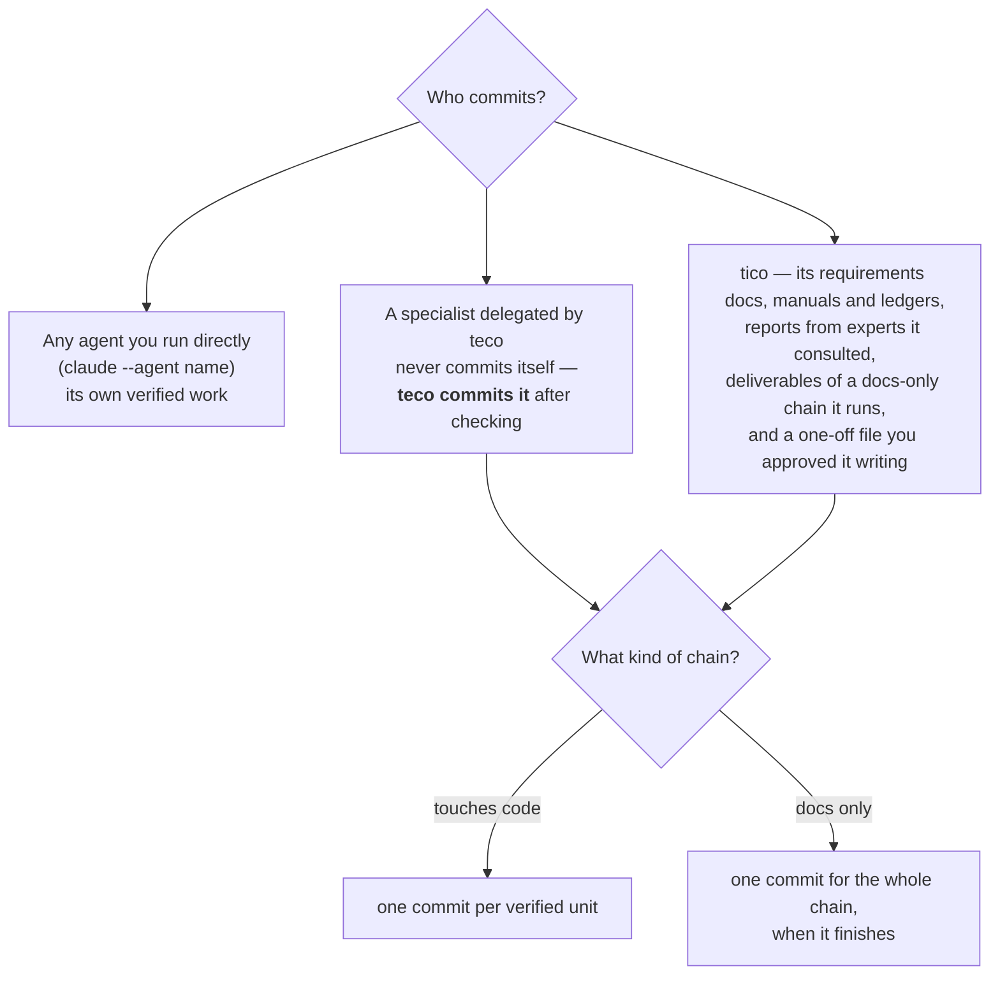
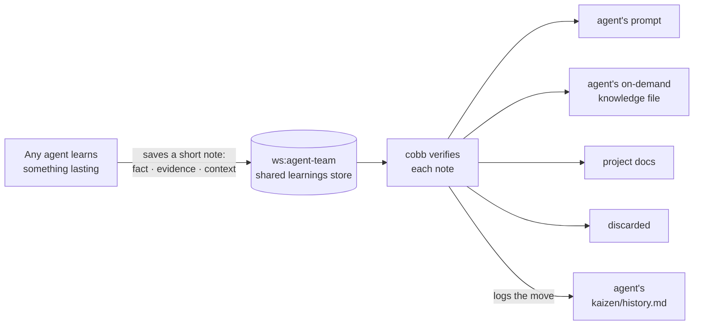

# The Claude Agent Team — User Manual

> **Status:** active · **Owner:** `tico` · **Tracks:** —

## Who this is for

Anyone directing work in this repo through Claude Code: a stakeholder asking for a feature, a
developer who wants a plan reviewed, or someone trying to work out **which agent to talk to**. It
also explains what you will see while the team works — the documents that appear, the approval
prompts you get, and where to look to know where a piece of work stands. You don't need to know
how any agent is built to use it.

## Overview

The team is a roster of thirteen agents in `claude/`. They cooperate on any product in this repo
through three things:

1. **People with narrow jobs.** Each agent does one discipline and, for most of them, can only
   write its own kind of output.
2. **A fixed set of document kinds.** Every step of a feature leaves a document behind, and the
   next agent is handed that document's **path**, never a retelling of it.
3. **Three layers of tracking.** A backlog for what's next, a coordination ledger for what's in
   flight, and a history log for what's done.

### Who's on the team



- **`tico`** — talk to it with a raw idea, a complaint, a "how does this work?", or a manual that
  needs writing. Launch it as its own session: `claude --agent tico`.
- **`teco`** — talk to it when the work has several steps or disciplines: a whole feature, a
  bug that needs diagnosing *and* fixing, a milestone close. Launch it with `claude --agent teco`
  to be asked decisions live; it also works when another session hands it a task.
- **Specialists** — normally pulled in by `teco` (or, for review and advice, by `tico`). You can
  address one directly for a single, well-scoped ask ("architect, plan X"); once a job has more
  than one moving part, routing it through `teco` is what keeps steps and reviews from being
  dropped.
- **`cobb`** — doesn't build product features. It writes, edits and audits the other agents.

### Who calls whom



*Reading it:* a **solid arrow** is a live call — one agent sends another a self-contained brief
and gets a result back. A **dotted arrow** is a handover of work already done.

The line that never moves: **`tico` never calls an implementer.** Anything that would change
source code, tests or configuration belongs to `teco`.

## How a feature moves through the team

### The path



Side roles join as needed: `data-scientist` advises on, and reviews, anything involving model
choice or evaluation; `graph-dba` designs graph-data changes; `devops` unblocks environments;
`security-expert` runs a deep security pass when someone asks for one.

**Independent review is the default.** Nobody signs off their own work:

| What was produced | Who reviews it |
|---|---|
| A plan or a code change | `analyst` |
| ML methodology | `data-scientist` |
| Behaviour (does it actually work?) | `qa-engineer` |
| A user manual | split — `qa-engineer` walks the steps, `analyst` checks the facts |

Ceremony scales with the task, and a genuinely trivial one-line fix can skip a step — but the
review gate is the *last* thing dropped, not the first, and skipping it is said out loud.

### One name per feature

Every document a feature produces shares one name, the **slug**. For a feature called `x`:



Specialist notes add a suffix to the same slug: `plans/x-ml.md` (data-scientist),
`plans/x-graph.md` (graph-dba), `reviews/x-rca.md` (a root-cause analysis), `reviews/x-impl.md`
(a review of the implementation). They live under the component's own `docs/` folder —
`falkor-chat/docs/plans/x.md`. A feature that spans several components uses the repo-root
`docs/` folder instead (e.g. `docs/requirements/salesperson-ui.md`).

To see a feature's entire paper trail, run this from inside the component's folder, with the
feature's slug in place of `x`:

```bash
find docs -regextype posix-extended -regex '.*/x(-(coordination|ml|graph|rca|impl|report))?\.md'
```

(A simpler `find docs -name 'x*'` also works, but it picks up any *other* topic whose name
merely starts with the same word.)

## How work is orchestrated

### teco's working loop



What's worth knowing about each step:

- **Understand.** teco starts FalkorDB and the team's learnings server if they're down (it never
  restarts one that's running) and warns if a code graph it may need is stale.
- **Decompose.** Each unit gets an owner, a "done" condition and a review gate. **Doc updates are
  written into the done condition** — code that works but leaves its README stale is unfinished.
- **Delegate.** Each specialist starts with an empty head, so its brief carries everything:
  the goal, the upstream document *by path*, constraints, and where to write its result.
- **Integrate.** teco checks instead of trusting: it re-checks numbers a delegate reports, opens
  every doc said to be updated, and may deliberately break the new code to confirm the tests
  notice.

### The coordination ledger

Once a job has **three or more units, any review gate, or any unit that stops to ask you
something**, the coordinator opens `<component>/docs/plans/<slug>-coordination.md`. Its core is
one table, one row per unit:

| Unit | Owner | Agent id | Status | Deliverable | Gate → verdict | Cost |
|---|---|---|---|---|---|---|
| U1 | `architect` | `a1b2…` | accepted | `docs/plans/x.md` | `analyst` → approve | 180k tok |
| U2 | `coder` | `c3d4…` | in-flight | — | `analyst` → — | — |
| U3 | `coder` | `e5f6…` | paused | ⏸ "backfill NULLs to 0, or reject the row?" — asked 2026-10-20 | — → — | — |

**The ledger is the memory, not the coordinator's head.** If a session crashes or runs out of
room, the next one reads the ledger and carries on rather than redoing work. The **Agent id** is
what lets the coordinator go back to the *same* agent — with everything it already knows — to
fix a review finding or continue after a pause, instead of briefing a new one from scratch.

Each unit moves through these states:



**Paused is how you stay in control.** A delegated agent can't talk to you mid-run, so it makes
ordinary judgment calls itself. But if a wrong guess would change the scope, do something
irreversible, or waste a lot of later work, it stops and returns the question instead. The
coordinator brings that question to you and parks only that unit — everything unrelated keeps
moving. There's no deadline: a paused unit waits for your answer.

### Two coordinators, one boundary

| | `tico` coordinates | `teco` coordinates |
|---|---|---|
| **What** | Docs-only chains: requirements → plan → review → revision | Anything that touches code, tests or config |
| **Ledger** | Same file, same table | Same file, same table |
| **When it ends** | The moment a unit would need an implementer, tico hands the **whole remaining chain** to teco | Through to delivery |

teco picks up tico's ledger as its starting point — nothing already done gets redone.

## How tasks are tracked

### Three layers



| Layer | Where | Rules worth knowing |
|---|---|---|
| **Backlog** | `<component>/docs/BACKLOG.md` | Items are numbered (`K-0NN` in most components, `C-NNN` in `cpg/`), grouped into milestones (M1, M2…). Markers: 🔵 proposed · 🟡 in progress · ✅ delivered · ⚪ rejected/deferred. **Forward-looking only** — an item may sit at ✅ briefly, but it is removed when its milestone closes, once its `HISTORY.md` entry is confirmed. An item revisited is rewritten as one current statement, never stacked with "Update:" notes. |
| **Ledger** | `<component>/docs/plans/<slug>-coordination.md` | Live state of one piece of work; see above. |
| **History** | `<component>/docs/HISTORY.md` | One dated entry per delivered change, written as part of delivering it. Only ever grows. |

Numbers are local to the backlog that holds them: `K-069` in `falkor-chat/docs/BACKLOG.md` and
`K-001` in an agent's plan are unrelated. One location trap: the repo-root `docs/BACKLOG.md` and
`docs/HISTORY.md` belong to the `cpg/` component, not to the whole repo.

**The agent team tracks itself in two places.** `claude/` has no `BACKLOG.md`. Improvements to a
single agent live in `claude/<name>/kaizen/plan.md` (that agent's backlog) and `history.md` (what
changed in it, and why). Team-wide changes go through the same documents as any feature, in
`claude/docs/` — requirements, plans, coordination ledgers, reviews (e.g.
`claude/docs/requirements/mid-run-escalation.md`).

### Document status, and closing a milestone

Every document opens with a one-line header carrying its status. This lifecycle applies to the
documents a piece of work produces — requirements, plans, ledgers, reviews, test plans and
reports. **Living documents** (backlog, history, design docs, READMEs) never freeze: they stay
`active` and are edited in place. **Manuals** stay `active` too, until the feature they describe
is removed or a new manual replaces them.

```markdown
> **Status:** active · **Owner:** `architect` · **Tracks:** K-069 (M7)
```



When a milestone closes, `teco` flips that milestone's documents to `archived`. **Nothing is
moved or deleted** — a frozen document stays where it is. teco also *lists* the delivered items
to drop from the backlog, but **you apply that list**: removing items is your call, and each one
is checked against `HISTORY.md` first.

A useful one-liner to see where every plan in a component stands:
`grep -m1 -H 'Status:' docs/plans/*.md`.

## Technical documentation vs. user documentation

| | Technical (engineering) docs | User manuals |
|---|---|---|
| **Audience** | People building the system | People using it |
| **Kinds** | requirements, plans, reviews, test plans, test reports, backlog, history, design docs | `docs/manuals/<slug>.md` |
| **Written by** | The producing specialist (table above) | `tico` |
| **Content** | Decisions, designs, findings, evidence | Screens, workflows, recovery from mistakes — never internals |
| **Kept current by** | The unit that changes the thing also updates its docs; teco checks | tico, whenever an explanation or interview reveals a stale or missing manual |

A few rules apply to all of them:

- **Cite, don't copy.** A document points to another by its path from the repo root rather than
  restating it — copies drift apart.
- **An approved work document is frozen.** Once a requirements doc, plan, test plan or similar
  has been approved or acted on, a change becomes a new document (`x2.md`) that points back to
  it, rather than an edit. Reviews are the exception: a re-review is added as `## Pass 2` in the
  same file. Living documents and manuals are simply kept up to date in place.
- **Manuals describe only what has shipped.** A feature still being designed gets a requirements
  doc or a plan, not a manual.

## Walkthroughs

### Starting from a raw idea

1. Run `claude --agent tico` and describe the idea in your own words.
2. tico asks one question at a time and writes the answers into
   `<component>/docs/requirements/<slug>.md` as you go — open it any time to see where you are.
   Settled answers go into its decision log, so nothing is asked twice.
3. If a question needs an expert (does the database support this today?), tico **says who it's
   asking and why, then asks** — you can stop it, but it won't wait for permission.
4. tico reads the whole document back to you. Only when you confirm does it flip to **Ready for
   design**.
5. tico gives you the path and offers to hand it to `architect`. That offer *does* wait for your yes.

### Getting something built end-to-end

1. Run `claude --agent teco` and ask for the outcome ("deliver the feature in
   `falkor-chat/docs/requirements/x.md`"). teco doesn't see your conversation with tico, so give it
   the path.
2. teco breaks the work into units and opens the ledger. Follow progress there.
3. When a unit pauses, teco asks you a specific question, with options and its recommendation.
4. At the end, teco reports what shipped, who reviewed what, and what it verified itself versus
   what it took on a specialist's word — every deliverable by path.

### Taking an idea all the way to an approved plan, without code yet

Ask tico. It can run the docs-only chain itself — your interview, then architect's plan, then
analyst's review, then revisions — tracked in the same kind of ledger. When you're ready to build,
tico hands the chain to teco.

### Asking "how does X work?" or "why was Y built that way?"

Just ask tico — no interview. It reads the real docs and code first, answers in plain language,
and draws a diagram when that's quicker than prose. It may offer a live demo (set up and torn
down by `devops`, teardown only after you agree). If the answer exposes a gap, it will say so and
offer to fix the manual or open a requirements interview.

### Getting a plan or a change double-checked

Ask `analyst`. It returns severity-ranked findings and a verdict — *approve*, *approve with
suggestions*, or *needs changes* — in `docs/reviews/<slug>.md`, and never edits what it reviews.
For a bug with an unknown cause, ask analyst for a root-cause analysis before anyone fixes it;
`tdd-engineer` then starts from a test that reproduces the bug. For a security-focused pass, ask
`security-expert` explicitly — it's never automatic.

### Picking up work after a crash or a new day

Open the ledger (`<component>/docs/plans/<slug>-coordination.md`) and ask teco to resume it. teco
treats the ledger as the truth, checks it against what's actually in git, and continues from the
first unfinished unit. If a previous session crashed mid-way, expect some uncommitted documents
in `git status` — a docs-only chain commits everything together only when it finishes.

### Closing a milestone

Ask teco to close it. It flips that milestone's documents to `archived` and gives you a list of
delivered backlog items to remove. Check the list and apply it yourself.

### Proposing a new team member

Start with tico, not cobb. tico interviews you about the new agent's job and its boundaries with
the existing team (`claude/docs/requirements/<slug>.md`); once that's Ready for design, cobb
builds the agent from it.

## What you'll be asked to approve

Most agents are fenced in by small scripts that run before an action and ask you when it's out of
bounds. When a prompt appears, it's usually one of these:

| You're asked because… | Typical agents |
|---|---|
| An agent wants to write outside its own document kind | `architect`, `analyst`, `data-scientist`, `security-expert`, `cobb` |
| A builder wants to edit another specialist's document, an agent definition, or a backlog | `coder`, `tdd-engineer` |
| A destructive operation — deleting a graph, flushing the database, wiping volumes | `devops`, `graph-dba`, `qa-engineer`, `coder`, `tdd-engineer` |
| An active exploitation attempt against a local system — asked fresh every time | `security-expert` |
| A coordinator wants to write outside the repo, or a delegation forgot to name its agent | `teco`, `tico` |

`frontend-engineer` has no such fence; it relies on its instructions and your normal Claude Code
permission settings.

**Commits.** No agent ever pushes, rewrites history, or commits "everything" — every commit names
its files.



## How the team gets better over time



Agents never promote their own notes into their instructions — cobb reviews each one first. cobb
also runs `claude/scripts/audit-team.sh` to check the agent definitions still agree with each
other (rosters, handoffs, fences).

## FAQ / troubleshooting

**Can I talk to a specialist directly instead of going through teco?**
Yes, for one well-scoped ask. Once a job has several steps or disciplines, use teco — that's what
keeps a review gate from being skipped without anyone noticing.

**Why won't teco run a requirements interview for me?**
An interview needs your answers turn by turn, and a delegated agent can't talk to you. teco will
tell you to run `claude --agent tico` instead. The exception is a manual update where the facts
are already known — that doesn't need a conversation, so teco can hand it to tico directly.

**Who checks tico's manuals?**
For a new or heavily rewritten manual, tico calls the check itself and tells you it's doing so:
`qa-engineer` for the step-by-step parts, `analyst` for the factual claims. Small edits don't get one.

**`git status` shows uncommitted documents I didn't write. Is something broken?**
Usually not. A docs-only chain that's still waiting on a review deliberately holds its documents
until it finishes — check the matching ledger's status. Other sessions can also be working in the
same folder at the same time.

**teco says the learnings server came up but agents can't reach it.**
The server started after Claude Code had already tried to connect. Run `/mcp` and reconnect
`falkor-chat-agent-team`.

**Where do I find out what's still open for a component?**
Its `docs/BACKLOG.md`. For something in flight, the matching `docs/plans/<slug>-coordination.md`.
For what already shipped, `docs/HISTORY.md`.
