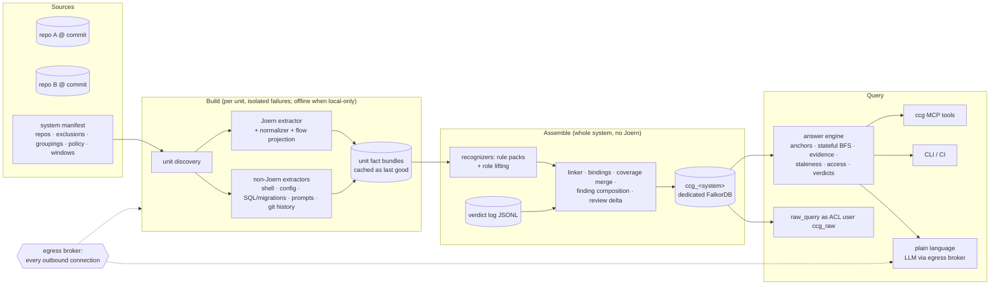

# Connected code graph — requirements review & architecture proposal

> **Status:** active · **Owner:** `architect` · **Tracks:** — (`docs/requirements/connected-code-graph.md`) · **Version:** 3.3 (proposal) · **Extended by:** `docs/plans/connected-code-graph-graph.md`, `docs/plans/connected-code-graph-ml.md` · **Reviews:** `docs/reviews/connected-code-graph.md`

**This is an architecture *proposal*.** The requirements it answers
(`docs/requirements/connected-code-graph.md`) are `Ready for design` (2026-10-28), and their AC
review is complete (decisions S1–S38 plus the use-case re-check, all in that document's decision log).
Nothing here is approved for implementation.

Two notes extend this plan and are authoritative in their own domains:
- the **graph note** (`docs/plans/connected-code-graph-graph.md` v2): graph model, DDL, traversal
  directions, sizing, store mechanics;
- the **ML note** (`docs/plans/connected-code-graph-ml.md` v2): every LLM touchpoint, RCA and risk
  ranking, the evaluation design.

The independent review is `docs/reviews/connected-code-graph.md` (findings B1–B6, m1–m7,
n1–n2). This plan cites findings by id (G*n*/V*n*/Q-R*n*, M*n*/m*n*/SQ*n*, B*n*, S*n*) and does
not restate them. The ledger is `docs/plans/connected-code-graph-coordination.md`.

*Revision 2026-10-26 (v2): both notes' findings adopted; requirement cross-references and R18 added.*
*Revision 2026-10-26 (v3): rewritten against the decided requirements, the review (B1–B6 and its
minors and nits) and both notes' v2 sections (graph §6, ML §8). Cross-reference tables in §2. Five
new stakeholder questions in §2.5.*
*Revision 2026-10-26 (v3.1): review Pass 2 (P2-1–P2-7, P2-n1) resolved; V3-Q1–V3-Q5 and SQ-A–SQ-G
folded in as decided (FR-9, FR-13, FR-14, FR-15, FR-21, FR-29, AC-8, AC-21a, AC-24); no open
stakeholder questions.*
*Revision 2026-10-28 (v3.2): review Pass 3 P3-1. A resolved call's other same-name candidates are
never dropped. They stay *possible* and are folded away in rendering (decision log 2026-10-28).*
*Revision 2026-10-28 (v3.3): Arduino `.ino` sketches added as C++ (FR-1, AC-26) — §3.2, an
optional slot in §4 gating no phase, §5.1, K14–K15; opening paragraph now says the requirements are
`Ready for design`.*

## 0. Goal & scope

**Goal.** One queryable, *connected* model of a software system: every program's code joined
across language, component and repository boundaries, following calls, data flow and control
dependencies (FR-11). It also joins the code to the data it touches, the config that wires it, and
the tests that reach it. Every answer is backed by an evidence chain. It serves the five use cases
(impact, RCA, review, test map, security) through four kinds of client, and works on any
codebase. This monorepo is the first proving ground.

**This document delivers:**
- §1: findings from the repo, re-grounded per review B3;
- §2: the status of every requirement-level item, plus cross-reference tables from each review
  finding, stakeholder decision and new or changed FR/AC to where this plan handles it;
- §3: the architecture;
- §4: a foundation-first phasing consistent with its gates (B5) and with the stakeholder's
  delivery choices (grow `cpg/`, S34; plain language in phase 1, S35);
- §5: verification;
- §6: risks and the remaining decisions.

**Out of scope here:** step-level implementation specs (each phase gets its own plan once the
requirements reach `Ready for design`); the graph DDL, which the graph note owns; the ML and
evaluation method, which the ML note owns. Product out-of-scope items are in the requirements doc
and are not restated.

## 1. Context & findings

CPG: used cpg_falkorchat — for v1 probed its labels, how FastAPI route and `@mcp.tool()` decorators and inline Cypher strings appear as `CALL` nodes, and its build marker (built 2026-10-15, `falkor-chat/server` @ `5c82170f`); v3's re-grounding of AC-1/AC-2 comes from reading source (the consumers live outside that graph), with flow-layer densities taken from the graph note's probe V15 against the same graph.

**What exists today, and what it means for the design.**

| Asset | What it is | Fact that shapes this design |
|---|---|---|
| `skills/joern-cpg/` (`scripts/pipeline.sh`, `build-cpg.sh`, `cpg-to-falkordb.py`, `git-provenance.sh`) | Build → neo4jcsv export → transform → load one Joern CPG into one graph `cpg_<component>`; stamps a `:CpgBuildInfo` provenance marker | The full CPG measures ~4.0k nodes / ~27k edges / ~2.6 MB **per file** on the current `cpg_falkorchat` (graph note V12), above the skill's 2.7k/18k rule of thumb. Statement-level flow layers alone are ~6,750 `REACHING_DEF` and ~535 `CDG` edges per file, and most `REACHING_DEF` edges pass through identifiers and operators (V15). So flow facts must be **projected**, not copied (§3.3). Provenance capture before the parse is reused as is. |
| `skills/joern-cpg/references/cpg-model.md` "Consumer-query facts" | Verified topology of a `pysrc2cpg` graph | Inbound call resolution is sparse (34% of call sites resolved, V12). Cross-object dispatch is unresolved. `REACHING_DEF` is intraprocedural. `FILENAME` is set only on `METHOD`/`TYPE_DECL`, relative to the parse root. All `pysrc2cpg`-only. |
| `skills/cpg-analysis/` (+ 5 recipes) | Single-graph consumer recipes | Their traversal idioms seed the answer engine's operators (§3.7). Python-verified only. The **freshness recipe stays** for the optional per-unit `cpg_*` graphs (§3.13). |
| `cypher-mcp/` | One generic tool `mcp__cypher__query` | **Not read-only for every graph:** a write rejected by `RO_QUERY` that matches a kaizen shape is re-run with `GRAPH.QUERY` on any graph name (`cypher-mcp/server.py` ≈1024–1037; graph note V6/G1, confirmed by the review). So it is not the FR-25 raw client (§3.6). |
| `claude/teco/teco.md` step 3, "CPG freshness" | `teco` runs the freshness recipe per graph at dispatch | The FR-6 seam (§3.13). |
| Joern v4.0.579, `~/joern/joern-cli/frontends` | All seven FR-1 frontends; astgen binaries for JS/TS, C#, Go bundled | Offline parsing is possible. But **four frontends can reach the network** (review B4, verified with `--help`): `javasrc2cpg --fetch-dependencies`, `kotlin2cpg --download-dependencies` and `--jar4import-url` (sends import names to an online service), `csharpsrc2cpg --download-dependencies`, `gosrc2cpg --fetch-dependencies`. FR-9/S18 forbids all of them under local-only (§3.12). |
| `cpg/` | Today: durable reload artifacts (`cpg/.cpg-artifacts/`); root `docs/HISTORY.md`/`BACKLOG.md` are its docs | **The code home (S34).** The system grows here (§3.13). |

**AC-1 grounding (re-done per review B3 and Appendix A).**
- **Provider.** The storefront endpoint the SPA calls is `/shop/api/health`. That is the
  `@router.get("/health")` at `falkor-chat/server/falkorchat/storefront_api.py:937`, inside
  `build_storefront_router()` (`:857`).
  - Its prefix is **not** a module constant read at the decorator. It is applied in another file,
    by `app.include_router(storefront_api.build_storefront_router(shop),
    prefix=storefront_api.API_PREFIX)` at `falkor-chat/server/falkorchat/app.py:521-524`
    (`API_PREFIX = "/shop/api"`, `storefront_api.py:133`).
  - The repo has three `/health` providers: the storefront one, the legacy dev router's bare one
    (`api.py:56`, mounted with no prefix only `if dev_surface`, `app.py:483-490`), and the bare
    re-registration otherwise (`app.py:497`).
  - So provider keys need **router-mount prefix composition**: decorator path + `include_router`
    prefix, across files, possibly conditional (§3.4).
- **Consumer.** `salesperson/src/api/endpoints.ts:8,17-19` calls
  `apiFetch({ path: \`${API_PREFIX}/health\` })`, with its own `API_PREFIX = '/shop/api'`. Inside
  `salesperson/src/api/client.ts`:
  - `apiFetch(opts)` (`:107`) calls `buildUrl(opts.path, opts.query)` (`:73,108`);
  - the result goes to `fetch(url, { method: opts.method })` (`:118`).

  So the key is a **field** of parameter 0, lifted through **two** functions, with the HTTP verb in
  another field. That is the case the flow schema must express (review B2, §3.3).

**AC-2 grounding (re-done per review B3).**
- **Provider.** The `@mcp.tool()` functions in `falkor-chat/server/falkorchat/mcp.py` (e.g. `:200`),
  served under the app's `/mcp` mount.
- **Consumers bind by URL, not by name or launch chain:**
  - `kiro/.kiro/agents/falkor-chat-demo.json:7` and `mcp-monitor/config.example.toml:34` both point
    at `http://localhost:8000/mcp`. The second is an **example** config, so it is a *possible* caller
    with reason "example config" (FR-5/S21).
  - `.mcp.json`'s `falkor-chat-agent-team` entry points at `http://localhost:8200/mcp`.
- **The ports come from launch config, partly implicit:**
  - Port 8000 is uvicorn's **default**: `falkor-chat/scripts/start_server.sh:251` launches it
    (`exec … uvicorn falkorchat.app:app $UVICORN_ARGS`, no `--port`; `:228-233` are only the
    banner), and `falkor-chat/Dockerfile:42` passes `--port 8000` explicitly.
  - Port 8200 is `AGENT_TEAM_PORT="${AGENT_TEAM_PORT:-8200}"` in
    `falkor-chat/scripts/start_agent_team.sh:137`, passed as `UVICORN_ARGS` (`:157`).

  So AC-2 needs a **URL binding**, (host, port, path) → launch entry → unit, with framework
  defaults as pack facts (§3.4). The `.mcp.json` → `docker-run.sh` chain is the **`cypher`** entry,
  which is AC-4's subject, not AC-2's.

**AC-3 / AC-4 grounding.**
- AC-3: `cpg_falkorchat` has 82 `query` call sites with inline `MATCH`.
- FalkorDB DDL is applied through a shell wrapper: `falkor-chat/scripts/bootstrap_schema.sh:26`
  `gquery` → `redis-cli GRAPH.QUERY`, 50 uses.
- Labels are also built at runtime (`falkor-chat/server/falkorchat/querygen.py:488`).
- AC-4: 55 tracked files under `claude/`+`skills/` name `mcp__cypher__query`. 52 are Markdown, 3
  are shell guard hooks, and 1 is a JSON manifest. `opencode/agents/tank/scripts/*.sh` is a further
  in-scope shell caller set (review m4).

**Scale of the proving repo** (tracked, non-deprecated): Python 198 files (197 outside `skills/`,
1 in it; review m5); TS/TSX/JS ~77 (salesperson 74); shell ~83. As full CPGs the Python alone
would be ~0.8M nodes / ~5.3M edges at V12's rate. As the v3 summary graph with projected flow
points (graph note §6.4) it is a few tens of MB.

**Comparable work** (unchanged from v1): academic static reconstruction of microservice
architectures matches per-service remote calls to endpoint signatures and reports high
precision/recall, while conceding that only dynamic analysis reaches full inter-service precision
([arXiv 2205.08527](https://arxiv.org/pdf/2205.08527),
[arXiv 2602.08166](https://arxiv.org/html/2602.08166v1)). Cross-service taint is research-grade
([ISSTA 2025](https://conf.researchr.org/details/issta-2025/issta-2025-papers/23/Bridge-the-Islands-Pointer-Analysis-for-Microservice-Systems)),
which is why security composes per-program summaries (§3.7). Joern's own maturity notes (2023)
rank `jssrc2cpg`/`pysrc2cpg` mature, Kotlin maturing, Go new and C# early
([Joern 2023 update](https://joern.io/blog/joern-org-update-2023)). P0 re-measures this (§4).

## 2. Requirements: status after the AC review, and cross-references

v1 reviewed the requirements (R1–R17), v2 added R18 and cross-referenced the notes' items. The
stakeholder has since decided all of it (review §5, S1–S38), re-checked the five use cases (which
added requirements) and accepted the notes' follow-up questions (graph Q-R7–Q-R11, ML SQ1–SQ8),
v3's own questions (V3-Q1–V3-Q5) and the review's Pass 2 questions (SQ-A–SQ-G). The requirements
doc's decision log is the record. This section only maps those outcomes onto this plan. **No
requirement-level question is open.** v1/v2's review prose is not kept: every
item in it is now a decision.

### 2.1 Disposition of R1–R18

| v1/v2 item | Decided as | Requirement now | Handled in |
|---|---|---|---|
| R1 published query for raw clients | S1 | FR-19 "recipe" (queries + algorithm name/version) | §3.6 step 5 |
| R2 same *interpreted* question | S2 | FR-19 | §3.6 clients |
| R3 raw queries vs access | S5, S6 | FR-24 (content only; raw for all-repo readers) | §3.10 |
| R4 AC-5 noise bound, blind list | S8, SQ1, SQ2 | AC-5 (≥75, 95%, 4:1 pooled, re-run on a new list) | §5.2 |
| R5 shell/config/prompts | S20, S21 | FR-1, FR-5 | §3.2, §3.3, §3.4 |
| R6 verdict semantics | S22, S24 | FR-29 | §3.8 |
| R7 identity for verdicts | S25 | FR-28 | §3.8 |
| R8 what "code" means locally | S17 | FR-9 (strict, allow-list) | §3.12 |
| R9 never-built part | S28 | FR-7a, AC-9b | §3.11 |
| R10 dependency reachability levels | S13 | FR-15 | §3.7 security |
| R11 runtime coverage granularity | S29 (**per test required**, over the recommendation) | FR-14 | §3.4 tests, §3.7 |
| R12 AC-12 sample size | S9, SQ8 | AC-12 (≥40 with a fixed mix) | §5.2 |
| R13 | — (numbering gap; never existed, review m5) | — | — |
| R14 overlay latency | awareness | — | §6.1 K6 |
| R15 system manifest | S30 | FR-0 | §3.2 |
| R16 vocabulary bound | S32 | FR-26, AC-22 | §3.3 |
| R17 PR adapter | S31 | FR-17 | §3.6 step 1 |
| R18 verdict state in "same snapshot" | S4 | FR-19, AC-9 | §3.5, §3.8 |

### 2.2 Review findings (Pass 1 and Pass 2) → where they are resolved

| Finding | Resolution | Where |
|---|---|---|
| **B1** writer→reader impact and RCA→writer lost | Adopted graph note §6.1–§6.2. Storage stays dependent → dependency; traversal direction is chosen **per (operator, edge type, arrival state)** from its normative table; shared state (data, topics, fields, config values) is one pattern; four fixture assertions | §3.1 rule 8, §3.7, §5.1 |
| **B2** flow schema too weak for AC-1's wrapper | Adopted graph note §6.3: `Param`/`Ret`/`Cond` points and `DATA {fromPath,toPath}` access paths (depth 3); role lifting at build time with `LIFTED_VIA` evidence; a **per-method projection** of Joern's DDG/CDG instead of whole-program `reachableBy`; **P0 vertical slice** before the bundle schema freezes | §3.3, §4 P0(b) |
| **B3** AC-1/AC-2 grounding wrong; binding shapes missing | §1 re-grounded against `storefront_api.py:937`, `app.py:521-524`, the URL-binding consumers and the launch-script ports; **router-mount prefix composition** and **URL (host, port, path) → launch entry → unit** bindings added to the pack design, to the P0 paper test and to P1's packs | §1, §3.4, §4 |
| **B4** egress outside the broker | The broker now covers **every** outbound connection, build time included. Local-only builds run in a no-network sandbox with each frontend's fetch flags off (Kotlin's `--jar4import-url` forbidden outright); the permitted fetches and hosted-default downloads are decided (V3-Q4/Q5 → FR-9); P0(a) measures fitness with fetching off; AC-8 runs a full refresh | §3.12, §4 P0(a), §5.3 |
| **B5** phases contradict gates | AC-7 is **per-stratum** first contact, verdict at P3 exit; AC-22 re-asserted at P5 exit; review-stage `teco` integration at P3; fixture system + P1 ground-truth strata are P0 deliverables | §4 |
| **B6** verdict lost across a swap; log and patch not atomic | Adopted graph note §6.4: `verdictLogOffset` on the snapshot; a lock shared by the `verdict` command and the swap; replay past the offset before `RENAME`; fsync then patch-and-advance in one query; self-healing replay | §3.8 |
| m1 `Name` hop | Compound hop with the `DISMISSED` anti-join, never a BFS node; resolved sites also carry `CALLS_NAME`; P0 measures resolved-call precision against one threshold (0.95) that drives both the rendering rule (folded vs listed, never dropped; P3-1) and indexer adoption (P2-5) | §3.6, §3.7, §4 P0(a) |
| m2 identity hash orphans verdicts | `symbolId = h(lang, repoId, qname[, signature only for overloading languages])`, no `unitId` (graph note §6.4); now matches decided FR-29/AC-21a (SQ-C) | §3.3, §3.8 |
| m3 θ vs "no score cut-off" | A deliberate, frozen, recall-calibrated exception, applied client-side over the complete full-text result set | §3.6 step 1 |
| m4 no node for shell/prompt callers | Synthetic per-file `script`/`document` Symbols, shell `CallSite`/`Param`/`DATA`; tank scripts in scope | §3.3, §1 |
| m5 stale text | Fixed by this rewrite: rule count, v1 edge names, "measured" → synthetic/estimated, §2.7 row, file counts, freshness recipe | throughout |
| m6 raw credential | No `GRAPH.LIST`, `+info` required, instance-wide `TIMEOUT_MAX` (V16–V18) as FR-21's one exception (SQ-F) | §3.5, §3.6 |
| m7 decision batching | Done by `tico` (S1–S38) | — |
| n1 test-name anchor | Added | §3.6 step 1 |
| n2 requirements hygiene | Closed in the requirements (2026-10-26 housekeeping entry) | — |
| **P2-1** AC-8 closed before its egress paths exist | AC-8 gated per part and re-run (full sandboxed refresh + queries, logging proxy) at the exit of P1, P2, P3, P4 and P5; closed at P5 | §4, §5.3 |
| **P2-2** four ACs out of line with FRs | (a) AC-8 now tests every FR-9 rule (SQ-A) → §5.3; (b) AC-24 binds the model actually used (SQ-B) → §3.12, §5.2; (c) signature change keeps the note where sameness is provable (SQ-C) → §3.8; (d) FR-14 aligned by `tico` → §3.7 already matches | §3.8, §3.12, §5.2, §5.3 |
| **P2-3** lock not grantable; PX expiry reopens B6 | Lock grants on the one key for `ccg_verdict` and `ccg_build`; PX sized above worst replay + swap; post-`RENAME` offset check and remainder replay; B6 test with mid-swap expiry | §3.5, §3.8, §5.1 |
| **P2-4** AC-18 and AC-9 closed too early | AC-9 closed at P4 (verdicts exist), AC-18 at P5 (every answer kind exists) | §4 |
| **P2-5** one measurement, two consequences | Both stated in §3.7 with the single 0.95 threshold | §3.2, §3.7 |
| **P2-6** late decisions not reflected | All V3-Q references rewritten as decided; §2.5 replaced | throughout |
| **P2-7** `findingId` undefined | `findingId = h(kind, end tuple per FR-15)`; the chain is not part of the identity | §3.8 |
| **P2-n1** `start_server.sh` citation | Corrected to `:251` | §1 |
| **P3-1** suppressed candidates become silent misses | Never dropped: always *possible* `resolution-unverified`, folded away in rendering when precision ≥ 0.95 (decision 2026-10-28) | §3.7, §5.1 |

### 2.3 Stakeholder decisions not covered in §2.1 → where v3 handles them

| Decision | Effect on the design | Where |
|---|---|---|
| S3 fixed RCA order | Deterministic ranker; no ordering allowance | §3.7 RCA |
| S7 read-only by credential | Raw ACL user | §3.5, §3.6 |
| S11 AC-6 planted kinds | ≥3 instances per kind (ML §8.2) | §5.2 |
| S12 AC-15 sets | Per-kind sets; never-unreachable gate | §5.2 |
| S14 AC-7 = OpenTelemetry demo | Per-stratum pre-registration; third codebase held back | §4, §5.2 |
| S15 + S37 AC-24 bilingual | EN+PT golden set, per-language floor | §4 P1/P5, §5.2 |
| S16 local model never changes facts | Holds by construction | §3.12 |
| S18 no dependency downloads (local-only) | Offline builds | §3.12 |
| S19 local-only sticky per answer | Broker policy; system-wide for model calls (V3-Q3 → FR-9) | §3.12 |
| S23 verdicts immediate | Live patch under the lock | §3.8 |
| S26 agent/CI identity | Principal = launching person or service identity | §3.10 |
| S27 either-side owner | Verdict authorization | §3.8 |
| S33 → **Q-R8: preview cap default 2** | Peak ≈ 18 GB at 10k files | §3.5, §3.9 |
| S34 grow `cpg/` | Code home and layout | §3.13 |
| S35 plain language in P1 | Broker, interpreter and golden impact cells move into P1 | §4 |
| S36 isolated key-writing agent | Two agents, capture–recapture (ML §8.2) | §5.2 |
| S38 no workplace statistics | Risk accepted | §6.1 K2 |
| SQ1 AC-5 fail procedure | Re-run on new blind items | §5.2 |
| SQ2 4:1 per real impact, pooled | Reported by distance band too | §5.2 |
| SQ3 "reinforce" three-part test | RCA combination rule | §3.7 RCA, §5.2 |
| SQ4 "no match" definition | Weak matches still shown | §3.7 RCA |
| SQ5 tests-for-a-change, none missing | Possible marked, runtime confirms | §3.7 test map |
| SQ6 risk = stated score + complexity | ML §8.4 score | §3.7 test map |
| SQ7 AC-24 binds the default model | Superseded by SQ-B (the model actually used); local target fallback kept | §5.2 |
| SQ8 AC-12 bug mix | Strata | §5.2 |
| Q-R7 distance = inter-function links | BFS distance rule | §3.7 |
| Q-R9 call-level fallback where flow is unavailable | Per-unit `flowAvailable` | §3.2, §3.7 |
| Q-R10 component = build unit, manifest groupings | `Unit.componentId` | §3.2 |
| Q-R11 keyed, non-reversible secret fingerprints | HMAC with a per-system key outside the graph | §3.7 security |
| V3-Q1 "worse" (→ FR-13) | Review delta rules | §3.7 review, §3.9 |
| V3-Q2 finding expiry ends (→ FR-15) | `findingId` end tuples | §3.8 |
| V3-Q3 model calls local system-wide (→ FR-9) | Broker policy | §3.12 |
| V3-Q4 two permitted fetches (→ FR-9) | Allow-list entries | §3.11, §3.12 |
| V3-Q5 hosted-default downloads via controlled path (→ FR-9) | Broker build path | §3.12 |
| SQ-A AC-8 tests every FR-9 rule, re-checked per phase | Test design and gating | §4, §5.3 |
| SQ-B AC-24 binds the model actually used | Gate binding | §3.12, §5.2 |
| SQ-C signature change: note dropped only where sameness is unprovable | Identity rule | §3.8 |
| SQ-D missing-auth expiry on entry-point and sensitive-operation functions | `findingId` end tuple | §3.8 |
| SQ-E IdP / access check / PR add-on under local-only only if allow-listed, names + identity only | Broker policy, adapters | §3.6, §3.10, §3.12 |
| SQ-F configurable raw-query time limit (FR-21 exception) | `TIMEOUT_MAX` | §3.5 |
| SQ-G unscored advisory → own stated severity, else high | Severity rule | §3.7 security |
| 2026-10-28 P3-1: other candidates of a resolved call stay *possible*, folded away | Rendering rule, never a facts filter | §3.7, §5.1 |
| 2026-10-28: Arduino `.ino` sketches mapped as C++ only; device links (serial/USB, Bluetooth, device↔service) out, addable later as FR-26 units; AC-26 gates no phase | A sketch is one C++ unit via an in-house preprocessor; no new vocabulary; optional slot after P2 | §3.2, §4 |

### 2.4 New or changed FR/AC → where v3 handles them

| Requirement | Where |
|---|---|
| FR-0 manifest + groupings | §3.2 |
| FR-1 shell + structured config; FR-4; FR-5 prompts/example configs | §3.2, §3.3, §3.4 |
| FR-7a never-built; AC-9b | §3.11 |
| FR-9 strict local-only, allow-list, no downloads, two permitted fetches, allow-listed IdP/access/PR, hosted-default controlled downloads, system-wide local model calls; AC-8 | §3.12, §4, §5.3 |
| FR-10 in P1 (S35); AC-11 | §3.6, §4 |
| FR-11 flow + control deps, direct/indirect, distance, grouping, reverse; AC-25 | §3.3, §3.7 impact |
| FR-12 multiple evidence, config/schema/wiring causes, backward flow, recent-change window, outside branch, feedback marks, no-match; AC-12 | §3.7 RCA |
| FR-13 all contract kinds, test/security/config impact, new-or-worsened + "show existing"; AC-13 | §3.7 review, §3.9 |
| FR-14 per-test runtime, function level, test kind, tests-for-a-change, risk score, stale data; AC-14 | §3.4 tests, §3.7 test map |
| FR-15 five kinds incl. risky config, git-history secrets, severity (incl. unscored advisories), finding verdicts with per-kind expiry ends, keyed fingerprints; AC-15 | §3.7 security, §3.8 |
| FR-21 raw-query time limit | §3.5 |
| FR-17 diff/commit range/branch, PR add-on; test name; AC-17 | §3.6 step 1 |
| FR-19 decision-state stamp, recipe, fixed order, interpretation; AC-9, AC-16 | §3.5, §3.6 |
| FR-23 cap default 2; AC-19 | §3.9 |
| FR-24 content only, agent/CI identity, raw for all-repo readers; AC-20 | §3.10 |
| FR-25 by credential; AC-21 | §3.5, §3.6, §5.3 |
| FR-26 vocabulary bound; AC-22 | §3.3, §4 P2/P5 |
| FR-28/29 owners, immediate, either side, confirmation expiry, rename/move/unprovable signature change; AC-21a | §3.8 |
| AC-5, AC-6, AC-7, AC-24 (evaluation) | §5.2 |
| FR-1 Arduino `.ino` sketches as one C++ program; AC-26 (not phase-blocking) | §3.2 Arduino sketches, §4 optional slot, §5.1 |

### 2.5 Questions v3 raised: all decided

v3 asked V3-Q1–V3-Q5. The stakeholder accepted every recommendation, and they are now
requirement text: V3-Q1 → FR-13 ("worse"), V3-Q2 → FR-15 (expiry ends per finding kind), V3-Q3,
V3-Q4 and V3-Q5 → FR-9. Review Pass 2's SQ-A–SQ-G were likewise accepted (§2.3). v3.1 raises no
new requirement-level question.

**One interpretation, recorded here so the build does not re-derive it** (it applies the decided
SQ-C principle and needs no decision): FR-29's "moved" means the code's **qualified name**
changed. A file relocation that keeps the qualified name (a moved build root, or a Java class
whose package is unchanged) is provably the same code. It keeps its identity and is treated as an
ordinary change.

## 3. Architecture proposal

### 3.1 Design rules and shape

1. **Facts are computed at build time; queries only traverse.** Links, lifted roles, flow
   projections, coverage merges, security findings and review deltas are all decided while a
   snapshot is assembled. The query side is deterministic traversal, which is what makes FR-19
   hold (§3.6).
2. **Joern maps programs; it is not the query engine.** It runs per unit at build time. FalkorDB
   holds the connected view and answers every query.
3. **One small, versioned core vocabulary.** Every extractor and recognizer emits into it, and
   every use case and client reads only it. That is the FR-26 seam, bounded as S32 states.
4. **Shipped framework support and in-house conventions use one declarative format** (FR-27).
5. **Possible is a first-class status with a reason code**, inside programs as well as across
   them (FR-8).
6. **Only direct facts are stored; reach is computed by traversal** (graph note §3.1 rule 3, G3).
   The exceptions are per-symbol aggregates and materialized security `Finding` chains.
7. **An LLM may interpret and phrase, never assert** (ML note §3.1). So there is no approximate
   nearest-neighbour search on the fact path (M4).
8. **Edges are stored one way; the traversal direction is chosen per question** (B1). Every edge
   is stored dependent → dependency. Each operator walks it by graph note §6.2's table, according
   to the state in which it reached the edge (`value`, `contract`, `arg(i, path)`). This replaces
   v2's "impact is always incoming reach".

### 3.2 Units and the per-language code map

**System manifest** (FR-0, S30) is the only human input. It lists:
- the repositories and their exclusions (`deprecated/` here);
- optional component groupings (Q-R10: a component is the build unit by default);
- per-codebase policy: local/hosted default (FR-9), the RCA recent-change window (FR-12), the
  secrets-history window (FR-15), the preview cap (FR-23);
- the local endpoint allow-list (§3.12).

It never describes how the parts talk.

**Unit:** one buildable program (repository, root, language).
- Units are discovered from build manifests (`pyproject.toml`, `package.json`/`tsconfig.json`,
  `pom.xml`/`build.gradle*`, `*.csproj`/`*.sln`, `go.mod`, `CMakeLists.txt`/`compile_commands.json`,
  and an Arduino sketch folder: a folder `<name>/` holding `<name>.ino`),
  with a directory-per-language fallback. Shell, structured config and Markdown are handled per
  file by the non-Joern extractors.
- The unit is the granularity of build, failure and staleness (§3.11).
- `Unit.componentId` is the unit itself, unless the manifest groups it into something larger.

**Joern extractor.** Per unit, the existing build stage (`skills/joern-cpg/scripts/build-cpg.sh`
plus `git-provenance.sh`) produces `cpg.bin`. A Joern script then writes the fact bundle directly:
- symbols, call sites, resolved string value sets;
- the **per-method flow projection** (§3.3);
- per-function complexity from the CFG (for FR-14 risk);
- test markers.

A per-frontend normalizer absorbs frontend quirks, so nothing downstream sees them. `cpg.bin`
stays on disk for deep REPL work and for re-extraction without a re-parse.

| FR-1 language | Frontend | Expected fit (P0 measures) | Weak spots | Local-only build flags (§3.12) | Fallback if P0 says so |
|---|---|---|---|---|---|
| Python | `pysrc2cpg` | Verified here; decorators visible | Sparse resolution (34%); cross-object dispatch | none needed | name-match *possible*; optional precise indexer |
| TS/JS | `jssrc2cpg` (astgen bundled) | Mature per Joern | Template literals, wrappers, dynamic imports | none needed | precise indexer |
| Java | `javasrc2cpg` / `jimple2cpg` | Strongest typed frontend; best with dependency jars | DI, reflection | **no** `--fetch-dependencies`; pre-provisioned jars only | `jimple2cpg` on locally built bytecode |
| Kotlin | `kotlin2cpg` | Maturing; needs classpath | DSLs, coroutines | **no** `--download-dependencies`; **never** `--jar4import-url` | as Java |
| C#/.NET | `csharpsrc2cpg` (dotnetastgen bundled) | Least proven | Cross-project types, attribute routing | **no** `--download-dependencies` | Roslyn-based indexer, offline |
| Go | `gosrc2cpg` (goastgen bundled) | New in 2023 | Interface dispatch, generated stubs | **no** `--fetch-dependencies`; vendored modules only | Go indexer, offline |
| C/C++ | `c2cpg` | Oldest; fuzzy parsing | Macros without build flags | none needed | `compile_commands.json`-aware parse |
| C++ (Arduino `.ino`) | `c2cpg`, on the sketch preprocessor's output (below) | Measured in its own optional slot (§4), not in P0 | Core/library headers absent unless pre-provisioned; prototype generation on unusual signatures | none needed; **no** board-core or library download | pre-provisioned core include paths (`--include`); else unresolved calls *possible* |

**Flow availability (FR-11, Q-R9).** `Unit.flowAvailable` is set per language from P0's
measurements. It is false for shell, for structured config and for any frontend P0 rates too weak.
Through such a unit, impact falls back to call-level reach, and every item is shown as *possible*,
`reason: flow-unavailable:<language>`.

**Arduino sketches (FR-1, AC-26).** A sketch is **one C++ unit** (`lang` = C++): its several
`.ino` files are one program, and any `.cpp`/`.h` beside them are ordinary C++ files of the same
unit. Device-specific links are out of scope (requirements, Out of scope); a later FR-26 unit adds
them. `c2cpg` skips `.ino` files (observed on Joern v4.0.579: a two-file `.ino` sketch gave a
CPG of baseline size, and the same files renamed `.cpp` gave one 70% larger). So a **sketch
preprocessor** runs before it, inside the offline build sandbox (§3.12), and does what the
Arduino build does:
- **joins** the folder's `.ino` files into one generated `.cpp` translation unit, in Arduino's
  order: `<name>.ino` first, then the others alphabetically;
- **adds** `#include <Arduino.h>` at the top unless the sketch already includes it;
- **generates a prototype** for every function defined in the `.ino` files without a declaration
  before it, inserted ahead of the first function definition, so a call into a later file
  resolves;
- **writes a line map** from every generated line to its origin `(file.ino, line)`; the inserted
  include and prototypes map to *generated*, not to any original line. It also emits `#line`
  directives, but the plan does not rely on `c2cpg` honouring them.

The generated file lives in the build's scratch area only. `c2cpg` parses it, plus the sketch's own
`.cpp`/`.h`. **The C/C++ normalizer then rewrites every location through the line map**, before
anything enters the bundle. Every `FILENAME`/line is replaced by the original `.ino` path and line,
so symbols, call sites, points and evidence hops all carry the sketch's own file and line (FR-20).
A symbol or point whose location maps to *generated* is dropped. A generated prototype is a
declaration, never a definition: any method stub `c2cpg` emits for it maps to *generated* and is
dropped, so it never becomes a second symbol. The symbol identity uses the
original file. The generated file name never reaches the graph, so a rebuild does not change any
id.

**Headers under local-only (FR-9).** Nothing is downloaded: no board core, toolchain or library.
- If a core and libraries are **pre-provisioned** on the build host (an Arduino data directory,
  named per codebase in the manifest's policy), their include paths go to `c2cpg --include`, and
  calls into them resolve like any other external library.
- Without them, `Arduino.h` and library headers are missing. `c2cpg`'s fuzzy parse still maps the
  sketch's own functions and the calls between its files, which is all AC-26 asks. Calls whose
  resolution depends on missing declarations (overloads, types from library headers) become
  name-match *possible*, `reason: headers-unavailable` (FR-8).

**Why in-house, not `arduino-cli`'s preprocessing.** `arduino-cli` performs the same four steps (per
its sketch-build-process documentation), but it finds `Arduino.h` in the selected board's core.
So it needs a board choice and an installed core for every build, and its normal path installs
cores and libraries from the network, which local-only forbids. The preprocessing is small and
documented; owning it gives a dependency-free, deterministic build with the line map the
normalizer needs. The cost is keeping its prototype rules close to Arduino's (K15). **Reversal
trigger:** if AC-26's fixtures show prototype generation diverging from Arduino's on real sketches,
run `arduino-cli`'s preprocessing against a pre-provisioned core where one exists. The line map is
then built from its `#line` directives.

The preprocessor is part of the C/C++ extractor unit plus one discovery rule. It adds no
vocabulary and touches no core code, so it is an AC-22-shaped addition (FR-26).

**Deviations from "Prefer Joern", stated:**
- Non-Joern extractors cover what Joern has no frontend for: shell (tree-sitter-bash); structured
  config (JSON/YAML/TOML/Compose/`.mcp.json`/Kiro agents); SQL DDL and migrations; Markdown prompt
  mentions; **git history** for the secrets window (FR-15) and the recent-change window (FR-12).
- A precise symbol indexer *alongside* Joern is adopted per language only where P0 measures
  fallback call recall below the gate, name-match fan-out beyond the noise bound, or resolved-call
  precision below 0.95 (ML m4, review m1). The same 0.95 measurement also decides whether a resolved
  call's other candidates are folded or listed; they are never dropped (§3.7, P2-5, P3-1).

### 3.3 Fact bundles, the flow projection, rule packs and extension units

**Fact bundle** (one per unit per build; versioned schema; JSONL). The **graph model is the graph
note's §3.2 as amended by its §6.1–§6.4.** The bundle carries the canonical tuples that model
hashes into ids. Contents:
- **Symbols** with canonical identity `(lang, repoId, qname[, signature for overloading languages:
  Java, Kotlin, C#, C++])`, with no unit in the identity (review m2). Each has a line span, a
  normalized-content **fingerprint** (FR-29 "change"), `complexity`, and `lastChangedAt`/`Commit`
  from git (FR-12, FR-14).
  - Synthetic per-file Symbols of kind `script` (shell) and `document` (Markdown) give shell
    statements and prompt mentions an enclosing symbol (review m4).
- **Points:** `Param {index, name}`, `Ret`, `Cond {code}`; every call site is a point too.
- **Flow projection (B2).** For each method, Joern's intraprocedural DDG and CDG are projected
  onto its points:
  - `DATA {fromPath, toPath}` use → def edges, with access paths such as `p0.path`, `a0`, `r`,
    `ret.f`, capped at depth 3. A longer path is truncated and marked *possible*,
    `field-truncated`.
  - `CONTROLLED_BY` point → `Cond`.

  This is a local search per method, not whole-program `reachableBy`, which is kept only for
  security taint (§3.7). Class fields are shared-state contract points of kind `field`, *possible*
  unless the receiver type is resolved. Shell gets `Param`s for `$1…`/`"$@"` and assignment →
  use `DATA` inside functions; `eval`, indirect expansion and computed `source` are *possible*,
  `shell-dynamic`. (Graph note §6.3.)
- **Call sites:** callee name, resolved targets, argument value sets (constants, concatenation,
  template literals; `unknown` with a reason).
- **Imports, dependency manifest entries, test markers** (framework, kind hints), **config
  entries** (key path, value hash, line; secrets never stored), **launch facts** (command, args,
  ports including framework defaults, mount paths), and **git-history secret sightings** (keyed
  fingerprint only, §3.7).

**Recognizers: declarative rule packs.** A pack is a versioned YAML file. A rule has three parts:
- **match:** callee qualified name or regex, decorator or annotation, receiver type hint, config
  path, file glob or role;
- **extract:** which argument, field path, keyword or config value supplies the contract key, read
  from the resolved value sets;
- **emit:** `PROVIDES`/`CONSUMES` of a kind; `READS`/`WRITES` of a shared-state contract point;
  `Test` kind; `source`/`sink`/`sanitizer`/`auth-check`/`sensitive` marks; risky-config rules with
  their severity rule; `LAUNCHES` and URL-binding facts.

The escape hatch is still declarative: a read-only query over the unit's bundle. Three generic core
mechanisms keep packs small:
- **Role lifting (B2).** If a function's parameter or field path flows, by `DATA`, to the key
  argument of a recognized client call, that function becomes a derived client keyed on that
  path. This iterates to a fixpoint over the bundles. For AC-1, `fetch` is an HTTP client on `a0`
  with its verb at `a1.method`, so `buildUrl.p0` is one, and so is `apiFetch.p0.path` with verb
  `p0.method`. The chain is kept as ordered `LIFTED_VIA` evidence on the resulting link, which
  satisfies FR-20. Shell functions lift the same way, which is how `gquery`'s 50 call sites in
  `bootstrap_schema.sh` carry their Cypher literals to the parser (AC-3).
- **Embedded-language parsing.** An argument declared as SQL or Cypher is parsed by the core into
  `READS`/`WRITES` on table/column or label/relationship contract points, with column → table
  `PART_OF`. Unparseable or runtime-built text (`querygen.py:488`) yields *possible*,
  `runtime-built`.
- **Mount composition (B3).** A pack can declare that a provider's key is composed from a
  decorator path plus the prefix of whatever mounts its router (`include_router(..., prefix=…)`,
  Express `app.use(prefix, router)`, Spring class-level `@RequestMapping`, ASP.NET route prefixes),
  resolved across files through the value sets. A conditional mount (inside `if dev_surface`)
  keeps the provider and records the condition, so both mounted variants are present and the
  consumer's key decides.

**Extension units (FR-26, S32).** Four kinds, each a directory with a manifest:
- language extractor;
- non-code extractor;
- rule pack (protocols, frameworks, data stores, test frameworks, security knowledge, risky-config
  rules, severity rules);
- importer (lcov, Cobertura, coverage.py JSON with dynamic contexts, JaCoCo per test, Go cover).

AC-22 is a contract test: the diff adds one directory and touches nothing else.

### 3.4 Linking

**One generic linker.** It joins `PROVIDES` and `CONSUMES` per kind on a normalized key, using a
matcher the pack selects (`exact`, `path-template`, `glob`/`prefix`, `regex`). Cross-boundary links
are reified `Link` nodes carrying status, reason, candidate count and `paramMap` (request argument
→ handler parameter). Their evidence is ordered `BOUND_BY` wiring entries and `LIFTED_VIA` chain
steps.
- Both keys known and matching → **confirmed**.
- Partially known keys, name-only provider choice, or unknown keys narrowed by a binding →
  **possible**, with reason and candidates.
- A fully unknown key with no binding → one *possible* link per provider of that kind. A group is
  collapsed only in rendering; every member stays individually listed with its own chain (ML M2).

**Bindings (FR-5, B3)** select providers and put wiring files on the chain:
- **URL binding:** a consumer URL (`http://localhost:8000/mcp`) is split into host, port and path.
  The port is matched against **launch facts**:
  - explicit flags (`Dockerfile:42 --port 8000`);
  - env-defaulted values (`AGENT_TEAM_PORT:-8200`);
  - framework defaults from the pack (uvicorn → 8000);
  - Compose port mappings.

  The path is matched against the unit's mount paths (`/mcp`). On `localhost`, several deployments
  of one unit (8000 and 8200 both serve `falkor-chat/server`) are one provider, so the link is
  confirmed to the unit. Two *different* units on one port are *possible*.
- **Env/Compose binding:** consumer base URL from env var → Compose sets it per service → service
  build context → unit.
- **Launch binding:** `.mcp.json` server → command → script → container → unit (the AC-4 `cypher`
  chain).
- **Example configs** (`File.role = 'example'`) bind like real ones, but every link through them is
  *possible*, `example-config` (S21). Prompt mentions are *possible*, `prompt-mention` (S20).
  Documentation snippets are not callers.

**Cross-repository (FR-22) and shared libraries.** Keys and symbol ids are repository-neutral. A
library unit `PROVIDES library_api` keyed by qualified name + signature hash. Consumers `CONSUMES`
it through their manifest and imports. Version skew is a note on the link.

**Shared state: one pattern (B1).** Data entities, message topics, class fields, env vars and
config keys are all contract points: writers `WRITES` them, readers `READS` them.
- Publishers write a topic and subscribers read it.
- Config entries write a `config_key`/`env_var` and code reads it. That is how a config value
  becomes an RCA cause (FR-12) and an impact source.
- Schema sources (DDL, migrations) attach by `DEFINED_BY`.

**Tests and coverage (FR-2, FR-14).**
- Test-framework packs mark `Test` symbols with `testKind` ∈ {unit, integration, e2e}, using
  deterministic rules: framework markers, directory conventions, and whether the test's reach
  crosses a boundary or drives an external interface (ML §8.4).
- Static reach is **not** stored per (test, symbol) (G3b). One multi-source BFS at assembly writes
  per-symbol aggregates (`staticCovered`, `coverageState`).
- Runtime coverage loads as `(:CoverageRun {commit, collectedAt, tool, stale})` plus direct
  `(:Test)-[:RAN {runId}]->(:Symbol)` at **function level** (FR-14).
- A run whose commit differs from the unit's built commit is `stale`: loaded, listed, **never
  merged** (FR-14, AC-14).
- A project with no per-test data gets static coverage only, marked "runtime data unavailable
  (needs per-test coverage)" (S29).
- Disagreements are first-class: **static-only** (reached, never executed) and **runtime-only**
  (executed, statically unreachable: a missed link, which feeds the recall oracle, §5.2).

**Security assembly (G4).** Cross-component taint is a stateful walk: argument *i* to parameter
*i* through `paramMap`, carried through field paths. It is composed at assembly from:
- Joern `reachableBy` within each unit, for pack-declared sources and sinks;
- the cross-unit links.

Each chain is stored as a `Finding` with ordered `STEP`s. Missing-auth, risky-config and
dependency findings are materialized the same way (§3.7).

### 3.5 Store: FalkorDB, one snapshot graph per system

**Prefer FalkorDB is honoured** for the connected view and every query path.
- **One graph per system, `ccg_<system>`**, because FalkorDB cannot traverse across graph keys
  (graph note V1). Everything an answer joins with must therefore be inside the snapshot,
  including verdicts and an overlay's base facts.
- **Size (graph note §6.4, estimated from synthetic V11 plus measured V15 densities; P0
  measures):** with projected flow points, ~455 nodes / ~2,400 edges / ~0.3–0.35 MB per source
  file, so ~3–4 GB for a 10k-file system. **Peak with the decided preview cap of 2** (FR-23, Q-R8):
  1 live + 1 building + 2 previews, +20%, about **18 GB**. Copying Joern's statement-level layers
  instead would be ~12 GB per snapshot and is rejected (§3.14).
- **A dedicated FalkorDB instance** (G8), `noeviction`, with persistence off or infrequent: every
  graph is rebuildable from bundles, and the verdict log is a file. Bring-up is `devops`'s.
- **Swap:** build into `ccg_<system>__build_<id>` (indexes first, one connection, no write retries;
  graph note §3.5). Load the full-text index and the `UNIQUE` constraints **after**, and poll them
  to `OPERATIONAL`; a `FAILED` constraint fails the build (G9). Write `:Snapshot` last. Then,
  under the verdict lock: replay verdicts past the stamped offset, `RENAME` over the live key
  (atomic, and safe for readers already running, V2), and replay any remainder before releasing
  (§3.8).
  - **Zero** old snapshots are kept; rollback means re-assembling the last-good bundles.
  - Key names come only from the manifest, always `ccg_`-prefixed. Only the build credential may
    `RENAME`/`EXPIRE` (G7), because neither is visible to the lab's destructive-ops guard.
- **`:Snapshot`** carries `snapshotId`, versions, `verdictLogOffset` and `verdictLogHash`.
  Together they are the **code-snapshot + decision-state stamp** on every answer (FR-19, AC-9, S4).
- **ACL users** (graph note §6.4, V5/V16–V18):
  - `ccg_build` (write, `RENAME`, `EXPIRE` on `~ccg_<system>*`);
  - `ccg_verdict` (`GRAPH.QUERY` on the live key only);
  - **lock grants (P2-3):** both `ccg_verdict` and `ccg_build` also get `+set +del +eval` (for a
    compare-and-delete release) on the single key `ccg_<system>:verdict_lock`, and nothing else
    beyond their lists above;
  - `ccg_engine` (read);
  - `ccg_raw_<system>`: `-@all +graph.ro_query +graph.explain +info ~ccg_<system>
    ~ccg_<system>__ov_*`. **No `GRAPH.LIST`**, which leaks every key name (V16). `+info` is needed
    by the client constructor (V17).

  An **instance-wide `TIMEOUT_MAX`** (V18) is FR-21's one exception, the **configurable time limit
  for raw queries** (SQ-F). Because it binds every read, the engine's per-level BFS queries are
  sized to fit under it. Built-in answers stay unbounded overall, because each is many short
  queries.
- **Telemetry streams** (V10/G13): operators pass ids, never code text, as parameters. No
  non-admin ACL pattern covers `telemetry{…}`. P0 checks whether the stream can be capped.
- **Deviation, stated:** interprocedural flow is projected per method at build time and composed by
  traversal at answer time. Whole-program taint is computed in Joern at build time and stored as
  findings. Cypher has no context-sensitive data-flow engine. Every *answer* is still Cypher over
  FalkorDB.

### 3.6 Answer engine and the four clients

**One answer engine** (Python 3.12) produces every fact.

1. **Anchor resolution (FR-17, FR-18).** The asker never names a graph or component.
   - **Code location:** exact indexed lookups (`nameNorm`, `qname`, `File.path` plus a line
     filter).
   - **Change:** a diff, commit range or branch maps hunks to symbols in the base and the overlay
     (§3.9). A PR from a hosting service is an optional adapter that runs through the broker
     (S31). Under local-only it may run only if named on the allow-list, and it receives nothing
     beyond repository names and the asker's identity (SQ-E, FR-9).
   - **Contract point:** by `keyNorm`. Prefix and template matching run client-side with the
     linker's matcher.
   - **Test name:** lookup on `Symbol:Test` (review n1).
   - **Failure evidence:** stack frames parsed per language; error and log text matched against
     build-time `LogTemplate`s in tiers (exact → containment → weighted overlap, ML Q5).
     - θ and the symptom score floor are a deliberate, frozen, recall-calibrated exception to
       "no score cut-off". They are applied client-side over the **complete** full-text result
       set, never as an index `LIMIT` (review m3).
     - Several pieces of evidence may arrive at once (FR-12).
   - **Plain-language symptoms:** handled by the front (below).
2. **Operator:** a **stateful, level-synchronous BFS** (graph note Q7 + §6.1). Each frontier entry
   carries a state (`value`, `contract`, `arg(i, path)`); each level issues one parameterized read
   per (edge type, direction) that §6.2's table allows from that state.
   - `Name` is expanded as **one compound hop** carrying the `DISMISSED` anti-join, never as a BFS
     node (review m1).
   - It keeps a visited set and the **best predecessor** per node: fewest possible hops, then
     distance, then length, then stable id.
   - Replies are batched below `RESULTSET_SIZE`. When the depth bound cuts the frontier, the answer
     says so ("reach stopped at distance d with k unexplored edges", ML m5).
3. **Evidence chains (FR-20):** the best-predecessor map, rendered hop by hop with file and line.
   - A `Link` hop expands to its `BOUND_BY` and `LIFTED_VIA` entries.
   - An item's status is the weakest hop on its best path.
   - **Distance** counts inter-function hops only (call, link, shared state, config). Steps inside
     one function count 0 (Q-R7).
   - **Direct** = distance 1.
4. **Overlays applied:**
   - verdicts (dismissed items hidden unless "show dismissed");
   - access redaction (§3.10);
   - staleness: each unit on any chain with its built commit and time, and whether it is
     kept-last-good or not mapped, with the reason (FR-7, FR-7a).
5. **Canonical answer** (versioned JSON). It holds:
   - the **interpretation** (the structured request, ambiguity options if any, and RCA marks);
   - the **recipe**: query set + algorithm name and version (FR-19, S1);
   - the facts in deterministic order;
   - the **stamp** (snapshot id + verdict-log offset);
   - for plain-language asks, the interpretation provenance (ML m3).

   Renderers produce the grouped text and Markdown report (FR-10, AC-11) with deterministic
   templates. No fact is model-written (ML m1).

**Clients (FR-16):**
- **Agents:** the **`ccg` MCP server**. Tools:
  - `ask` (structured), one per use case, plus the reverse "depends on";
  - `resolve`;
  - `refresh`;
  - `verdict` (separately authorized, `ccg_verdict` user);
  - `raw_query` (as `ccg_raw_<system>`).
- **Automation/CI:** the CLI emitting the canonical JSON, with optional exit codes. The asker's
  access is the launching person's, or a configured service identity's (S26).
- **People in plain language (FR-10, in P1 per S35; ML Q1):**
  - deterministic parsers run first on traces, routes, file:line and diffs (ML m2);
  - for free prose, a one-shot schema-constrained extraction of the use case and anchor spans;
  - a deterministic resolver; ambiguity is answered with the possible readings;
  - an interpretation cache keyed by (question, snapshot, model fingerprint, prompt hash);
  - an optional aggregate-only summary, dropped on any added entity;
  - every model call goes through the broker (§3.12).
- **Power users:** `raw_query`, enforced read-only by the credential (FR-25, S7). It is available
  only to principals who can read every repository (FR-24, S5). The schema (graph note §3.2 +
  §6) is a published, versioned contract.

**FR-19 holds because** the facts are a pure function of (code snapshot, decision state, access
scope, interpreted request, algorithm version). With the deterministic RCA ranker the order is
fixed too (S3).

### 3.7 Use-case operators

All five are the same BFS with a different column of graph note §6.2's table. None has
per-language code.

- **Impact and the reverse question (FR-11, AC-25).**
  - *Impact:* starting from the changed symbols (or a contract point, in `contract` state), follow
    callers, data flow (`DATA`, path-matched), control dependencies (`CONTROLLED_BY`: a changed
    condition reaches the guarded points), links, shared state (writer → contract point → readers;
    never writer → other writers, B1) and config bindings.
  - *Through a unit with `flowAvailable = false`:* call-level reach only, every item *possible*
    with the reason (Q-R9).
  - *Resolved calls (P2-5, graph note §6.1 item 6).* A resolved call site is confirmed toward its
    resolved target. Its other same-name candidates are **never dropped**, in any language. They
    stay in the facts as *possible*, `resolution-unverified`, so a wrong resolution is never a
    silent miss (FR-8; decision log 2026-10-28, review P3-1). P0's measured resolved-call
    precision for the language, against **one threshold, 0.95**, decides only how they are shown:
    - **at or above 0.95:** they are **folded away** in rendering, as an expandable "other
      possible callees" group per site;
    - **below 0.95:** they are listed, and the language also becomes a candidate for a precise
      indexer (§3.2).

    Folding is display only. Folded candidates are in the canonical answer, count for AC-5 hits
    when expanded, and count in the noise bound measured on expanded groups (ML M2).
  - *Each item* shows direct/indirect and distance. Items are grouped by repository → component →
    distance, confirmed before possible.
  - *The reverse question* ("what does this depend on?") is the depends-on column, with the same
    marking and grouping.
- **Review (FR-13, AC-13).** Runs on the overlay (§3.9). It lists:
  - impacted callers and code;
  - **broken contracts of every kind** (endpoint, topic, table/column/label, MCP tool,
    shared-library signature), each with every consumer of the *old* key (`CONSUMES ←` in
    `contract` state, kept for removed contract points);
  - **test impact:** the tests reaching the changed code, and the impacted code no test reaches;
  - **security impact:** findings with `delta ∈ {new, worsened}`;
  - **config and wiring entries** referencing what changed (`LAUNCHES ←`, `BOUND_BY ←`,
    `WRITES`/`READS` of config keys).

  Only new or worsened items are shown. Pre-existing ones are behind "show existing". The
  definition of *worse* is FR-13's (decided V3-Q1):
  - a finding is worse if its severity rises, or a new source or entry point now reaches the same
    risky spot;
  - test impact is worse if code that tests reached before is no longer reached, or newly impacted
    code is reached by no test.
- **Test map (FR-14, AC-14).**
  - *Per function:* `coverageState` (static, runtime, both, neither), the static/runtime
    disagreements, stale runs listed, and "runtime unavailable" where there is no per-test data.
  - *Every test* is labelled by kind.
  - ***"Which tests does this change reach?"*** is the tests column from the changed symbols. Every
    exercising test is listed, none missing. Tests reached only through unproven links are
    *possible*. Per-test `RAN` data confirms (SQ5).
  - ***Risk ranking of untested functions*** uses the ML note's §8.4 stated score:
    - entry-point reach over confirmed links, plus a cross-component bonus;
    - security relevance;
    - in-window change count;
    - complexity.

    Each factor's points are shown, ties are broken by reach then stable id, possible-only reach
    is listed in its own "reachability uncertain" tier, and "statically reached, never executed"
    functions are flagged.
- **RCA (FR-12, AC-12).**
  - **Anchors:** from every evidence piece at once.
  - **Candidates are deterministic:** backward reach per the depends-on/RCA column. That covers
    callees, data flow back to where a value came from, conditions that chose a branch, the writer
    of a value read (B1), config entries writing a read key (**config cause**), `DEFINED_BY` and
    column contract points with no matching schema entry (**schema-mismatch cause**), and
    consumers whose contract point has no provider, or whose `BOUND_BY` port/topic does not match
    (**wiring cause**). Each is traced to its file or entry.
  - **Outside the mapped code:** an explicit branch is always present. It is scored by an
    infrastructure-signature pack (connection refused, DNS, timeout, OOM, TLS, third-party
    exception classes) and by `FROM_DEP`/`DEPENDS_ON` hops (ML §8.3).
  - **Ranking (S3, S10):** the ML note's deterministic weighted feature score (Q2), with a stable
    tie-break. Each feature's contribution is shown.
    - *Recent change* uses the codebase's own window, marking each hypothesis with when it changed
      (FR-12).
    - *Anchor agreement* is how several pieces of evidence reinforce each other. The combination
      must meet SQ3's three-part test.
  - **Feedback marks** (ruled out / confirmed) are part of the echoed request. They re-rank and
    expand the tree for that investigation only; nothing persists.
  - **"No match"** = no stack frame and no exact or full-template match. The answer shows what was
    tried and what to provide next, and still lists weak matches as "weak matches only" (SQ4).
- **Security (FR-15, AC-15).** Five kinds, all materialized as `Finding`s at assembly. Each carries
  a four-level **severity** with its reason, from pack rules. Dependencies map from the advisory's
  CVSS rating (critical/high/medium/low on the standard qualitative bands). An advisory with no
  score uses its own stated severity if it gives one, otherwise *high*, with reason "advisory
  unscored" (SQ-G, FR-15).
  - **Cross-component taint** (§3.4, G4).
  - **Missing authorization:** entry → sensitive sink or entity with no dominating `auth-check` on
    the chain.
  - **Secrets:** a pattern + entropy scan over code and config, plus taint with secrets as sources
    and logs, responses and outbound calls as sinks. **Git history is scanned over the per-codebase
    window** (FR-15). Each `SecretSighting` records path, line, commit, removal commit and
    present-at-head, and a secret committed then removed is reported with rotate-it advice.
    - Values are never stored or shown. The fingerprint is an **HMAC with a per-system key kept
      outside the graph** (Q-R11), so it cannot be brute-forced back.
    - The scanner never logs a value; a canary test proves it (§5.3).
  - **Vulnerable dependencies:** matched against a locally held OSV database, with reachability
    at package level always and at function level where the advisory names functions (S13). A
    reachable one is never reported unreachable: when undecidable, it is "possibly reachable".
  - **Risky configuration:** pack rules over `ConfigEntry`, e.g. a published database port, debug
    on, a privileged container, `0.0.0.0` binds. Findings `STEP` to the entry.
  - **Verdicts on findings** follow the link rules (§3.8). The code that expires each kind is
    FR-15's list, encoded in `findingId` (§3.8).

### 3.8 Verdicts and expiry (FR-28–FR-30)

Adopts graph note Q6 and §6.4 (FR-28/29 + B6 row).
- **Identity.** Ids are hashes of canonical tuples, built from symbol ids that carry no unit
  (review m2):
  - `linkId = h(kind, keyNorm, providerSymbolId, consumerSymbolId)`.
  - **`findingId = h(kind, end tuple)`, never including the intermediate chain** (P2-7), so an edit
    in the middle of a taint path does not orphan the finding's verdict. Its fingerprints are those
    of the same ends. Per FR-15 the end tuple is:

    | Finding kind | End tuple |
    |---|---|
    | Injection-type | functions holding the source and the risky spot |
    | Missing authorization | functions holding the entry point and the sensitive operation (SQ-D) |
    | Risky configuration | the config entry |
    | Secret | the enclosing function or entry, plus the keyed fingerprint |
    | Vulnerable dependency | the manifest entry, plus the advisory id |
- **System of record.** An append-only, fsynced JSONL log per system, beside the manifest. It
  records the verdict, why, by, at, both end fingerprints and the endpoint tuple. There is no
  verdict graph.
- **Authorization (FR-28, S25, S27).**
  - The designated people are the owners in a CODEOWNERS-style file for the repository of
    **either** end, and the verdict is shown on both sides.
  - Identity is the OS user locally (honest users only) and the identity provider when hosted.
    Under local-only, an identity provider may be called only if it is allow-listed and receives
    nothing beyond repository names and identity (SQ-E). Otherwise the OS user applies.
  - Raw queries can never write (FR-30).
- **Immediate effect (S23) without loss across a swap (B6).**
  - **The lock.** Both the `verdict` command and the swap take
    `SET ccg_<system>:verdict_lock <token> NX PX <ttl>`, granted on that one key (§3.5). Release is
    a compare-and-delete on the token. The ttl is sized well above the worst measured replay plus
    swap time (P0(c) measures it).
  - **A verdict:** under the lock, append and fsync to the log, then **in one query** patch the
    live key and advance `:Snapshot.verdictLogOffset`.
  - **A swap:** assembly stamps the offset it read. Under the lock, replay every log entry past
    that offset onto the new key, then `RENAME`. Then, **still under the lock, compare the live
    offset with the log length and replay any remainder** before releasing. This covers a lock
    that expired mid-swap and let a verdict patch the old key (P2-3).
  - **After a crash** between append and patch, the next verdict or swap replays from the offset,
    so the log and graph re-converge.
- **Expiry (FR-29).**
  - Either end's fingerprint changed → the item returns as *possible*, with the earlier verdict
    noted. This applies to **confirmations too** (S22). "Change" means the enclosing function or
    config entry.
  - If an id no longer resolves, the item returns as *possible* **without** the note, and the
    orphaned verdict stays listable and counted (S24). That happens on a rename, on a move (the
    qualified name changed; §2.5 records the reading), or on a signature change in a language with
    overloading (Java, Kotlin, C#, C++), where the signature is part of the id.
  - **Elsewhere** (Python, TS/JS, Go, C), the signature is not in the id. Sameness is provable, so
    a signature change is an ordinary change: the fingerprint differs and the earlier verdict is
    noted (decided SQ-C, FR-29, AC-21a).
- **"Show dismissed"** lists dismissed items with who, when and why.

### 3.9 Overlays and the review delta (FR-23)

1. Changed files → changed units. Those units are rebuilt on a patched checkout under the same
   egress policy; every other unit reuses its base bundle.
2. Assembly runs over the whole bundle set: linking, lifting, findings, coverage aggregates. It
   also computes the **review delta**, because base and overlay are separate keys that cannot be
   joined (V1). The delta is:
   - `ContractPoint.overlayState ∈ {unchanged, added, removed, changed}`. Removed contract points
     are kept with their consumers.
   - `library_api` keys pair an old and new signature by qname.
   - `Finding.delta ∈ {new, worsened, existing}`.
   - The same marking for test reach, by FR-13's "worse" rules.
3. The overlay is bulk-loaded into `ccg_<system>__ov_<id>` exactly like a snapshot. There is no
   `GRAPH.COPY` and no delta graph (G6).
4. Lifetime: `EXPIRE` renewed on use, and a **cap of 2 by default**, configurable, with the oldest
   idle overlay retired by the runner (FR-23). An answer says when its overlay was rebuilt.

Runtime coverage is always stale on an overlay (its commit differs), so it is flagged rather than
merged, per FR-14. AC-19 is the overlay's acceptance test.

### 3.10 Access control (FR-24)

- **Principal:** the asker, or for agent/CI asks the launching person or a configured service
  identity (S26).
- **Access provider plug-in:** a local static file, or a hosting-service/IdP adapter that runs
  through the broker. Under local-only the adapter may be used only if named on the allow-list,
  receiving nothing beyond repository names and the asker's identity. Otherwise the local access
  file applies (SQ-E, FR-9).
- **Content-only protection (S6):** an item in an unreadable repository is shown as
  `affected, no access`, with its repository name and counts but no paths, names, lines or code. A
  chain through such a repository shows that segment as one redacted hop.
- **Raw queries** are granted only to principals who can read every repository (S5). There are no
  per-scope views.
- Facts are computed over the whole system, so FR-19 holds within an access scope.

### 3.11 Refresh and partial failure (FR-7, FR-7a)

**One entry point**, `refresh(system, scope)`, with four triggers (AC-9a): a schedule, on demand
(CLI, MCP `refresh`, `teco`), a staleness threshold, and a CI event.
- **The staleness check** compares each unit's built commit with the repository head, by commits
  or by files changed under the unit root. The head comes from the local clone, refreshed only
  through each repository's own allow-listed git remote (§3.12, FR-9).
- **Unit isolation.** Each unit builds in isolation. A failure keeps the unit's last good bundle,
  marked `stale-kept {built commit, failed at, reason}`. A never-built unit is `not-mapped`, and
  any link into it is *possible*, `target-not-mapped` (S28). Answers report both (§3.6 step 4).
- **Rebuild policy.** A full rebuild is the default. Bundle caching by tree id is an optimization
  that does not change facts.

### 3.12 Local/hosted and the egress broker (FR-9, AC-8; review B4)

- **Every outbound connection** from every component goes through **one egress broker**. That
  covers build time (frontends, indexers, package managers, git) and answer time (LLM, PR
  adapter, hosted access provider). No other component holds network credentials.
- **Policy.** The effective policy is the codebase default, overridden by the run, except that
  **local-only is sticky**: an override to hosted is refused and logged. In a mixed system, an
  answer touching a local-only repository is handled entirely locally (S19). **In a system containing
  any local-only repository, every model call is local, interpretation included**, because the
  touched repositories are not known yet when a question is interpreted (FR-9, decided V3-Q3).
- **Local-only means** nothing derived from the repositories goes to any endpoint outside the
  **configured allow-list**: source, names, paths, messages, traces, dependency lists (S17). The
  allow-list holds local endpoints (e.g. LM Studio on the Windows host reached from WSL), plus only
  the permitted outbound entries listed below.
- **Local-only builds run offline:**
  - inside a no-network sandbox (a container or network namespace with no route out) for Joern,
    extractors and indexers;
  - with every frontend's fetch flags off (§3.2 table) and Kotlin's `--jar4import-url` forbidden;
  - with only dependency caches provisioned in advance; without them, analysis is less precise,
    as FR-9 accepts.

  P0 measures every frontend in this configuration (B4).
- **What local-only allows out (FR-9, decided V3-Q4 and SQ-E).** The allow-list may name only:
  - each repository's **own git remote**, for fetching;
  - the **vulnerability-database refresh**, as a separate job that never sees repository content;
  - optionally, an **identity provider, hosted access check or PR add-on**, each named
    explicitly, receiving nothing beyond repository names and the asker's identity.

  Everything else is refused and logged.
- **Hosted-default codebases** (FR-9, decided V3-Q5) may download dependencies during builds,
  but only through the broker's **controlled path** (configured registries). No service that
  receives the code's import names (Kotlin's `--jar4import-url`) is used unless explicitly
  allowed.
- **Models never change facts** (S16). Every model touchpoint is narrow (ML Q1), so a weaker local
  model lowers only interpretation and summary quality. AC-24 binds **the model that actually
  interprets a codebase's questions**: the local model in any system containing a local-only
  repository (SQ-B).

### 3.13 Home in `cpg/`, `teco` integration, and today's assets

**Code home (S34): grow `cpg/`.** Proposed layout (P1's plan fixes the details):
- `cpg/pyproject.toml`;
- `cpg/ccg/` (core: bundle schema, recognizer runtime, linker, assembly, store loader, answer
  engine, broker);
- `cpg/extractors/<name>/`, `cpg/packs/<name>/`, `cpg/importers/<name>/`;
- `cpg/clients/{mcp,cli}/`;
- `cpg/tests/`;
- `cpg/.cpg-artifacts/` kept as is.

Root `docs/` is already `cpg/`'s docs tree. The root `AGENTS.md` `cpg/` bullet is rewritten when
P1 delivers (`teco`'s documentation-impact scan).

**FR-6 seams** (the prompt edits are `cobb`'s):

| `teco` stage | Use case | In the brief or review | Phase |
|---|---|---|---|
| Architect dispatch | impact on named symbols/files | Impact answer + stamp, replacing the `CPG: <graph>, built …` line for the systems `ccg` covers | P1 |
| Implementer dispatch | impact on the plan's file list | Same, refreshed | P1 |
| Analyst review gate | review on the implementer's diff (overlay) | Review answer | P3 |
| QA dispatch | test map + tests-for-a-change | Tests to run, untested impacted code by risk | P3 |
| Security-expert (when invoked) | security, scoped to the change | New/worsened findings | P5 |
| RCA dispatch | RCA from the brief's evidence | Hypothesis tree | P5 |

**Existing assets:**
- **`joern-cpg` → evolves** into the Joern extractor. Build stage and provenance are reused; the
  neo4jcsv path is kept for the optional full `cpg_*` graphs.
- **`cpg-analysis` → evolves** into the usage skill for the `ccg` tools. Its recipes remain for
  optional `cpg_*` graphs. **Its freshness recipe stays** for those graphs, and `teco` keeps
  running it for them, while `ccg` answers carry their own stamp (review m5).
- **`cypher-mcp` → unchanged, and not the raw client** (G1). The raw client is `ccg`'s `raw_query`
  as `ccg_raw_<system>`, which keeps FR-25 independent of a server whose write path serves another
  purpose.

### 3.14 Alternatives considered and rejected

- **Full CPGs, or Joern's statement-level DDG/CDG, in FalkorDB.** Rejected: ~26 GB (full CPG) or
  ~12 GB (flow layers) per 10k-file snapshot, before the build copy and previews (graph note §6.4).
  The per-method projection keeps flow at ~3–4 GB.
- **Mirror edges for the reverse direction** (`WRITTEN_BY`). Rejected. A plain walk then reaches
  every other writer of a hot entity (false impact). The per-state traversal rule is needed
  anyway (graph note §6.1).
- **Application-side federation across per-unit graphs.** Rejected as the default. It remains a
  fallback only past about a third of a shard per snapshot (G10).
- **Joern at answer time.** Rejected: a JVM per query, no cross-unit view, and it breaks FR-19.
- **CodeQL.** Rejected on licensing for closed-source commercial use (the review concurs; not
  re-fetched).
- **LLM-inferred links, query-time or build-time.** Rejected (M5). An LLM or co-change history
  only *suggests* rule-pack entries, offline, for a person to accept.
- **Approximate vector search on the fact path; an LLM RCA ranker.** Rejected (M4, M3).
  Reversal trigger for the ranker: the ML note's held-out McNemar test, top-k only, and only by a
  deliberate S3 reopening.
- **Semgrep-style per-language patterns as the primary rule format.** Rejected: N rules per
  convention erodes FR-26. Patterns over the language-neutral bundle are primary.

## 4. Phasing

Foundation first: P0 settles every contract all five use cases depend on, and **proves the
riskiest one end to end** (B2's vertical slice) before freezing it. P1 delivers impact, including
data flow, control dependencies and plain language (S35), on this repo. P2 proves generality
before more use cases are stacked on top. Every AC is gated in the phase that builds everything it
needs (B5). An AC that spans phases is gated per part and closed at a named exit. All code lands in
`cpg/` (S34). Each phase gets its own implementation plan once requirements reach
`Ready for design`, named per root `AGENTS.md`'s filename grammar.

| Phase | Delivers | ACs gated (✓ = closed at this phase's exit) |
|---|---|---|
| **P0: Foundation contracts, spikes, ground truth** | (a) **Frontend fitness**, all 7 FR-1 languages, **with dependency fetching off** (the local-only configuration) **and on** (B4). Measures parse success, line fidelity, **fallback call recall** (gate ≥ ~0.98) and **name-match fan-out** (ML m4), **resolved-call precision** (gate ≥ 0.95 observed; review m1), decorator/annotation shape, value-set recovery, and per-file density and build time of the **flow projection**. Output: the §3.2 table measured, plus `flowAvailable` and the indexer decision per language. (b) **Vertical slice (B2):** real bundles for `falkor-chat/server` + `salesperson/`, value sets, projection, two-level field-sensitive lifting, mount-prefix composition, and the AC-1 link computed end to end with its chain. **Bundle schema v1 and the graph model freeze only when the slice passes**; otherwise they stay provisional until P1 exit. (c) **Store spikes:** stateful BFS vs `algo.SSpaths` incl. the FR-19 repeat-diff; `MULTI`/`RENAME` rollback; telemetry cap; the four ACL users plus the lock grants; `TIMEOUT_MAX` sizing; the verdict lock, its ttl and replay, incl. a mid-swap expiry (B6, P2-3). The **dedicated instance** is brought up by `devops`. (d) **Rule-pack format v1**, proven on paper against FastAPI (incl. mount composition), fetch-with-wrapper, FastMCP + URL binding with framework-default ports, Kafka, and an invented in-house bus. (e) **Egress broker contract and the offline build sandbox**. (f) **Evaluation protocol** (ML note §4, §8): splits, pre-registration (per stratum for AC-7), the hit rule, the noise bound by distance band, and the AC-5 fail procedure. (g) **Fixture system** (3 repos, every link kind and status, planted unprovable kinds ×3, B1's four assertions). **P1's held-out strata** (HTTP, MCP, scripts, flow-shaped impacts) are written by **two isolated key-writing agents** for capture–recapture (S36, ML §8.2), plus the **bilingual impact cells** of the AC-24 set. (h) Canonical answer schema (interpretation, recipe, stamp, provenance). | none (contracts and data); de-risks all |
| **P1: Impact on this repo, every client** | Unit discovery; Joern extractor + flow projection for Python and TS; extractors for shell, JSON/YAML/TOML/Compose/`.mcp.json`/Kiro, prompts, example configs; packs: FastAPI (mount composition), fetch + lifting, FastMCP, MCP URL binding + launch facts (uvicorn defaults, env defaults, Dockerfile), `.mcp.json` launch chain, Compose; linker; store with swap, stamp, ACL users; refresh (on demand) with stale-kept and not-mapped; answer engine (code-location and contract-point anchors, stateful BFS, impact + reverse question, distance/grouping, evidence, staleness); `ccg` MCP server, CLI, `raw_query`; **egress broker** with local allow-list and offline local-only builds; **plain-language front** (parsers first, schema-constrained interpretation, cache, ambiguity options, aggregate-only summary) and Markdown reports for impact. **`teco` v1:** impact in architect/implementer briefs (a `cobb` unit). Noise measured from here on. | AC-1 ✓, AC-2 ✓, AC-4 ✓, AC-5 on the HTTP/MCP/scripts/flow strata, AC-6 for the P1 kinds (runtime-built URL, dynamic import, example config, prompt mention), AC-8 part 1 (full refresh + queries in the sandbox: offline Python/TS builds, git-remote fetch only, system-wide local model calls in a mixed-system fixture, hosted override refused), AC-9 (code-snapshot stamp), AC-9b ✓, AC-10 (impact stages), AC-11 (impact), AC-16 ✓ (impact, all four clients), AC-17 (code location, contract point), AC-18 (impact answers), AC-21 ✓, AC-24 smoke (impact cells, EN+PT), AC-25 ✓ |
| **P2: Generality** | Extractors for Java, Kotlin, C#, Go, C/C++ (offline flags, per P0), with the hosted-default **controlled download path** (no import-name service); packs: gRPC, Kafka/RabbitMQ (+1 broker), shared libraries + version skew, topic-from-config binding; multi-repo manifest with groupings; an in-house convention pack written by someone other than the format's author; **OpenTelemetry demo first contact for its HTTP, gRPC, messaging and library strata** with the pack set pre-registered (S14, ML §8.1). | AC-5 on those strata, AC-6 ✓ (adds a topic read from config), AC-8 re-run (the four fetch-capable frontends offline under local-only; controlled path only for hosted-default), AC-7 (non-data strata), AC-17 (queue name), AC-22 for impact (a unit added touching nothing else), AC-23 ✓ |
| **P3: Data, tests, change, review** | Embedded SQL/Cypher parsing, schema/migration extractors, NoSQL/cache packs, config-value shared state; test packs + kinds; per-test runtime importers, function-level `RAN`, stale-run handling, coverage aggregates; change anchors (diff, commit range, branch; optional PR adapter via the broker, allow-listed under local-only); overlays (cap 2) + **review delta**; review operator (contracts, test impact, config/wiring); test map, tests-for-a-change, risk score (security relevance from pack marks; finding-based relevance arrives in P5); schedule, staleness-threshold and CI triggers. **`teco` v2:** review answer at the analyst gate, test map at QA dispatch. **OpenTelemetry demo first contact for its SQL/cache stratum**, so **AC-7 is decided at P3 exit** (B5.1). | AC-3 ✓, AC-5 data stratum (proving repo), AC-7 ✓, AC-8 re-run (PR add-on), AC-9a ✓, AC-10 (review, QA stages), AC-11 (review, test map), AC-13 except its security element, AC-14 ✓, AC-17 (branch), AC-19 ✓ |
| **P4: Trust & governance** | Verdict log, `verdict` command, lock + replay (B6), expiry incl. confirmations and orphans; owners file + identity (OS user / IdP adapter via broker, allow-listed under local-only); access provider, content-only redaction, agent/CI principals, raw access for all-repo readers. | AC-8 re-run (IdP and access-check adapters), AC-9 ✓ (decision-state stamp now non-trivial), AC-20 ✓, AC-21a ✓ |
| **P5: RCA & security, and closure** | Failure-evidence anchors (per-language traces, log templates, tiered matching, symptom → lexical anchors), infrastructure-signature pack, RCA operator + deterministic ranker + feedback + "no match"; security packs (sources, sinks, sanitizers, auth checks, sensitive marks), build-time `reachableBy` findings, missing-auth, risky-config, git-history secret scan with HMAC fingerprints (local), local OSV matching with two-level reachability fed by the allow-listed OSV refresh job, severity rules, finding verdicts; security element of the review delta. **`teco` v3:** RCA and security stages. **Closure:** AC-22 re-asserted with all five use cases across a newly added unit; AC-24's full gate. | AC-8 ✓ (re-run with the full outbound surface), AC-10 ✓, AC-11 ✓ (RCA, security), AC-12 ✓, AC-13 ✓ (security element), AC-15 ✓, AC-17 ✓ (stack trace, test name), AC-18 ✓ (every answer kind), AC-22 ✓, AC-24 ✓, AC-5 ✓ (all strata re-run on fresh held-out items) |
| **Optional slot (any time after P2): Arduino sketches** | Sketch-folder discovery rule; the sketch preprocessor (join, `Arduino.h` include, prototypes, line map); the C/C++ normalizer's line-map rewrite; optional pre-provisioned core include paths from the manifest's policy (§3.2). Measures parse success, line fidelity and fallback call recall on the AC-26 fixtures, with and without core headers. Builds on P2's C/C++ extractor; needs nothing from P3–P5. | AC-26 ✓ — **gates no phase** (decision log 2026-10-28); the AC-8 no-download assertion is re-run with this unit included |

**Ordering notes:**
- **Verdicts (P4) after P3.** Their ids and fingerprints are emitted from P1 (bundle schema v1),
  so nothing is retrofitted. P4 is deliberately small and could be merged into P3 if planning
  prefers fewer phases.
- **ACs closed late on purpose (P2-1, P2-4).**
  - AC-8 re-runs at every phase that adds an outbound path and closes at P5.
  - AC-9's decision-state half closes at P4, when verdicts exist.
  - AC-18 closes at P5, when every answer kind exists.
- **Plain language in P1 (S35).** It brings the broker and the local allow-list forward. Its gate
  is a smoke gate on the impact cells (~25 questions) until all five use cases exist (ML §8.1).
- **Security relevance in the test map.** Until P5 it comes from pack marks only. The risk score
  states which inputs it used.
- **The "outside the mapped code" branch** depends on the infrastructure-signature pack (P5).
  Nothing before P5 claims RCA.
- **Arduino is optional and late on purpose.** It is a personal-project need. AC-26 blocks no
  phase exit, and no other phase depends on the slot. It can land after P2, or after P5.

## 5. Test & evaluation strategy

The method is the ML note's (§4, §8). This section records only what binds the build.

### 5.1 Correctness at three altitudes

- **Unit (per extension unit).** Each extractor, pack and importer ships fixture sources plus the
  expected bundle or vocabulary facts. Packs are table-driven, with positive and negative snippets
  per rule. Each normalizer has a per-frontend golden test, which is where Joern upgrades get
  caught. The projection has golden `DATA`/`CONTROLLED_BY` sets for small methods per language.
- **Contract.** The bundle, graph and canonical-answer schemas are versioned and validated in CI.
  AC-22 is the "adds one directory, touches nothing else" test.
- **Integration (on the 3-repo fixture system, P0(g)):**
  - every link kind and status;
  - **B1's four assertions:** writer W change lists reader R; RCA from R lists W; renaming the
    entity lists R and W; W does not list another writer W2;
  - the AC-1 lifting chain (field path, two levels), mount composition, URL binding (8000/8200 →
    one unit, the example config *possible*);
  - stale-kept and not-mapped units;
  - **a verdict issued during a running build is present after the swap** (B6). So is one issued
    while the lock **expires mid-swap**, caught by the post-`RENAME` remainder replay (P2-3);
  - a signature change in Python keeps the earlier-verdict note, and one in Java drops it
    (SQ-C);
  - a taint finding's verdict survives an edit to a middle hop of its chain, and expires on an
    edit at either end (P2-7);
  - a planted **mis-resolved call** (resolved to Y, true callee X, in a language at or above the
    0.95 threshold): impact from a change to X lists that call site as *possible*,
    `resolution-unverified`, inside the folded group, and the canonical answer contains it (P3-1).
- **Arduino sketches (AC-26, optional slot).**
  - Preprocessor golden tests: the join order, the include added only when absent, a prototype for
    each undeclared definition and none for a declared one, and the line map for every generated
    line. Edge cases: default arguments, templates, multi-line signatures, `#if`-guarded
    functions, comments and string literals that look like code.
  - AC-26 fixture: a sketch of three `.ino` files with no hand-written prototypes, where a function
    is called from a file that comes before its definition in the join order. Impact on that
    function lists its callers in the other files, each with its **original `.ino` file and line**;
    no item, hop or symbol carries the generated file's name or a generated line.
  - The fixture is run with and without a pre-provisioned core. Without one, the sketch's own
    cross-file calls are still mapped, and core calls are external or *possible*,
    `headers-unavailable`.
  - Rebuilding the same commit gives identical symbol ids (determinism, as below).
- **Determinism (FR-19, AC-16).** Kept separate from interpretation accuracy (ML m6):
  - the same structured request through every client → identical canonical facts;
  - two builds from the same commits and decision state → identical snapshots, minus timestamps;
  - re-running the published recipe through `raw_query` → the same facts;
  - the RCA order is identical across runs (S3).
- **Store integrity.** `UNIQUE` constraints are the build gate. An id-hash fuzz test (long,
  whitespace-edged, odd-character keys) runs against a **throwaway** instance only (G2).

### 5.2 Evaluation gates

- **AC-5 (S8, SQ1, SQ2):**
  - **Ground truth.** Frozen blind keys of at least 75 items, written by **two isolated
    key-writing agents** (provider-first and consumer-first). Capture–recapture estimates key
    completeness; the runtime oracle (runtime-only coverage, traces on the demo) is the independent
    check, reported separately (m7). Dev and held-out are separated, and the first-run result is
    reported (M1).
  - **Pass:** every held-out item individually listed with its chain. Confirmed precision ≥ 0.95
    over all confirmed items. Wrong-possible ≤ 4 per real impact listed, pooled over answers with
    a bootstrap interval, also reported **by distance band** and at p90 per answer. The
    indirect-item labelling rubric is ML §8.1's.
  - **On any miss:** root-cause it, fix on dev, and re-run on **new** blind items.
- **AC-6 (S11):** at least 3 planted instances per named unprovable kind, in different syntactic
  shapes. All must be *possible* with the kind's reason; none confirmed.
- **AC-7 (S14):** per-stratum pre-registration of the pack set before first contact. The gRPC
  stratum comes mechanically from `.proto` files, the others are written blind, and the service
  map is a sanity check only (m8). The demo is never a source for LLM evaluation. A third codebase
  is held back.
- **AC-12 (S9, SQ3, SQ8):**
  - **The set:** at least 40 held-out planted bugs with the decided mix, plus the six real `-rca`
    cases reported individually.
  - **The leak:** about half the mutations sit **outside** the recent-change window, and hit@5 is
    reported with and without that feature (ML §8.2).
  - **Pass:**
    - top-5 ≥ 70% from an error, trace or log, and ≥ 50% from a symptom;
    - the ranking beats "closest to the error first", scored with exact tie expectations by a
      paired sign test over bugs (ML §8.3);
    - the three-part combination test holds;
    - at least 20 negative controls yield "no match";
    - the feedback simulation is reported as rule-outs to reach the true cause.
- **AC-14:**
  - **Tests-for-a-change:** every exercising test is listed, with zero misses.
  - **Risk score:** checked for being stated, deterministic and correctly ordered on planted
    functions. Its predictive validity is not claimed (ML §8.4).
  - **Test-kind labels:** accuracy on about 50 labelled tests, with a confusion matrix.
- **AC-15 (S12):**
  - **Sets:** at least 10 real and 10 look-alike cases per kind. Report recall and false alarms
    per kind and pooled.
  - **Reachability:** **zero** reachable-reported-unreachable is the gate.
  - **Canary secrets:** plant unique canaries, then search every stored view, answer, report and
    log for each canary and for every substring of 8 characters or more. Zero hits.
  - **History:** a secret committed then removed within the window is reported.
- **AC-24 (S15, S37, SQ7):**
  - **The set:** about 100 held-out questions (50 EN + 50 PT, written natively), plus an ambiguity
    stratum of at least 15 with two-annotator gold, and a dev set of about 40.
  - **Scoring:** the ML note's table, which counts over-asking as a failure.
  - **Pass:** pooled ≥ 0.92; each language ≥ 0.85; every ambiguous item answered with options.
  - **Model:** binds the model that actually interprets the codebase's questions: the local model
    in any system containing a local-only repository (SQ-B). If no local model passes, a stated
    lower local target applies.
  - **Phasing:** a smoke gate on the impact cells at P1, the full gate at P5.
- **AC-25:** at least 3 planted data-flow and 3 control-dependency effects. Noise is reported by
  distance band.

### 5.3 Policy and trust tests

- **AC-8** (every FR-9 rule, SQ-A). One sandboxed scenario runs a **full refresh plus queries**,
  with all egress through a logging proxy. It is re-run at the exit of every phase that adds an
  outbound path, P1–P5, against that phase's full feature set (P2-1). It asserts:
  - a local-only codebase makes **zero connections outside the allow-list**, and the only allowed
    ones are its own git remotes, the separate vulnerability-database job, and any allow-listed
    IdP / access-check / PR service, whose request bodies carry nothing beyond repository names
    and identity;
  - a local-only build makes **no dependency download**, and every fetch-capable frontend is
    invoked with its fetch flags off (asserted from the command lines);
  - in a mixed system, a question touching **only hosted repositories is still interpreted by a
    local model**, and an answer touching a local-only repository is handled entirely locally;
  - a hosted override on a local-only codebase is refused, and a hosted-default codebase run with a
    local override stays local;
  - a hosted-default build downloads dependencies **only through the controlled path**, with no
    import-name service.
- **AC-20 / AC-21a:**
  - fixture principals with different repository grants and designations;
  - agent/CI principals inherit the launcher's grants;
  - assert the redaction shape, the raw-query refusal, either-side verdicts, confirmation expiry,
    and the orphan-without-note case.
- **AC-21:** a write through `raw_query`, and a direct `GRAPH.QUERY`/`GRAPH.PROFILE` with the
  `ccg_raw_<system>` credential, are rejected by the database, and the stamp is unchanged.
- **AC-9b:** a fixture unit made unbuildable (stale-kept), and one never built (not mapped).

## 6. Risks & open decisions

### 6.1 Risks

| # | Risk | Impact | Mitigation |
|---|---|---|---|
| K1 | **Joern frontend quality outside Python is unmeasured**, worst offline (C#, Go, Kotlin without a classpath) | Noise, or call-level fallback for whole languages | P0(a) measured with fetching on and off; `flowAvailable`; indexers per language |
| K2 | **Dynamic wiring dominates in some codebases** | Floods of *possible* links | Bindings, convention packs, the runtime oracle, noise by distance band. Workplace statistics were declined (S38), so this is checked on this repo and the demo only. **Risk accepted.** |
| K3 | **Summary-composition taint is an approximation** | Security misses across complex flows | Stated in answers; within-unit `reachableBy`; AC-15 sets with the never-unreachable gate |
| K4 | **The rule-pack format is not expressive enough** (mount composition, URL binding, in-house buses) | AC-23 fails or code creeps into packs | P0(d) paper test; P2 second-author test; bundle-query escape hatch |
| K5 | **Unbounded edge families and the cost of flow points** (`DATA` fan-out under field paths, `RAN` volume, name products) | Memory, BFS state blow-up | `Name` indirection, direct facts only, depth-3 paths, P0 density measurement; the peak at preview cap 2 is ~18 GB (graph note §6.4) |
| K6 | **Overlay latency in the `teco` flow** (Joern on changed units) | Slow dispatches | Changed units only; bundle cache; base-snapshot impact first, overlay as follow-up |
| K7 | **The projection's build cost is unmeasured** (B2) | Long refreshes | Timed in the P0 vertical slice; schema freeze waits for it |
| K8 | **An instance-wide FalkorDB crash from arbitrary keys** (G2) | Everything on the instance down | Hashed ids, stripped keys, fuzz test on a throwaway instance, dedicated instance |
| K9 | **Key destruction invisible to the destructive-ops guard** (`RENAME`/`EXPIRE`) | Silent loss of a graph | Manifest-only `ccg_` names; only the build credential may rename or expire |
| K10 | **Ground-truth cost**: two key agents, 75+ items per gate, 40+ bugs, ~140 questions bilingual, ~100 security cases | Evaluation is the bottleneck | Mechanical derivation where possible (`.proto`, Compose); mutation for bugs; strata per phase |
| K11 | **Offline local-only precision** (S18): no dependency downloads | More *possible* items for Java/Kotlin/C#/Go | Pre-provisioned caches documented per codebase; P0 measures the gap |
| K12 | **A first-run AC-5 failure is likely even for a good system** (~47% pass at true recall 0.99, ML §8.2) | Repeated gate cycles | The decided fail procedure (new blind list); plan for it in P1's schedule |
| K13 | **Scope** | Long road to workplace value | Impact with flow and plain language in P1; generality in P2 |
| K14 | **Arduino core and library headers missing under local-only** (nothing downloaded) | `c2cpg` resolution degrades: overloads and library types unresolved, more *possible* items | Pre-provisioned core include paths per codebase; `headers-unavailable` reason; AC-26 needs only the sketch's own cross-file calls; measured with and without headers (§4 optional slot) |
| K15 | **Sketch preprocessing drifts from Arduino's**, or the line map drifts (wrong prototypes, off-by-n lines after the inserted text) | Missed cross-file calls, or evidence pointing at the wrong `.ino` line (FR-20) | Golden line-map tests over every generated line; drop anything that maps to *generated*; never rely on `#line` in `c2cpg`; reversal trigger to `arduino-cli` preprocessing (§3.2) |

### 6.2 Open decisions

- **For the stakeholder:** none. V3-Q1–V3-Q5 and SQ-A–SQ-G are decided (§2.3).
- **For P0 to settle (engineering, no stakeholder input):**
  - resolved-call precision and the indexer adoption per language;
  - `flowAvailable` per language;
  - BFS vs `algo.SSpaths`;
  - `MULTI`/`RENAME` rollback;
  - whether telemetry can be capped;
  - `TIMEOUT_MAX` sizing (the raw-query limit's default, FR-21) and the verdict-lock ttl;
  - the infrastructure-signature pack's initial content;
  - the severity rule table for non-dependency findings.
- **For `graph-dba`:** fold the four quirk entries (graph note §1) into
  `claude/graph-dba/falkordb-quirks.md`, plus V16–V18.
- **For `security-expert` (optional, before P5):** review the HMAC-fingerprint and canary design
  (ML §8.2 suggests routing it there).

## 7. Ready for review — summary

**For the reviewer of v3.1:**
- §2.2 maps each review finding (Pass 1: B1–B6, m1–m7, n1–n2; Pass 2: P2-1–P2-7, P2-n1) to its
  resolution.
- §2.3 and §2.4 map every stakeholder decision and every new or changed FR/AC to a section.
- No finding from the review or the notes is rejected. Where an option had to be chosen (G1's
  raw client, B1's remedy), the choice is explained where it lands.

**For the stakeholder (via `tico`):** nothing open. v3's five questions and Pass 2's seven are
decided and folded in (§2.3).

Digest (v3.1):
- **Programs are mapped at build time.** Joern maps each unit, offline when local-only, and
  projects its data flow and control dependencies onto parameters, returns and conditions. Shell,
  config, prompts, SQL and git history have their own small extractors.
- **Declarative rule packs turn facts into contracts.** Role lifting through field paths,
  embedded SQL/Cypher parsing and router-mount composition make shipped and in-house conventions
  the same kind of thing.
- **One generic linker** joins providers and consumers by key and by URL/env/launch bindings. It
  treats data, topics, fields and config values as shared state, and materializes security
  findings and review deltas.
- **One FalkorDB snapshot graph per system**, on a dedicated instance: ~3–4 GB at 10k files,
  ~18 GB peak with two previews. It stores direct facts with hashed ids, edges one way, and is
  swapped by `RENAME`. Verdicts are replayed under a lock so none is lost across a swap.
- **One deterministic answer engine** runs a stateful BFS whose direction is chosen per question.
  It serves MCP, CLI/CI and plain language (in P1). Every answer carries its interpretation,
  recipe, evidence chains, staleness and decision-state stamp.
- **Raw read-only Cypher** goes through a database credential with no `GRAPH.LIST`.
- **One egress broker** governs every outbound connection, build included.
- **The code lives in `cpg/`.**
- **Phases:** P0 contracts, vertical slice and ground truth → P1 flow-aware impact with every
  client on this repo → P2 generality → P3 data, tests, change, review (AC-7 decided) → P4 trust
  and governance → P5 RCA, security, closure. Arduino sketches (AC-26) take an optional slot
  after P2 and gate no phase.
