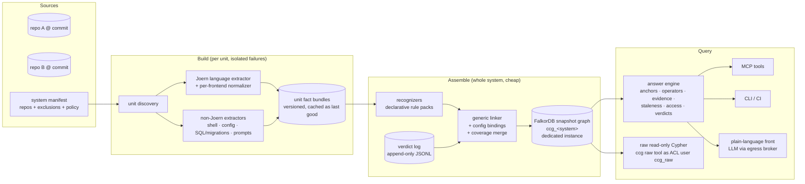

# Connected code graph — requirements review & architecture proposal

> **Status:** active · **Owner:** `architect` · **Tracks:** — (`docs/requirements/connected-code-graph.md`) · **Version:** 2 (proposal) · **Extended by:** `docs/plans/connected-code-graph-graph.md`, `docs/plans/connected-code-graph-ml.md`

**This is an architecture *proposal*, pending stakeholder review.** The requirements it answers
(`docs/requirements/connected-code-graph.md`) are still `Interviewing`; nothing here is approved
for implementation. Two notes extend it and are authoritative in their own domains: the
**graph note** (`docs/plans/connected-code-graph-graph.md`: graph model, DDL, sizing, store
mechanics) and the **ML note** (`docs/plans/connected-code-graph-ml.md`: every LLM touchpoint,
RCA ranking, evaluation design). This plan cites their findings by id (G*n*, Q-R*n*; M*n*, m*n*,
RQ*n*) and does not restate them. `analyst` reviews the whole chain next
(`docs/reviews/connected-code-graph.md`), per `docs/plans/connected-code-graph-coordination.md`.

*Revision 2026-10-26 (v2): every finding in both notes adopted, with the one choice between
alternatives explained (§3.12); requirement cross-references and R18 added in §2.7; §3–§7 revised
to match.*

## 0. Goal & scope

**Goal.** One queryable, *connected* model of a software system: every program's code, joined
across language, component and repository boundaries, to the data it touches, the config that
wires it, and the tests that reach it. Every answer is backed by an evidence chain. It serves
the five use cases (impact, RCA, review, test map, security) through four kinds of client, and
works on any codebase. This monorepo is the first proving ground.

**This document delivers:** (§2) a review of the requirements as agreed so far; (§3) the
proposed architecture, honouring the Guiding principles; (§4) a foundation-first phasing mapped
to the ACs; (§5) how the result would be verified; (§6) the risks and the open decisions,
including the specific questions for `graph-dba` and `data-scientist`.

**Out of scope here:** step-level implementation specs (each phase gets its own plan once the
requirements reach `Ready for design`), the graph DDL and sizing (the `-graph` note's job), and
ML method choices (the `-ml` note's job). Product out-of-scope items are in the requirements doc
and are not restated.

## 1. Context & findings

CPG: used cpg_falkorchat — probed its labels, how FastAPI route and `@mcp.tool()` decorators and
inline Cypher strings appear as `CALL` nodes, and its build marker (built 2026-10-15,
`falkor-chat/server` @ `5c82170f`), to ground the extractor/recognizer design in §3.2–§3.3.

What exists today, and what it means for the design:

| Asset | What it is | Fact that shapes this design |
|---|---|---|
| `skills/joern-cpg/` (`scripts/pipeline.sh`, `cpg-to-falkordb.py`, `git-provenance.sh`) | Build → neo4jcsv export → transform → load one Joern CPG into one FalkorDB graph `cpg_<component>`; stamps a `:CpgBuildInfo` provenance marker | ~2,700 nodes / ~18,000 edges **per Python source file** with default overlays (`SKILL.md` Gotchas, "Scale"). The CPG is a statement-level graph; loading full CPGs for a large multi-repo system into an in-memory store does not scale (see §3.4). Provenance capture before the parse, with scoped dirty flags, is a solved problem and gets reused. |
| `skills/joern-cpg/references/cpg-model.md` "Consumer-query facts" | Verified topology of a `pysrc2cpg` graph | **Inbound call resolution is sparse** (~1.3k of ~20k call sites carry a resolved `CALL` edge; cross-object dispatch is unresolved). **`REACHING_DEF` is intraprocedural** in the exported graph. `METHOD_FULL_NAME` is inconsistent. `FILENAME` is set only on `METHOD`/`TYPE_DECL`, relative to the parse root. Every claim is `pysrc2cpg`-only. So even *within* one program, a correct "callers of X" answer mixes **proven** edges with **name-matched** ones. The confirmed/possible split (FR-8) is therefore needed inside a program, not only across boundaries. |
| `skills/cpg-analysis/` (+ 5 recipes) | Consumer recipes: impact, RCA, review/taint, test gap, freshness | The recipes encode hard-won traversal idioms (callers by `CALL.NAME` + `CONTAINS`, bounded `CONTAINS|CALL*` reach, the interprocedural bridge by `ARGUMENT_INDEX`↔`INDEX`). They become the seed of the answer engine's operators (§3.6). They are Python-verified only. |
| `cypher-mcp/` | One generic tool `mcp__cypher__query(graph, cypher, agent?)`; reads go through `GRAPH.RO_QUERY` | ~~`GRAPH.RO_QUERY` already gives FR-25/AC-21~~ **Corrected in v2:** not read-only for every graph. A write that `RO_QUERY` rejects but that matches a kaizen write shape is re-run with `GRAPH.QUERY` against any graph name (graph note V6, G1), so FR-25 is enforced by a database credential instead (§3.10). The README insists on **one tool**, so the answer engine's tools belong in a new server rather than being bolted onto this one. No parameter binding; the 10,000-row `RESULTSET_SIZE` cap is silent (`skills/cpg-analysis/SKILL.md` §2 gotcha 6). The answer engine must page or aggregate rather than trust row counts. |
| `claude/teco/teco.md` step 3, "CPG freshness" | `teco` runs the freshness recipe per graph at dispatch and states the result in each brief | That is the seam FR-6 plugs into (§3.11). It is also where a per-graph freshness check turns into a per-answer staleness statement (FR-7, AC-9). |
| Installed Joern v4.0.579, `~/joern/joern-cli/frontends` | `c2cpg`, `csharpsrc2cpg`, `gosrc2cpg`, `javasrc2cpg`, `jssrc2cpg`, `kotlin2cpg`, `pysrc2cpg` (+ others) | All seven FR-1 languages have a frontend. The AST generators for JS/TS, C# and Go (`astgen-linux`, `dotnetastgen-linux`, `goastgen-linux`) **are bundled**, so offline (local-only) builds are possible without first-run downloads. Only `pysrc2cpg` has been exercised in this repo. |

What the proving repo actually looks like at its boundaries. These are the cases the ACs will
hit first, and they are harder than "match a route string":

- **AC-1 (HTTP).** The server declares routes as decorators: `@router.get("/health")` in
  `falkor-chat/server/falkorchat/api.py`, with a module constant `API_PREFIX = "/shop/api"` in
  `storefront_api.py:133`. `pysrc2cpg` does surface each decorator as a `CALL` applied to the
  function (verified: `mcp.tool()(def send_message(...))`). The client builds paths through a
  **wrapper** and a **template literal**: `apiFetch({ path: \`${API_PREFIX}/health\` })` in
  `salesperson/src/api/endpoints.ts`, with its own `const API_PREFIX = '/shop/api'`. Linking needs
  (a) constant/string resolution across a template literal and (b) "lifting" the HTTP-client role
  from `fetch` up through the `apiFetch` wrapper. Neither comes out of a Joern CPG directly.
- **AC-2 (MCP + wiring).** The MCP callers named in AC-2 are **not code**:
  `kiro/.kiro/agents/falkor-chat-demo.json` (a Kiro agent config listing tool names),
  `mcp-monitor`'s TOML config, and `.mcp.json` (server → launch command → `cypher-mcp/docker-run.sh`
  → container). The provider side *is* code (`@mcp.tool()` in `falkor-chat/server/falkorchat/mcp.py`).
- **AC-4 (scripts).** Of the 55 files under `claude/`+`skills/` that name `mcp__cypher__query`,
  only 3 are scripts (shell guard hooks matching the tool name), plus one JSON manifest. The rest
  are **Markdown agent prompts and skills**, the de facto callers of that tool in this repo. Shell is
  not an FR-1 language and has no Joern frontend.
- **AC-3 (code→data).** `cpg_falkorchat` has 82 call sites named `query` whose code carries an
  inline `MATCH`. The FalkorDB labels a function touches are inside Cypher **string literals**, so
  code→data linking means parsing embedded query languages.
- **Scale of the proving repo** (tracked files): Python ~210 (falkor-chat 110, model-bench 54,
  mcp-monitor 15, salesperson 10, cypher-mcp 4, claude 4); TS/TSX/JS ~77 (salesperson 74);
  shell ~83. At the measured rate of the current `cpg_falkorchat` build (~4.0k nodes / ~27k
  edges / ~2.6 MB per file, graph note V12 / G12; above the skill's rule of thumb), full CPGs of
  all the Python alone would be ~0.85M nodes / ~5.7M edges / ~550 MB. That is fine here, but it
  is a warning for the workplace.

Comparable work (web research, 2026-10-25): academic static reconstruction of microservice
architectures does it the same way this proposal does: per-service IR, then matching detected
remote calls (path, verb, params) against endpoint signatures. It reports >95% precision/recall
on Spring benchmarks, concedes that only dynamic analysis reaches full inter-service precision,
and notes that "endpoint representations vary with each codebase's conventions", which is the
case for FR-27's declarative conventions
([arXiv 2205.08527](https://arxiv.org/pdf/2205.08527),
[arXiv 2602.08166](https://arxiv.org/html/2602.08166v1)). Cross-service *pointer/taint*
analysis (Micans, [ISSTA 2025](https://conf.researchr.org/details/issta-2025/issta-2025-papers/23/Bridge-the-Islands-Pointer-Analysis-for-Microservice-Systems))
confirms that stitching value flows across RPC/messaging/DI is research-grade. That is why
§3.7's security design composes per-program summaries instead of attempting whole-system
precision. Joern's own maturity notes (2023) call `jssrc2cpg`/`pysrc2cpg` mature, Kotlin
maturing, Go new, C# early ([Joern 2023 update](https://joern.io/blog/joern-org-update-2023)).
That is three years old, so Phase 0 re-measures it (§4).

## 2. Requirements review

**Overall verdict: feasible as a whole, and the Guiding principles are sound.** The requirement
set is coherent enough to design against, with three exceptions where requirements contradict
each other as written (R1–R3). Three more items would make an AC either trivially passable or
unrunnable (R4, R7, R12). The rest are gaps or cost flags. Nothing here edits the requirements
doc; each item names what revisiting it would buy. Severity: **contradiction** (two requirements
cannot both hold as written), **untestable** (an AC cannot give a meaningful pass/fail),
**gap** (a case the requirements are silent on), **cost** (achievable, but out of proportion to
what it buys).

### 2.1 Contradictions

- **R1 — FR-19 / AC-16 vs raw queries (FR-16).** *Contradiction.* "Same facts for every client"
  cannot be guaranteed for a power user's **hand-written** Cypher. Two correct-looking raw queries
  can differ (depth bound, name-matched vs resolved edges, dismissed links filtered or not).
  *Proposal:* every engine answer publishes the exact read-only query (or query set) it ran.
  AC-16's raw-query leg then means "running the published query through the raw client returns
  the same facts". *Buys:* a testable AC-16 and a learning path for power users.
- **R2 — FR-19 vs plain-language input (FR-10, FR-12 symptom).** *Contradiction.* Turning a
  plain-language question or symptom into a structured request (use case + starting point) needs
  an LLM, and that step is not deterministic. Two runs can pick different starting points and
  therefore return different facts, and RCA's "identical hypothesis set" breaks for a described
  symptom. *Proposal:* scope FR-19 to "the same **interpreted** question". Every answer echoes
  its interpretation (the structured request), which the asker can pin and re-run. *Buys:*
  FR-19 stays strict where it matters (the facts engine) without requiring a deterministic LLM.
- **R3 — FR-24 (repo access) vs raw queries (FR-16, FR-25).** *Contradiction.* A raw Cypher query
  against a connected graph sees every repository in it. Filtering results after the query runs
  leaks through aggregates, counts and path shapes. *Options:* (a) raw-query access only for
  askers who can read **every** repository in the view (recommended: simple and safe); (b) one
  materialized view per access scope (cost multiplies with the number of distinct scopes); (c) no
  raw queries in multi-tenant setups. *Buys:* AC-20 holds for all four clients, not three.

### 2.2 Untestable or trivially passable as written

- **R4 — AC-5 (never miss) has no false-alarm bound.** *Untestable.* Under FR-8, listing every
  symbol as *possible* passes AC-5. *Proposal:* pair AC-5 with a noise bound measured on the
  same seeded set, e.g. a precision floor on *possible* items, or a ceiling on possible-per-answer
  relative to confirmed (the number is `data-scientist`'s, §6.3). Also state that the seeded list
  is written **blind**, by someone who has not seen the system's output, from an independent
  source (§5.2). *Buys:* AC-5 measures recall rather than verbosity.
- **R7 — FR-28 "designated person" has no identity source.** *Untestable.* AC-21a's negative leg
  ("a person who is not designated cannot record a verdict") needs authenticated identity plus a
  per-repo designation list. In a local single-user setup, OS user or git identity is spoofable.
  *Proposal:* the requirements name the identity source per deployment mode: local = OS user plus
  a designation file in the repo (CODEOWNERS-style); hosted = the identity provider of the hosting
  environment. They also accept that local mode only enforces against honest users. *Buys:*
  AC-21a becomes runnable.
- **R12 — AC-12 evaluates ranking on n=1.** *Untestable as an evaluation of ranking.* One seeded
  bug per input form proves the true cause *appears*, but says nothing about whether ranking "by
  likelihood" is any good. *Proposal:* keep AC-12 as the smoke test and add a small seeded-bug
  set with a rank metric (design is `data-scientist`'s, §6.3). *Buys:* FR-12's "ranked by
  likelihood" becomes a measured claim.

### 2.3 Gaps

- **R5 — FR-1 omits the languages the proving ground's ACs actually exercise.** AC-2's callers
  are JSON/TOML configs, AC-4's are shell hooks and **Markdown agent prompts** (§1), and FR-5's
  start scripts are shell. *Proposal:* add to FR-1 "shell scripts and structured config formats
  (JSON, YAML, TOML, Compose, `.mcp.json`)". Decide explicitly whether **prompt prose** that
  instructs an agent to call a tool counts as a caller for AC-4. Recommendation: yes, as a
  *possible* link with reason "named in an agent prompt", because in an agent repo prompts are
  the real callers. *Buys:* AC-2/AC-4 become satisfiable without stretching FR-1.
- **R6 — FR-28/29 verdict semantics are half-specified.** (a) FR-29's expiry covers dismissals
  only; does a **confirmation** expire when either end changes? Recommendation: yes, by the
  same rule, because a confirmation of code that no longer exists is just as stale. (b) "The code
  at either end changes" needs a granularity: the call statement, the enclosing function, or the
  file. Recommendation: the **enclosing function** (or the config entry), after normalizing
  whitespace and comments. *Buys:* a precise AC-21a.
- **R9 — FR-7a assumes a last good version exists.** A unit that has **never** built cleanly has
  none. *Proposal:* answers touching such a unit report it as "not mapped: <reason>", and any
  impact that would cross it is listed as *possible* (it could hide links). *Buys:* no silent
  holes on first adoption, which is exactly when builds fail most.
- **R11 — FR-14 does not say whether runtime coverage must be per test.** Totals ("line L ran
  under the suite") show what tests reach. "Which test reaches it", which FR-2's test links
  and AC-13 want, needs per-test coverage contexts (e.g. coverage.py dynamic contexts), and not
  every ecosystem's tooling gives them cheaply. *Proposal:* require totals; use per-test data when
  supplied. *Buys:* FR-14 achievable for every FR-1 language.
- **R8 — FR-9 "no code leaves the machine": define "code".** Is a dependency name plus version
  sent to a vulnerability service "code"? Is an error message sent to a hosted LLM for RCA
  "code"? *Proposal:* local-only means **no repository-derived content of any kind** leaves the
  machine, including names, messages and manifests. Vulnerability data is *downloaded* (an OSV
  database dump) and matched locally. *Buys:* a crisp AC-8, and one egress rule to enforce.
- **R15 — FR-0 vs FR-22: something must say which repositories form a system.** A list of
  repositories (a *system manifest*) is the minimum input. *Confirm* this does not count as
  "hand-describing how parts connect" (the user story's bar). It should not: it names the parts,
  not the connections. The same file carries exclusions, such as this repo's `deprecated/`.
- **R17 — FR-17 "PR" starting point needs a git host.** Fetching a PR means credentials for a
  hosting service. *Proposal:* the core accepts a diff, a commit range or a local branch. Fetching
  a PR is an optional adapter. *Buys:* the core stays host-neutral and works local-only.

### 2.4 Cost flags

- **R10 — FR-15 vulnerable-dependency reachability for seven ecosystems.** Function-level
  reachability needs advisories that name the vulnerable symbols. Go's vulnerability database
  does; most other ecosystems' advisories do not consistently. *Proposal:* report reachability at
  two levels: **package-level** (the vulnerable package is imported *and* its API is called on a
  path from an entry point) everywhere, and **function-level** only where the advisory names
  symbols, each labelled with its level. *Buys:* AC-15 achievable without building a
  vulnerability-symbol database.
- **R14 — FR-21 (no time budget) meets FR-6 (in the teco flow).** Correctness-first is fine for
  people asking ad hoc. But an overlay answer for an un-merged change (FR-23) means re-running
  Joern on each changed unit: minutes per unit (JVM start ~30–60 s plus parse,
  `skills/joern-cpg/SKILL.md` Gotchas). A `teco` dispatch would wait that long. No requirement
  change needed, but the stakeholder should know; §3.9 keeps the wait proportional to the units
  touched, not to the system.
- **R16 — FR-26 "never requires changing the core".** It holds for anything expressible in the core
  vocabulary (§3.3). A genuinely new *concept*, as opposed to a new instance of a known one (say,
  stream-processing topologies or GraphQL federation), needs that vocabulary to grow. *Proposal:*
  read FR-26/AC-22 as "within the core vocabulary; vocabulary growth is a versioned core change".
  *Buys:* an honest AC-22.

### 2.5 Sound as written (no change recommended)

FR-8's over-list-and-flag stance, FR-7's full rebuild, FR-20's full evidence chain, FR-23's
latest-plus-one-overlay limit and FR-25's read-only raw queries are each both valuable and
cheap under the proposed architecture. FR-7's full-rebuild allowance in particular removes the
hardest problem (incremental cross-program re-linking) and should be kept.

### 2.6 AC-7 / AC-19 candidate codebase

AC-7 needs "a second, unfamiliar multi-service codebase" using two or more FR-1 languages plus
gRPC, messaging and SQL. Candidate: the **OpenTelemetry demo** ("Astronomy Shop"). Its services
are in Go, .NET, Kotlin, Java, Python, TypeScript and C++, and it uses gRPC + HTTP, Kafka
(checkout → accounting and fraud-detection), PostgreSQL (accounting) and Valkey as a cache
([architecture](https://opentelemetry.io/docs/demo/architecture/); exact service list varies by
release, verify against the pinned tag). Its maintainers' published service map is an
independent ground truth for AC-5's seeded list. Its runtime traces can serve as a link oracle
(§5.2). It is one repository, so AC-19's three-repository fixture would split it. **v2
correction (ML m8):** that map is service-level only, so it is not the code-level seeded list.
The gRPC stratum is derived mechanically from `.proto` files, the other strata are written blind,
and the demo is kept out of any LLM evaluation because of contamination (ML note §4.5).

### 2.7 Cross-reference to the specialist notes' requirement findings (v2)

The notes raise their own requirement-level items for the stakeholder: graph note §5 Q-R1–Q-R6
and ML note §6 RQ1–RQ11. Overlaps with R1–R17 are listed so the stakeholder decides each
question once. The note's wording is the sharper one where both exist.

| This plan | Related note items | Relationship |
|---|---|---|
| R1 (published query for AC-16) | Q-R4, RQ8 | Q-R4 sharpens it: the published artifact is the **query set plus algorithm id and version**, because reach and RCA are engine algorithms (G4). RQ8 scopes the plain-language leg to "whenever the shown interpretation matches". |
| R2 (FR-19 per interpreted question) | RQ3, RQ8, RQ9, RQ11 | RQ3 goes further: with the deterministic ranker (M3), FR-19's RCA-order allowance can be **dropped**. RQ9 adds the missing AC for interpretation accuracy. RQ11 sets expectations for weaker local models. |
| R3 (raw queries vs repo access) | Q-R1, Q-R6 | Q-R1 is the deciding question: does FR-24 protect **content** only, or **structure** too? Q-R6: AC-21's guarantee should sit at the database credential. |
| R4 (AC-5 noise bound, blind list) | RQ1, RQ10 | RQ1 is the proposed rewording, with thresholds marked *proposal*. RQ10 frames the bound as FR-8's exchange rate. |
| R6 (verdict semantics) | Q-R2, Q-R3 | Q-R2: a verdict takes effect immediately. Q-R3: a rename orphans a verdict, and the orphan stays listable. |
| R12 (AC-12 on n=1) | RQ2, RQ4 | RQ2 is the rewording (≥40 seeded bugs, hit@5). RQ4: "likelihood" should read "a stated score". |
| R14 (overlay latency) | Q-R5 | Overlays are full in-memory snapshots, so their number needs a configurable cap. |
| (R5, R6 on AC-6/AC-15) | RQ5, RQ6 | New ACs that make AC-6 and AC-15 testable, including "never claims unreachable when reachable". |
| (AC-7) | RQ7 | Configuration frozen before first contact; a third, held-back codebase later. |
| (deployment) | graph note §5 "Context" | Workplace scale wants a dedicated FalkorDB instance with ~10 GB RAM (G8). Stated for awareness, no decision. |

**R18 (new in v2) — FR-19's "same snapshot" must include the verdict state.** *Gap.* Once verdicts
take effect immediately (Q-R2, adopted in §3.8), a dismissal between two asks changes the facts
of the second answer on an unchanged code snapshot. *Proposal:* FR-19 reads "same code snapshot
**and same verdict state**". Every answer states its snapshot ID and a verdict-state marker (the
verdict log's length or hash). *Buys:* FR-19 stays strictly true, and a reader can see why two
answers differ.

## 3. Architecture proposal

### 3.1 Shape in one picture

Five rules shape the design:

1. **Facts are computed at build time; queries only traverse.** Every link, flow summary and
   coverage merge is decided when a snapshot is built and stored in it. The query side is
   deterministic graph traversal, which is what makes FR-19 hold (§3.6).
2. **Joern maps programs; it is not the query engine.** It runs per unit at build time.
   FalkorDB holds the connected view and answers queries.
3. **One small, versioned core vocabulary.** Every extractor and recognizer emits into it, and
   every use case and client reads only it. That single seam is what makes FR-26 hold.
4. **Shipped framework support and in-house conventions use the same declarative format.**
   FR-27 then comes for free.
5. **Possible is a first-class status with a reason code**, inside programs as well as across
   them (FR-8, §1).
6. **Only direct facts are stored; reach is computed by traversal** (graph note §3.1 rule 3,
   G3). No materialized closures. The only exceptions are per-symbol aggregates and
   cross-component security `Finding` chains (G4, §3.7).
7. **An LLM may interpret and phrase, never assert** (ML note §3.1). This means **no approximate
   nearest-neighbour search on the fact path** (M4, graph note Q9). A proposal that lets a model
   decide or prune facts is rejected on this rule.

### 3.2 Units and the per-language code map (Joern's fit per FR-1 language)

**Unit.** A *unit* is one buildable program: (repository, root path, language). Units are found
by scanning for build manifests (`pyproject.toml`/`setup.cfg`, `package.json`/`tsconfig.json`,
`pom.xml`/`build.gradle(.kts)`, `*.csproj`/`*.sln`, `go.mod`, `CMakeLists.txt`/
`compile_commands.json`), with a directory-per-language fallback. No hand description is needed
(FR-0). The unit is also the granularity of build, failure and staleness (§3.11). The only human
input is the system manifest (R15).

**Joern extractor.** Per unit, the existing build stage (`skills/joern-cpg/scripts/build-cpg.sh`
plus `git-provenance.sh`, so provenance is captured before the parse) produces `cpg.bin`. A
**Joern script** (`joern --script`), not the neo4jcsv export, then writes the unit's fact bundle
directly (§3.3). Why: the full statement-level export is what blows up memory
(~2,700 nodes/file), and the connected view needs only symbols, call sites, resolved strings and
flow summaries. A **per-frontend normalizer** absorbs frontend differences (`FILENAME` relative
to the parse root, inconsistent `METHOD_FULL_NAME`, how decorators/annotations appear), so
nothing downstream ever sees a frontend quirk. `cpg.bin` is kept on disk as an artifact for deep
queries in the Joern REPL and for re-extraction without a re-parse.

| FR-1 language | Joern frontend | Expected fit (to be measured in P0) | Known weak spots | Fallback, if P0 says so |
|---|---|---|---|---|
| Python | `pysrc2cpg` | **Verified here.** Good AST; decorators visible | Sparse call resolution (~1.3k/20k); cross-object dispatch unresolved | Name-match as *possible*; optional precise indexer (e.g. SCIP-python) for resolved targets |
| TS/JS | `jssrc2cpg` (astgen bundled) | Mature per Joern; type-recovery + call-linker passes exist | Template literals and wrappers (AC-1); dynamic imports; framework DI | Precise indexer (e.g. SCIP-typescript) for symbol resolution |
| Java | `javasrc2cpg` (or `jimple2cpg` on bytecode) | Strongest typed frontend; best with dependency jars on the classpath | Spring DI / reflection-built wiring | Build-and-bytecode via `jimple2cpg` where the build runs |
| Kotlin | `kotlin2cpg` | Maturing; uses the Kotlin compiler; type-recovery pass exists | Needs classpath for types; coroutines/DSLs | Same as Java |
| C#/.NET | `csharpsrc2cpg` (dotnetastgen bundled) | Least proven (early in 2023) | Type resolution across projects; ASP.NET attribute routing | Roslyn-based indexer (e.g. SCIP-dotnet) alongside |
| Go | `gosrc2cpg` (goastgen bundled) | New in 2023; static typing helps | Interface dispatch; generated gRPC stubs need to be in the parse root | Precise Go indexer alongside |
| C/C++ | `c2cpg` | Oldest frontend; fuzzy parsing tolerates missing headers | Preprocessor/macros without build flags; name-based call resolution | `compile_commands.json`-aware parse; clang-based indexer alongside |

**Deviation from "Prefer Joern", stated:** non-Joern extractors are needed for what Joern has no
frontend for: **shell** (tree-sitter-bash), **structured config** (JSON/YAML/TOML/Compose/
`.mcp.json`/Kiro agent configs, plain parsers), **SQL DDL and migrations** (a SQL parser, e.g.
sqlglot) and **Markdown prompt mentions** (R5). A precise symbol indexer *alongside* Joern is
held in reserve per language. It would feed resolved call targets into the same bundle, never a
second model. **v2 (ML m4):** the adoption bar is not call-resolution rate. Under the name-match
fallback, resolution rate drives *noise*, while misses come from the fallback itself. P0
therefore measures, per language, on a sample with known callees, **fallback recall** (the gate)
and **name-match fan-out** (the cost) (ML note §3.6). An indexer is adopted where fallback recall
fails the gate, or where fan-out breaks the noise bound (§5.2).

### 3.3 The core vocabulary, fact bundles and the extension model (FR-26, FR-27)

**Fact bundle** (one per unit per build, a versioned schema, JSONL on disk). It holds:
- **Symbols**: files, types, functions/methods, with a **stable symbol ID** (language + unit +
  qualified name + signature, never a Joern node id), file + line span and a **content
  fingerprint** (normalized body hash).
- **Call sites**: enclosing symbol, line, callee name, callee targets each tagged
  `resolved | name-matched`, and **argument value sets**: the string/constant values each
  argument can take, resolved through constants, concatenation and template literals within the
  unit, or `unknown` with a reason.
- **Intra-unit flow summaries** from Joern's data-flow engine (build time, so `reachableBy`'s
  precision is available): parameter → return, parameter → call-site argument, and
  source/sink-kind facts per §3.7.
- **Imports and dependency manifest entries** (package + version), **test markers** (by test
  framework convention), and **config/script facts** from the non-Joern extractors (keys,
  values, env var assignments, commands launched).

**Core vocabulary** (what the connected graph is made of; DDL is `graph-dba`'s, §6.2):
`System`, `Repo`, `Unit` (with build status and staleness), `File`, `Symbol`, `CallSite`;
`ContractPoint {kind, key}` with kinds `http`, `rpc`, `topic`, `mcp_tool`, `library_api`,
`data_entity` (table/column/graph label/relationship/collection/key pattern), `config_key`,
`env_var`; `Test`; `Finding`; `Dependency`. Edges: `CALLS`, `FLOWS`, `PROVIDES`, `CONSUMES`,
`LINKS` (provider↔consumer, with status, reason and evidence), `READS`/`WRITES`, `BINDS`
(config → value), `TESTS` / `COVERS`, `DEPENDS_ON`. Every edge carries `status ∈ {confirmed,
possible}`, a `reason` code from a closed, extensible list (`resolved-call`, `name-match`,
`exact-contract`, `template-match`, `prefix-only`, `runtime-built`, `prompt-mention`,
`runtime-observed`, …) and an **evidence pointer** (file + line).

**v2: the concrete graph model is the graph note's §3.2, and it supersedes the edge list above
wherever they differ.** The vocabulary *concepts* are unchanged. Three of the graph note's rules
bind the bundle schema, so P0 freezes them together:
- **Every constrained id is a fixed-length hash** of its canonical tuple. Readable keys live in
  unconstrained, stripped properties, because a long or whitespace-edged value under `UNIQUE`
  crashes the instance (G2, graph note §3.4). So the bundle carries the canonical tuples, and
  the hash function is part of the schema version.
- **Name-matched calls go through a language-scoped `Name` node**, not one edge per candidate
  (G3a). The bundle records the callee name and the resolved targets only; candidates are
  derived at assembly.
- **Evidence lives on nodes and status on edges.** Every dependency edge points from dependent
  to dependency, so impact is always incoming reach (graph note §3.1 rules 1–2). The `LINKS`
  above becomes a reified `Link` node for cross-boundary links only; `TESTS`/`COVERS` becomes
  per-symbol coverage aggregates plus direct runtime `RAN` edges (G3b). The reason code
  `model-suggested` is **not** in the list (M5, §3.13).

**Recognizers: declarative rule packs.** A pack is a versioned data file (YAML) that matches
bundle facts and emits vocabulary facts. A rule has: a **match** (callee qualified name / regex,
decorator or annotation, receiver type hint, config path, file glob); an **extract** (which
argument, keyword or config value supplies the contract key, using the resolved value sets); and
an **emit** (`PROVIDES`/`CONSUMES` of a kind, `READS`/`WRITES` of an entity, `Test` marks,
`source`/`sink`/`sanitizer`/`auth-check` marks, `BINDS`). One escape hatch, still declarative: a
rule may be a **read-only query over the unit's bundle** for patterns a matcher cannot express.
Two built-in generic mechanisms make packs small:
- **Role lifting.** If a function's parameter flows (by summary) to the key argument of a
  recognized client call, that function becomes a derived client with that parameter as the key.
  This is iterated to a fixpoint, so `apiFetch({path})` → `fetch(url)` is recognized from the
  `fetch` rule alone (AC-1).
- **Embedded-language parsing.** A rule can declare that an argument is SQL or Cypher. The core
  parses it (SQL parser; an openCypher grammar) and emits `READS`/`WRITES` per table/column or
  label/relationship type (AC-3). Unparseable or partially-known text yields *possible* with
  reason.

**Shipped packs** cover standard frameworks: FastAPI/Flask/Django, Express/Next, Spring,
ASP.NET, gin/net-http, gRPC stubs per language, Kafka/RabbitMQ/NATS clients, DB drivers and
ORMs, FastMCP plus MCP client configs, pytest/vitest/jest/JUnit/xUnit/go-test, and Compose/
k8s/`.mcp.json`. **In-house conventions (FR-27) are just more packs** in the codebase's config
directory, in the same format. Nothing in the core distinguishes a shipped pack from a local one.
AC-23 is satisfied by construction if, and only if, the format is expressive enough, which is
what P2's convention test checks.

**Extension units (FR-26).** Four plug-in kinds, each a directory with a manifest: **language
extractor** (frontend invocation + normalizer → bundle), **non-code extractor** (parser →
bundle), **rule pack** (protocol/framework/data store/test framework/security knowledge) and
**importer** (runtime coverage formats: lcov, Cobertura, coverage.py JSON, JaCoCo, Go cover;
optionally traces). Use cases and clients read only the vocabulary, so a new unit lights up
every use case without per-use-case code. AC-22 is checked as: the change adds one directory and
modifies nothing else.

### 3.4 Linking: across programs, repositories, data, config and tests

**The linker is one generic algorithm.** For each contract kind it joins `PROVIDES` and
`CONSUMES` on a normalized key using one of a few **matchers** the pack selects declaratively:
`exact`, `path-template` (`/threads/{tid}/messages` vs `/threads/` + unknown), `glob`/`prefix`
and `regex`. The result:
- Both keys fully known and matching → **confirmed** (`exact-contract` / `template-match`).
- A partially known consumer key (`prefix-only`), a provider chosen only by name, or a fully
  unknown key with the provider candidates narrowed by config binding → **possible**, with
  reason and the candidates.
- A fully unknown key with no binding → one *possible* link per provider of that kind in the
  bound target (or the system if unbound), collapsed in answers as "may call any of N endpoints
  of X: URL built at runtime (file:line)". This is FR-8's over-listing, kept readable. The volume
  is controlled by the noise bound from R4. **v2 (ML M2):** a collapsed group is a rendering
  choice, never a counting shortcut. Every member stays **individually enumerable with its own
  evidence chain** (the group expands). For AC-5 a member counts as a hit only on those terms.
  The noise bound is always measured on the **expanded** groups (ML note §4.1 hit rule, §4.2
  two-part bound).

**Cross-repository (FR-22)** needs nothing special: keys and symbol IDs are repository-neutral.
**Shared libraries:** a library unit `PROVIDES library_api` for its exported symbols under its
published package name. A consumer unit's dependency manifest plus imports `CONSUMES` them.
Symbol-level links come from import-qualified call names. If the consumer pins a version
different from the library repo's built commit, the link carries a `version-skew` note.

**Config and wiring (FR-5)** do two jobs. (1) **Bindings** pick the provider: a consumer's base
URL comes from env var `X`; Compose sets `X=http://falkor-chat:8000` for that service; the
Compose service builds from the `falkor-chat/` context → the provider unit. That turns a
"possible: any HTTP provider" into a confirmed link, and puts the wiring files themselves on the
evidence chain (AC-2). (2) **Config as caller/provider:** `.mcp.json` server → launch command →
script → unit; Kiro agent JSON and `mcp-monitor` TOML `CONSUMES mcp_tool` by name. Shell
launchers are parsed for `exec`/command lines and env assignments; anything dynamic is
*possible*.

**Code → data (FR-3).** Data entities are `ContractPoint`s of kind `data_entity` with keys like
`sql:<db>.<table>.<column>`, `graph:<label>` and `kv:<key-pattern>`. `PROVIDES` comes from
schema sources (DDL, migrations; the latest migration state wins, and each migration is evidence
on its entity). `READS`/`WRITES` come from driver/ORM rules plus embedded-language parsing.
Graph databases with no schema file get their entities from the union of all writers.

**Tests (FR-2 tests, FR-14 static half).** Test-framework packs mark `Test` symbols. A test
reaches code statically, by call edges plus links, so an end-to-end test that issues HTTP reaches
the server's handler and beyond. **v2 (G3b): that reach is not stored as per-(test, symbol)
edges.** That would be a transitive closure, O(tests × reach). Instead:
- One multi-source BFS at assembly writes **per-symbol aggregates**
  (`staticCovered`, `runtimeCovered`, `coverageState`).
- "Which tests reach X" is a traversal at query time.

**Runtime coverage merge** (an importer) maps covered file:line to symbols. It sets
`runtimeCovered`, plus direct `RAN` edges per test where coverage contexts exist (R11). The
linker records disagreements as first-class facts:
**static-only** (statically reachable, never executed: a missing test input or a dead branch)
and **runtime-only** (executed but statically unreachable: a **missed link**, fed back to link
recall, §5.2).

### 3.5 Store: FalkorDB, one connected snapshot graph per system

**Prefer FalkorDB is honoured** for the connected view and every query path. Its layout:
- **`ccg_<system>`**: the summary-level connected snapshot (the vocabulary above). Symbols and
  call sites, not statements.
  - **Size, measured:** ~0.115 MB per source file, about 20× smaller than a full CPG; ~1.5 GB
    budget for a 10,000-file system (graph note Q3, V11). This holds only under rule 6 and the
    `Name` indirection (G3).
  - **One graph per system is confirmed:** FalkorDB cannot traverse across graph keys (graph
    note V1, Q1). The corollary: **anything an answer joins with must be inside the snapshot**,
    including verdicts and an overlay's base facts.
- **Hosting: a dedicated FalkorDB instance** for the code graph (G8). It is sized from the graph
  note's peak formula (Q3: ~11 GB at workplace scale with four overlays), set to `noeviction`,
  with persistence off or infrequent, because everything in it is rebuildable from bundles.
  Never the shared `falkordb-dev`. Bring-up is `devops`'s.
- **Swap: build into `ccg_<system>__build_<id>`, then `RENAME` it over the live key.** This is
  atomic and safe for readers already running (graph note V2, Q4; G7). **Zero** old snapshots
  are kept; rollback means re-assembling the last-good bundle set.
  - A build is complete only when every index and constraint reads `OPERATIONAL`, and the
    `:Snapshot` node is written last. A `FAILED` constraint fails the build, and the last good
    snapshot stays live (G9, graph note §3.5).
  - `RENAME` and `EXPIRE` destroy graphs without the literal `GRAPH.DELETE`. So key names come
    only from the system manifest, always `ccg_`-prefixed, and only the build credential may
    issue those commands (G7, graph note Q10).
- **Verdicts are not a graph.** They are an append-only JSONL file of record, applied into each
  snapshot at assembly (G5, §3.8).
- **Overlay graphs** `ccg_<system>__ov_<id>`, built from bundles (§3.9).
- **Full per-unit CPGs** in FalkorDB (`cpg_<unit>`, today's pipeline) stay **optional**, for small
  codebases and power users. They are never needed by the answer engine.
- **Load path:** follows graph note §3.5 and Q8: indexes on the empty key first, one persistent
  connection, no write retries, `GRAPH.BULK` as the optimization.
- **Telemetry streams** (`telemetry{<graph>}` record queries with their parameters, V10/G13):
  operators pass anchor ids rather than code text as parameters, every non-admin ACL pattern
  excludes these keys, and P0 checks whether the stream can be capped or disabled.

**Deviation, stated: deep interprocedural analysis is not done in Cypher.** It runs in Joern at
build time, and its results land in the graph as intra-unit summary edges (`ARG_FLOWS`,
`paramToReturn`). Cross-component taint chains are composed at assembly into `Finding` nodes
(G4, §3.7). Reason: Cypher has no
context-sensitive data-flow engine, and the exported `REACHING_DEF` is intraprocedural (§1). The
query language for every *answer* remains Cypher over FalkorDB.

### 3.6 Answer engine and the four clients (FR-10, FR-16–FR-21, FR-25)

**One answer engine** (a library, Python 3.12 like the rest of the lab) is the only producer of
facts for three of the four clients. Its pipeline:

1. **Anchor resolution (FR-17, FR-18).**
   - **Code location** → `Symbol`, by exact lookup on indexed, normalized properties
     (`nameNorm`, `qname`, `File.path` plus a line filter; graph note §3.4).
   - **Change** → changed symbols, by mapping diff hunks onto base spans, plus new symbols from
     the overlay.
   - **Contract point** → `ContractPoint` by `keyNorm`. Prefix and template matching run
     client-side with the linker's own matcher, because `STARTS WITH` is not index-backed
     (graph note §3.4).
   - **Failure evidence** (v2, ML M4): stack frames are parsed per language into file + line →
     symbol. Error and log text are matched against **build-time log templates** (`LogTemplate`,
     carrying IDF information scores) in tiers: exact → containment → weighted overlap. The
     threshold is frozen from the dev split at 100% recall, and low-information templates are
     collapsed, never truncated (ML note Q5). The full-text index is allowed because it returns
     the complete match set; fuzzy hits are *possible* only (graph note Q9).
   - **Symptoms** go through the plain-language front (below).

   The asker never names a graph or component: there is one graph, and anchors are found by
   content.
2. **Operator (per use case, §3.7).** v2 (G11, graph note Q7): reach is a **level-synchronous
   BFS driven by the engine**, one parameterized read per depth level. It keeps a visited set
   and the **best predecessor** per node: fewest *possible* hops, then depth, then stable id.
   No path enumeration in Cypher.
   - Replies are batched below `RESULTSET_SIZE`; a reply of exactly 10,000 rows is treated as
     truncated and re-split.
   - `algo.SSpaths` is a P0 benchmark candidate only.
   - The depth bound is stated, and when the frontier is cut, the answer says so: "reach stopped
     at depth d with k unexplored edges" (ML m5).
3. **Evidence chains (FR-20).** The best-predecessor map *is* the chain. Each hop renders as
   `{node kind, path, line, unit, repo}` plus `{edge type, status, reason}`. A `Link` hop expands
   to its `BOUND_BY` wiring entries (graph note §3.3). An item's status is the weakest hop on its
   best path.
4. **Overlays applied:** verdicts (dismissed items hidden unless "show dismissed"), access
   redaction (§3.10), and **staleness**: the set of units on any evidence chain, each with its
   built commit, its time, and whether it is a kept-last-good version and why (FR-7, FR-7a,
   AC-9, AC-9b).
5. **Canonical answer** (JSON, versioned schema). It holds:
   - the interpreted request;
   - the **published query set plus algorithm id and version** (R1 as sharpened by G4/Q-R4);
   - the facts in a **deterministic order** (stable sort by status, component and symbol ID,
     applied before any paging or top-k);
   - the staleness block, the snapshot ID and the verdict-state marker (R18);
   - for plain-language asks, **interpretation provenance**: model id, quantization,
     local/hosted, prompt hash, cache hit (ML m3, note §3.2).

   Renderers produce the grouped text and the Markdown report (FR-10, AC-11) by **deterministic
   templates**. No fact is ever model-written (ML m1, note §3.3).

**Clients:**
- **Agents (MCP):** a **new `ccg` MCP server** exposing `ask` (structured request), one tool per
  use case, `resolve` (anchor preview), `refresh` (FR-7 on demand), `verdict` (§3.8, separately
  authorized) and `raw_query` (below). Why not extend `cypher-mcp`: its contract is deliberately
  one generic tool (`cypher-mcp/README.md`, "The tool").
- **Automation/CI:** a CLI (`ccg impact --diff …`, `ccg testmap …`) emitting the canonical JSON,
  with exit codes for gating if a pipeline wants one. Gating policy is the pipeline's, not
  ours ("no fixing" is out of scope).
- **People in plain language** (v2, ML note Q1 (a)–(c)):
  - **Deterministic parsers first.** Pasted traces, routes, file:line or diffs inside a sentence
    never reach the model (ML m2).
  - **For the remaining free prose:** a one-shot, schema-constrained extraction of the use case
    plus anchor *spans*, which a deterministic resolver turns into anchors.
  - **The interpretation is echoed and cached**, keyed by question, snapshot, model fingerprint
    and prompt hash. Repeat asks are then literally deterministic; pinning the temperature alone
    is not on this stack (ML note §1, §3.2).
  - **The only optional LLM prose** is a summary paragraph written from aggregates. It is dropped
    if it names any entity that is not in the canonical answer.
  - **All LLM calls go through the egress broker** (§3.11).
- **Power users:** raw read-only Cypher through the `ccg` server's `raw_query` tool, connected as
  the per-system Redis ACL user `ccg_raw_<system>`. That user has only `graph.ro_query`,
  `graph.explain` and `graph.list` on the system's keys (G1, graph note Q10). **FR-25/AC-21 is
  then enforced by the database, not the client.** Access is gated by R3's rule. The schema (graph
  note §3.2) is documented as a public, versioned contract.

**FR-19 holds because** the facts are a pure function of (code snapshot, verdict state, access
scope, structured request, algorithm version). The interpretation step is the only
non-deterministic part, and it is echoed, cached and pinnable. With the deterministic RCA ranker
(M3), the order is deterministic too (RQ3).

### 3.7 Use-case operators

All five read the same vocabulary. None has per-language code.

All operators are the same BFS (§3.6 step 2) with a different edge-type list and direction
(graph note Q7). That is what keeps FR-26's "no per-use-case code" true.

- **Impact (FR-11).** Incoming reach from the anchor symbols over:
  - `CALLS` (confirmed) and `CALLS_NAME`→`Name`→`RESOLVES_TO` (possible), minus `DISMISSED` pairs;
  - `Link` hops (consumer side);
  - `READS`/`WRITES` through shared entities (a writer change reaches the readers);
  - config `BOUND_BY` and `LAUNCHES` entries.

  Affected tests are the `Test` symbols the same traversal reaches. Results are grouped by
  component. Forward reach is offered for "what does this depend on".
- **Review (FR-13)** = impact anchored on a change, against the overlay snapshot (§3.9). It adds
  the **contract delta**: a provider whose key changed (route renamed, column dropped), with every
  consumer of the *old* key listed. That is AC-13's "callers in other components and the tests
  that exercise it".
- **Test map (FR-14)** = per symbol, read from the aggregates (`coverageState`: both,
  static-only, runtime-only, neither; §3.4). "Which tests, via which hops" is computed by
  traversal on request. "Reached only across a boundary" falls out of the hop kinds on the chain
  (AC-14).
- **RCA (FR-12).**
  - **Anchors** come from failure evidence (several services' logs give several anchors).
  - **The candidate set is deterministic:** backward reach from each anchor, including data
    entities (the writer of a bad value in another component), bounded and with chains. Each
    candidate becomes a hypothesis node in a tree ordered by its evidence path.
  - **Ranking (v2, ML M3):** a **deterministic weighted-feature score** with a stable tie-break
    (ML note Q2). Each hypothesis shows each feature's contribution, which is what AC-12's
    "ranking shows its evidence" means. Weights are tuned on the dev split only. The feature
    "recent change" uses a named window: the overlay diff, or the last N commits before the
    snapshot (ML n2).
  - **Baseline:** the ranker must beat path-length (BFS) order. An LLM re-ranker over the top-k
    is a later, gated experiment that never removes a hypothesis.
  - **Order:** with this ranker the order is deterministic (RQ3).
- **Security (FR-15).** Four finding kinds:
  - **Cross-boundary taint (v2, G4):** source marks (HTTP/RPC handler params, message payloads,
    files, env) and sink marks (SQL, shell, file, eval, deserialization) come from packs.
    Per-unit Joern flow summaries give within-unit facts. The stitching across `Link`s is a
    stateful walk: argument *i* at the call site must match parameter *i* of the handler. A
    fixed Cypher pattern cannot express that, so it runs **at assembly**, and each chain is
    stored as a `Finding` with ordered `STEP`s (graph note §3.2). Security answers read findings,
    which are deterministic and visible to raw queries. Sanitizer marks cut paths. This is a
    summary-composition approximation, and is documented as such (§1, comparable work).
  - **Missing authorization:** paths from entry points to sensitive sinks or entities with no
    `auth-check` mark dominating them on the chain. Packs define the auth idioms per framework.
    Also materialized as `Finding`s.
  - **Secrets:** a secret-pattern scan (regex + entropy) over code and config bundles, plus taint
    with "secret" as a source and logs/responses/outbound calls as sinks. **Secret values are
    never stored**, only `valueHash` plus path + line (graph note §3.2).
  - **Vulnerable dependencies:** manifests → `Dependency` matched against a **locally downloaded
    OSV database**, with reachability at package and (where advisories name symbols) function
    level (R10).

### 3.8 Verdicts and expiry (FR-28–FR-30)

v2 adopts graph note Q6 / G5 as the design. In brief:
- **Stable link identity:** `linkId` is a fixed-length hash of (kind, normalized key, provider
  symbol ID, consumer symbol ID), never a build-local id (G2). It survives a full rebuild.
- **System of record:** an append-only JSONL verdict log per system, kept beside the system
  manifest. Each record carries the verdict, why, by, at, both end fingerprints and the endpoint
  tuple. There is no verdict graph (G5), because nothing can join a second graph key (graph note
  Q1).
- **Applied at assembly:** fingerprints still match → the verdict applies (on a `Link`, a
  `READS`/`WRITES` edge, or as a materialized `CALLS {verdict-confirmed}`/`DISMISSED` edge for a
  name-matched pair). Either fingerprint differs → the item returns as *possible* with
  `priorVerdict*` set: "earlier dismissed by X at T for 'why'; expired because <end> changed"
  (FR-29, AC-21a). **Confirmations expire by the same rule** (R6a adopted). Fingerprints are the
  enclosing symbols' normalized content hashes (R6b).
- **Takes effect immediately** (Q-R2): the `verdict` command appends to the log **and** patches
  the live snapshot in one write, under its own ACL user `ccg_verdict`. Live overlays pick it up
  on their next build. Answers carry the verdict-state marker (R18).
- **Orphans** (Q-R3): when a rename or delete changes an end's `symbolId`, the verdict stays
  listable as orphaned and is counted on `:Snapshot.orphanedVerdicts`. The link returns as
  *possible* without the "earlier dismissed" note (pending stakeholder acceptance of Q-R3).
- **Writing:** only through the `verdict` command (MCP tool / CLI), never through raw queries
  (FR-30). It is authorized against the designation list for the repo of **either** end, with
  identity per R7.

### 3.9 Change overlay (FR-23)

Given a diff, commit range or branch, applied to one or more repositories:
1. Map changed files to units; rebuild only those units on a patched checkout. Their fact
   bundles replace the base ones in a scratch set; every other unit reuses its base bundle.
2. Re-run recognizers and the linker over the whole bundle set, including security `Finding`
   composition. This is cheap, because it is data processing with no Joern.
3. Bulk-load into `ccg_<system>__ov_<id>` **exactly like a snapshot, from bundles**. Never
   `GRAPH.COPY` the base and patch it: that stalls the instance and reintroduces incremental
   re-linking. Never a delta graph either, which would be federation (G6, graph note Q5). Answers
   say "base snapshot S + overlay of <change>".
4. **Lifetime:** `EXPIRE` renewed on each use. A configured **cap on concurrent overlays** (each
   one is a full snapshot of RAM; default about 4, Q-R5), with the oldest idle overlay retired
   by the runner, never by Redis eviction. An answer says when its overlay had to be rebuilt.

Cost: the Joern rebuild of the changed units dominates (R14). Loading takes ~2–3 min for 10k
files (graph note Q5). AC-19 (an un-merged change in one of three repositories) is the overlay's
acceptance test.

### 3.10 Access control (FR-24)

- An **access provider** plug-in answers "may principal P read repo R": a local static file in
  local mode, or a git-host/IdP adapter in hosted mode.
- The engine filters at step 4 of §3.6. An item in an unreadable repo is shown as
  `affected, no access` with its repo name only. A chain that passes *through* an unreadable
  repo to a readable item shows that segment as one redacted hop
  ("via <repo>: no access").
- Facts are still computed over the whole system, so FR-19 holds within an access scope.
- Raw queries follow R3: the `ccg_raw_<system>` credential is issued only to principals who can
  read every repo in the system (graph note Q10, which agrees with R3(a)). Per-scope raw views
  (`ccg_<system>__scope_<h>`, topology kept and code-revealing properties scrubbed) are buildable
  later at one snapshot of RAM per scope, **if** the stakeholder answers Q-R1 with "content
  only". Dropping hidden repos from a view is rejected, because it breaks FR-19 across clients
  (graph note Q10).

### 3.11 Refresh, partial failure, and local/hosted configuration (FR-7, FR-7a, FR-9)

**Refresh runner**: one entry point, `refresh(system, scope=all|units)`, called by four triggers
(AC-9a):
- a **schedule** (a cron/systemd timer, or the CI scheduler);
- **on demand** (CLI, the `refresh` MCP tool, `teco`);
- a **staleness threshold**: a cheap periodic check comparing each unit's built commit with its
  repo head, by commit count or changed-file count under the unit root; configurable;
- a **CI event**: the CLI called from a pipeline step or webhook.

Each unit builds in isolation. A **failed unit keeps its last good bundle**, marked
`stale-kept {built commit, failed at, reason}`, and assembly proceeds. Answers report it per
§3.6 step 4. A never-built unit is "not mapped" (R9). The full rebuild of every unit is the
default (FR-7 permits it). Bundle caching keyed by the unit tree's object ID is an optimization
that does not change the facts.

**Local/hosted (FR-9).** Every outbound call (LLM, embeddings, any hosted service) goes through
**one egress broker**. It computes the effective policy as `codebase default` overridden by the
`run override`, except that `local-only` is sticky (an override to hosted is refused and
logged). Under local-only the broker routes LLM calls only to a configured local endpoint
(e.g. LM Studio, as the lab already uses) and refuses everything else. No other component holds
network credentials. Vulnerability data is downloaded in advance, so no repository content
leaves the machine (R8). AC-8 is tested with network egress blocked or proxied (§5).
Under this design every LLM touchpoint is narrow: one-shot extraction, or a summary built from
aggregates (ML note Q1, §3.5). A weaker local model can therefore only lower interpretation
accuracy and summary quality. It never changes the facts (RQ11).

### 3.12 Integration into the `teco` flow (FR-6), and what happens to today's assets

**FR-6 seams** (prompt edits are `cobb`'s, not this plan's):

| `teco` stage | Use case | What lands in the brief / review |
|---|---|---|
| Architect dispatch | impact (symbols/files the task names) | Impact answer + staleness, replacing today's `CPG: <graph>, built …` freshness line in `claude/teco/teco.md` step 3 |
| Implementer dispatch | impact on the plan's file list | The same, refreshed |
| Analyst review gate | review (overlay of the implementer's diff) | Review answer: cross-boundary callers, contract delta, affected tests |
| QA dispatch | test map for the changed symbols | Static/runtime gaps reached by the change |
| Security-expert (when invoked) | security, scoped to the change | Cross-boundary findings touching changed code |
| RCA dispatch (`analyst` -rca) | RCA from the failure evidence in the brief | Hypothesis tree |

AC-10 is checked by inspecting the briefs of one coordinated change.

**Existing assets: reuse, evolve, retire:**
- **`joern-cpg` skill / pipeline → evolves** into the Joern language extractor. Its build stage
  and `git-provenance.sh` are reused as is. Its neo4jcsv → `cpg-to-falkordb.py` path is retained
  only for optional full-CPG graphs. The `:CpgBuildInfo` marker idea generalizes to the per-unit
  status in `ccg_<system>`.
- **`cpg-analysis` skill → evolves** into the usage skill for the `ccg` tools. Its recipes' idioms
  become the engine's operators. The single-graph recipes remain valid for optional full CPGs,
  and are marked superseded for everyday use once P1 ships.
- **`cypher-mcp` → unchanged, and not the FR-25 raw client** (v2, G1). Its write escalation
  re-runs kaizen-shaped writes on any graph name (graph note V6), so the raw client is the `ccg`
  server's `raw_query` tool, connected as the ACL user `ccg_raw_<system>`. G1 offered two
  options: give `cypher-mcp` configurable credentials, or ship a raw tool on `ccg`. **Chose the
  `ccg` tool:** it keeps FR-25 independent of a generic server whose write path serves another
  purpose, and it keeps `cypher-mcp`'s one-tool contract untouched. `cypher-mcp` can still read
  `ccg_*` for the lab's own power users if it is ever configured with that credential (an
  addition, not required).
- **`teco`'s per-graph freshness recipe → replaced** by the per-answer staleness block, which is
  stronger (per unit, per answer, with failure reasons).
- **Code home (decision for the stakeholder, §6.1):** a new top-level component (working name
  `codegraph/`) with its own `docs/` tree, because it is a product meant for any codebase. `cpg/`
  stays the home of today's artifacts.

### 3.13 Alternatives considered and rejected

- **Load every full CPG into FalkorDB and add cross-graph edges.** Rejected. Edges cannot span
  graph keys, so one giant graph would be needed: ~27k edges / ~2.6 MB per source file measured
  (graph note V12; ~26 GB for a 10k-file system), held in memory,
  which does not scale to the workplace (§1). And statement-level detail is not what the
  connected questions need.
- **Federate per-unit graphs in application code** (traverse graph A, hop, continue in graph B).
  Rejected as the default. It moves path search out of the database, makes evidence chains and
  determinism harder, and gives raw queries no single graph to query. It remains a fallback only
  past about a third of a shard's RAM per snapshot (~150k source files on a 64 GB host). That is
  an order of magnitude past the workplace target (G10, graph note Q3). The live size risk is
  unbounded edge families, which are controlled by model rules (§3.1 rule 6, G3), not by
  federating.
- **Query Joern at answer time** (CPGQL over `cpg.bin`). Rejected for answers. A JVM per query,
  no cross-unit view, and it breaks "same facts from every client". Kept for build-time
  extraction and power-user deep dives.
- **CodeQL** (strong multi-language data flow). Rejected: its licence does not permit use on
  closed-source commercial code without a paid licence, which matters for the workplace target.
  Its cross-service gap is the same as Joern's.
- **LLM-inferred links, at query time or stored at build time.** Rejected (v2, M5). Query-time
  inference breaks FR-19. Build-time `model-suggested` links add unauditable noise with no FR-20
  chain. Instead, an LLM, or co-change statistics, works **offline as a rule-pack suggester**: it
  proposes recognizer rules, a human accepts or rejects them, and accepted rules are ordinary
  deterministic packs (ML note Q1e, Q3). This reuses the FR-27 machinery. The reason code is
  reserved for a future, experiment-gated promotion.
- **Approximate vector search for anchors or symptom retrieval.** Rejected on the fact path (M4,
  §3.1 rule 7). Retrieval is lexical; embeddings are only a later paired experiment (ML note
  §3.4).
- **An LLM as RCA ranker.** Rejected for v1 (M3, ML note Q2). The reversal trigger is that note's
  held-out McNemar test, and an adopted re-ranker would re-order only the top-k.
- **Semgrep-style per-language patterns as the rule format.** Rejected as the *primary* format,
  because it is per-language, so one convention would need N rules and FR-26 would erode.
  Patterns over the language-neutral bundle are primary. A per-language AST pattern hook could
  be added later as an extractor-level unit.

## 4. Phasing

Foundation first: P0 settles every contract that all five use cases depend on. P1 proves the
contracts end to end on one use case. P2 proves generality *before* more use cases are stacked
on top, because a contract that fails on Go or Kafka is cheaper to fix with one use case on it
than with five. Each phase gets its own implementation plan once requirements reach `Ready for design`, named
per root `AGENTS.md`'s filename grammar (a successor such as `connected-code-graph2.md`, or its
own topic slug).

| Phase | Delivers | ACs it can satisfy |
|---|---|---|
| **P0: Foundation contracts & spikes** | (a) **Frontend fitness spike**, all 7 FR-1 languages, on small real samples with known callees: parse success, symbol/line fidelity, **fallback call recall (gate) and name-match fan-out (cost)** (ML m4), decorator/annotation shape, string-constant recovery, build time and **real summary-graph density per frontend** (graph note Q3 caveat). Output: the §3.2 table with measured numbers and the per-language "Joern alone / Joern + indexer" decision. (b) **Fact-bundle schema v1, core vocabulary v1 and the graph model** (graph note §3), frozen together, including the id-hash rule (G2) and `Name` indirection (G3). (c) **Store spikes:** BFS vs `algo.SSpaths` benchmark incl. the FR-19 repeat-diff test (G11); the `MULTI`/`RENAME` rollback variant (graph note Q4, not yet live-verified); whether `telemetry{…}` can be capped (G13); the ACL users (Q10). The **dedicated FalkorDB instance** is brought up by `devops` (G8). (d) **Rule-pack format v1**, proven on paper against FastAPI, fetch-with-wrapper, FastMCP, Kafka, and one invented in-house bus. (e) **Evaluation protocol** (ML note §4): dev vs frozen held-out splits and pre-registration (M1), hit rule and two-part noise bound (M2), set sizes, AC-7 pack set frozen before first contact. Protocols and sizes are fixed; the numbers are not (ML E4). (f) Canonical answer schema (incl. interpretation provenance, published query set + algorithm version) and egress-broker contract. | none (contracts only); de-risks all of them |
| **P1: Walking skeleton on this repo: impact** | Unit discovery; Joern extractor for Python + TS; non-Joern extractors for shell, JSON/TOML/Compose/`.mcp.json`/Kiro config, prompt mentions; packs for FastAPI, fetch + role lifting, FastMCP + MCP client configs; linker with bindings; snapshot build + `RENAME` swap with the `OPERATIONAL` gate; refresh runner (on demand) with per-unit failure isolation; answer engine with exact anchors (code location, contract point), BFS impact operator, evidence chains, frontier-cut flag, staleness; `ccg` MCP server (incl. `raw_query` as `ccg_raw_<system>`) + CLI. **Noise measured from here on** (ML note §4.2; thresholds ratified after P1). **`teco` integration v1** (impact in briefs; a `cobb` unit). | AC-1, AC-2, AC-4, AC-6, AC-9, AC-9b, AC-10 (impact stages), AC-16 (impact: three structured clients + published query set), AC-17 (code location + contract point), AC-18, AC-21 (through the ACL credential); AC-5 on the proving-repo held-out strata for HTTP/MCP/scripts |
| **P2: Generality** | Extractors for Java, Kotlin, C#, Go, C/C++ (per the P0 decisions); packs for gRPC, Kafka/RabbitMQ (+ one more broker), shared libraries + version skew; multi-repo system manifest; an in-house convention pack written by someone other than the pack-format author; **first-contact build on the AC-7 codebase with the pre-registered pack set**, gRPC ground truth derived from `.proto` (ML m8, RQ7). | AC-7, AC-22, AC-23; AC-5 on the second codebase (first-contact result reported); AC-17 (queue name) |
| **P3: Data, tests, change** | Embedded SQL/Cypher parsing, schema/migration extractors, NoSQL/cache packs; test-framework packs, coverage aggregates + direct runtime `RAN` edges (G3b), runtime coverage importers + disagreement lists; change anchors (diff, commit, branch; optional PR adapter) + overlay graphs from bundles with TTL and cap (G6, Q-R5); review and test-map operators; schedule, staleness-threshold and CI triggers. | AC-3, AC-9a, AC-13, AC-14, AC-17 (PR/diff), AC-19 |
| **P4: Trust & governance** | Verdict log (JSONL) + `verdict` command (immediate live patch, `ccg_verdict` user) + expiry for dismissals and confirmations + orphan listing (G5); access provider + redaction (+ the R3 raw-query rule); egress broker + policy; plain-language front: deterministic parsers first, schema-constrained extraction, interpretation cache, aggregate-only summary with the no-added-entity check (ML Q1); interpretation golden set (ML note §4.4); Markdown reports for every use case. | AC-8, AC-11 (impact, review, test map), AC-16 (plain-language leg, per RQ8), AC-20, AC-21a; the interpretation gate (RQ9, if adopted) |
| **P5: RCA & security** | Failure-evidence anchors (stack traces per language, build-time log templates with tiered matching, symptom → lexical anchors); RCA operator + deterministic weighted ranker vs the BFS baseline (M3); flow summaries at build time and assembly-time `Finding` composition (G4); source/sink/sanitizer/auth packs; secret scanning (hash-only storage); OSV-based dependency findings with two-level reachability; `teco` integration for RCA, QA and security stages. | AC-11 (RCA, security), AC-12 (+ the RQ2 measured set), AC-15 (+ the RQ6 sets), AC-17 (stack trace), AC-10 (remaining stages) |

Gate thresholds per phase follow the ML note's §4.7 gate summary. Each is marked *proposal* until
the phase named there ratifies it.

Ordering notes. Verdicts (P4) come after P2–P3 because their expiry depends on stable symbol IDs
and fingerprints, which P1 must already emit (bundle schema v1), so nothing is retrofitted. If
the stakeholder wants the plain-language client sooner, the P4 front end can move into P1. It
depends only on the egress broker and the canonical answer schema, both settled in P0. Its
golden set (ML note §4.4) would then move with it.

## 5. Test & evaluation strategy

### 5.1 Correctness at three altitudes

- **Unit (per extension unit).** Each extractor, pack and importer ships fixture sources plus the
  expected bundle or vocabulary facts. Pack tests are table-driven, as positive and negative
  snippets per rule. The normalizer has a per-frontend golden test, which is where frontend
  upgrades get caught.
- **Contract.** The bundle schema, vocabulary and canonical answer schema are versioned JSON
  schemas. Every unit's output is validated against them in CI. AC-22 is enforced as a contract
  test: an added unit's diff touches only its own directory and the suite stays green.
- **Integration / acceptance.** A small multi-language **fixture system** (3 repos, mirroring
  AC-19) with planted links of every kind and status, plus the proving repo and the AC-7
  codebase. **Determinism (FR-19, AC-16)** is a deterministic test, kept separate from
  interpretation accuracy (ML m6):
  - Ask the same **structured** request through every client and diff the canonical facts.
  - Repeat a build from the same commits and diff the snapshot (minus timestamps).
  - Re-run the published query set through `raw_query`.

  The plain-language leg is judged by the interpretation golden set (ML note §4.4, §4.6).
- **Store integrity.** The post-load `UNIQUE` constraints are a build gate (graph note V7, G9).
  An id-hash fuzz test feeds long, whitespace-edged and odd-character keys through the pipeline
  against a **throwaway** instance, never the shared one (G2).

### 5.2 Measuring "never miss" (AC-5) honestly

The method is the ML note's §4.1–§4.2; this section records only what binds the build.
- **Ground truth independent of the system.** It is written blind from source reading, frozen,
  and split into **dev** and **frozen held-out** sets (M1).
  - Triage and pack fixes happen on dev only.
  - The first-run held-out result is the one reported.
  - A held-out item that gets fixed moves to dev, and oracle misses replenish the next gate.
  - For AC-7, the pack set is pre-registered before first contact (RQ7). The gRPC stratum is
    derived from `.proto` files; the service map is a sanity check only (m8).
- **A runtime oracle, where available.** Runtime coverage (`runtime-only` disagreements, §3.4)
  and, on the OTel demo, distributed traces reveal real calls the static linker missed. Each
  miss is triaged as above. **Oracle recall is reported separately**, never pooled with seeded
  recall, because the oracle only sees exercised paths (m7).
- **Report recall and noise together:**
  - **Recall:** 100% *observed*, with the Wilson lower bound stated (n1). Measured at the shipped
    default depth bound (m5). A hit must be individually listed with its own chain (M2).
  - **Noise:** the two-part bound (confirmed precision gated; possible precision, expanded burden
    and reduction vs a naive over-lister measured from P1, gated once ratified) (M2).

### 5.3 Policy and trust ACs

- **AC-8:** run a local-only codebase with a hosted override requested, inside a network sandbox
  (no egress, or egress through a logging proxy). Pass means zero outbound connections and the
  refusal is logged.
- **AC-20 / AC-21a:** fixture principals with different repo grants and designations. Assert the
  redaction shape, and assert the verdict command rejects a non-designated principal.
- **AC-21:** a write through `raw_query`, and also a direct `GRAPH.QUERY`/`GRAPH.PROFILE` issued
  **with the `ccg_raw_<system>` credential**, is rejected by the database (`NOPERM`, or the
  engine's read-only rejection), and the snapshot ID is unchanged. This tests the guarantee where
  Q-R6 places it, independent of the client (G1).
- **AC-9b:** a fixture unit made deliberately unbuildable.

## 6. Risks & open decisions

### 6.1 Risks, and decisions for the stakeholder

| # | Risk / decision | Impact | Mitigation / recommendation |
|---|---|---|---|
| K1 | **Joern frontend quality on the non-Python languages is unmeasured here** (C# and Go especially) | Weak call resolution means more *possible* noise or missed links | P0 spike before any contract is frozen; the precise-indexer fallback per language (§3.2) |
| K2 | **Dynamic wiring dominates in some codebases** (DI containers, service discovery, URLs from runtime config) | Floods of *possible* links | Config bindings (§3.4), convention packs, runtime oracle; the R4 noise bound makes this visible rather than silent |
| K3 | **Summary-composition taint is an approximation** | Security misses across complex flows | Documented as such in answers; within-unit precision from Joern; the AC-15 seeded set |
| K4 | **Rule-pack format not expressive enough** for a real in-house convention | AC-23 fails, or code changes creep into packs | P0 paper test against an invented bus; P2 test by a second author; the read-only bundle-query escape hatch |
| K5 | **Unbounded edge families** (name-match products, materialized closures, "any of N" expansions); raw memory size at workplace scale is **not** the main risk (G10) | Quadratic growth; instance memory exhaustion | Model rules: `Name` indirection, direct facts only (§3.1 rule 6, G3); dedicated, sized instance (G8); P0 re-measures density per frontend; federation only past ~⅓ shard per snapshot |
| K6 | **Overlay latency inside the teco flow** (R14) | Slow dispatches | Rebuild only changed units; cache bundles by tree ID; impact on the base snapshot as an immediate first answer, overlay as the follow-up |
| K7 | **Scope is large** (7 languages × 5 use cases × 4 clients × governance) | Long road to workplace value | The phase order puts impact on real cross-boundary links first (P1) and generality second (P2) |
| K8 | **An instance-wide FalkorDB crash from arbitrary keys** (G2) | Every graph on the instance goes down | Hashed constrained ids; stripped readable keys; fuzz test (§5.1); dedicated instance (G8) |
| K9 | **Destructive key operations invisible to the lab's destructive-ops guard** (`RENAME`/`EXPIRE`, G7) | A wrong key name destroys a graph silently | Manifest-only, `ccg_`-prefixed key names; only the build credential may rename or expire |
| K10 | **Ground-truth cost**: recall strata, ~60 bugs, ~140 questions, ~80 security cases, labeling of possible items (ML E3) | Evaluation becomes the bottleneck | Mechanical derivation where contracts are declarative; mutation for bugs; strata built per phase, not all in P0 (ML note §7) |
| D1 | **Requirement findings (§2): R1–R18 plus the notes' Q-R1–Q-R6 and RQ1–RQ11**, cross-referenced in §2.7 | Several ACs change shape; Q-R1 decides whether per-scope raw views are ever built | Stakeholder decides at the AC review |
| D2 | **Code home**: new top-level component (`codegraph/`, working name) vs. growing `cpg/` | Docs tree and ownership | Recommend new component; `cpg/` keeps today's artifacts |
| D3 | **Pull the plain-language client into P1?** | Earlier value for people, earlier LLM dependency | Possible without rework (§4 ordering notes) |
| D4 | **Who produces ground truth** (ML note §7 open question 3) | Independence of every recall and RCA gate | Recommend an agent instance with repo-read-only access and no view of the system's packs or output, spot-checked by the stakeholder |
| D5 | **Deployment footprint**: a dedicated FalkorDB instance (~10 GB RAM at workplace scale, graph note §5 "Context") | Hosting cost at the workplace | Awareness only; sized in P0 from real bundles |

### 6.2 Questions put to `graph-dba` (answered)

All eight questions (v1) are answered in the graph note's §2 (Q1–Q8, plus Q9 relayed from the ML
note and Q10 on raw-query enforcement). v2 adopts the answers and every finding G1–G13; §3 and
§5 cite each where it lands. One item stays open for P0 verification: the `MULTI`/`RENAME`
instant-rollback variant (graph note Q4). The graph note also proposes four new entries for
`claude/graph-dba/falkordb-quirks.md` (its §1); that is for a later `graph-dba` pass, not this
plan.

### 6.3 Questions put to `data-scientist` (answered)

All six questions (v1) are answered in the ML note's §2 (Q1–Q6), with method notes in its §3 and
the evaluation design in its §4. v2 adopts M1–M5, m1–m8 and n1–n2; §3–§5 cite each where it
lands. Still open, as the ML note's §7 records: the ground-truth producer (D4 here), whether
questions also arrive in Portuguese, and whether "any provider of the kind" stays within the
noise bound at the workplace.

## 7. Ready for review — summary

**For `analyst` (U5):** review this plan together with both notes. Every graph-note and ML-note
finding is adopted. The one choice between offered alternatives is G1, where the raw client is
the `ccg` server's own tool rather than a credentialed `cypher-mcp`, explained in §3.12.
**For the stakeholder (via `tico`):** the requirement findings in §2: R1–R18, cross-referenced to
the notes' Q-R1–Q-R6 and RQ1–RQ11 in §2.7. Decisions D1–D5 in §6.1.

Digest (v2):
- **Joern maps each program at build time.** It writes a versioned fact bundle (symbols, call
  sites with resolved string values, flow summaries). Small non-Joern extractors cover shell,
  config, SQL and prompts.
- **Declarative rule packs turn facts into contract points.** The same format serves standard
  frameworks and in-house conventions. LLMs only *suggest* packs offline, for a human to accept.
- **One generic linker** joins providers and consumers across programs, repositories, data
  stores, config and tests, and marks each link confirmed or possible with a reason.
- **The result is one summary-level FalkorDB snapshot graph per system**, on a dedicated
  instance (~1.5 GB for 10k files). It stores direct facts only, with hashed ids and `Name`
  indirection, is built from bundles, and is swapped in by `RENAME`. Failed units keep their last
  good version.
- **One deterministic answer engine serves MCP, CLI/CI and plain language.** It runs an engine
  BFS with best-predecessor evidence chains, and every answer carries staleness, the verdict
  state and the published query set plus algorithm version.
- **Raw read-only Cypher** goes through a database ACL credential, so FR-25 is enforced by the
  database.
- **The supporting pieces around that core:**
  - verdicts in an append-only log, applied at assembly and patched live, expiring on change;
  - overlays built from bundles, with a cap;
  - security chains materialized as findings;
  - a deterministic RCA ranker;
  - lexical, exact anchors with no approximate vector search;
  - one egress broker enforcing local-only.
- **Phases:** P0 contracts, spikes and evaluation protocol → P1 impact on this repo → P2
  generality → P3 data, tests, change → P4 trust and governance → P5 RCA and security.
