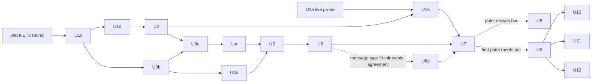

# Typed Decision Models — Implementation Plan, Method Amendments

> **Status:** active · **Owner:** `architect` · **Tracks:** — · **Version:** 1.1 · **Extends:** `docs/plans/typed-decision-models.md` · **Reviews:** `docs/reviews/typed-decision-models2.md`

*2026-10-30 — v1.1: answers review Pass 1, with the note v1.4's chat-timeout and load-rule rulings.*

## 1. Goal & scope

**Goal.** Fold the accepted method note `docs/plans/typed-decision-models-ml.md` (v1.4, "the
note") and the requirements revised on 2026-10-30 (FR-1, FR-4, FR-8, FR-10, FR-11a; AC-1/6/12)
into the build plan, without restating it.

**How to read it.** `docs/plans/typed-decision-models.md` (v1.3, "the base plan") stays
authoritative. This document amends only the base-plan sections and units it names. Where the two
disagree on a named point, this document wins. Everything not named here stands as written.

**In scope.** The note's eleven "Handed to architect" items; two carried impl-review items (U1a-n1,
the `score_answer` hand-off); the pending U1a live probe's follow-up; the replicate rule.

**Out of scope.** The base plan's exclusions. Re-designing U1a/U1b/U3a, which are built and gated
(`docs/reviews/typed-decision-models-impl.md` Pass 1). Changes to them are stated below as deltas to
the built code. The wave-1 fix round (impl review U1b-n1/n2, U1a-m1…m4; m5 is U1e's) is already ledgered
(`docs/plans/typed-decision-models-coordination.md`) and is not re-planned here.

## 2. Context & findings

CPG: considered, not relevant — no `cpg_modelbench` graph exists, and `cpg_falkorchat` is stale (21 commits behind), so the few falkor-chat facts below were read from source.

**Built state (working tree, uncommitted).**
- `fingerprint.py`: `model:decisions` (33 fields: embeddings + `_DECISIONS_ADD`) and
  `model:handoff` (45: decisions + `_HANDOFF_ADD`), in schema 1. No stored record carries either.
- `lmstudio.py`: `DECISIONS_ROUTE = "/v1/decisions"`; `DecisionResult(answers, model, usage,
  wallClockMs)` keeps `usage` verbatim; `decide` refuses a `score` answer only after the POST. The
  decisions `warm_up` returns `LoadResult(..., runtime=None, stats=None)` and **discards the
  answer** (`lmstudio.py:839-846`); its input is the private `_WARMUP_DECISION_INPUT`.
- `scoring/classification.py`: `answer_from_chat` and `score_answer(item_input, answer, outcome,
  timing, *, pack)`, with no `decided_by`/`probability` yet. U3a's golden test pins the old pack.

**Facts the amendments rest on (read, not inferred).**
- `results.ItemTiming`: `wallClockMs` is `None` on an incomplete item, never a partial measurement;
  call exceptions carry no elapsed time (`runner.py:393-398`), so it must come from the item clock.
  `ItemResult.detail` is a free mapping. `stats.Basis` already has `"assumed"`.
- `cli._select_arms --models` keeps one run per key, last wins (`cli.py:209`).
- `residentModelsAtStart` entries are `{id, state}` (`runner._resident_dicts`), captured before the
  warm-up; `fingerprint.modelKey` is the same catalog id. `Pack.seed` is `sampling.seed`.
- `RunConfig.requestTimeoutSeconds` (default 120, `--request-timeout`) is recorded nowhere.
- falkor-chat: `services.read_thread(ctx, *, thread_id)` returns chronological rows
  (`repository.py:726`); the runtime timeouts and failure paths are as note §Q4.3 cites.

## 3. Design amendments

### 3.1 Message-type input (v1.3 §3.2.1, §3.5)

Replaces v1.3's message-only default (note §Q1.5).
- `render_message_type_input(text, prior_turn)` renders the note's §Q1.5 text. `prior_turn` is
  `{speaker, text}` or `None`. When it is `None`, the `PREVIOUS MESSAGE` block is omitted.
- `INPUT_FIELDS_BY_ROLE["message-type-classifier"] = (text, priorTurn)`.
- **The preceding turn**, at runtime and in generated data alike, is the **last** row of the thread
  rows strictly before the message's position, after `_recent_turns`' filter. Its speaker follows
  `_recent_turns`' rule. It may be any role, the agent's included.

### 3.2 Candidate file and decision timeout (v1.3 §3.3)

The candidate JSON gains two required top-level fields:

```json
"decisionTimeoutSeconds": 2.0,
"fit": {"outcome": "below-margin", "qualityTarget": "mcnemar-nonreject"}
```

- `decisionTimeoutSeconds` (finite, > 0) is a `fit.py` input that the fit writes into the
  candidate (note §Q2). The bench uses it for every scored `decide` call and the within-load
  re-check, replacing `requestTimeoutSeconds` on the decisions surface. The warm-up is a declared
  exception to note item 3: it keeps `firstCallTimeoutSeconds`, because it carries the cold load.
  falkor-chat's `timeoutSeconds` copies it verbatim (§3.7).
- `fit.outcome` is one of `within-margin`, `below-margin`, `fit-infeasible: ranking`,
  `fit-infeasible: agreement` or `fit-infeasible: latency` (note §Q2.0, which also gives the
  precedence). `fit.qualityTarget` is closed per bar kind (`BAR_KIND_BY_ROLE`): speed-up
  `D_c<=0` | `mcnemar-nonreject`; new-ability `T=0.94` … `T=0.90` | `max-min-agreement`.
- `Candidate.load` refuses: a missing or ill-typed field (`decisionTimeoutSeconds` NaN, ±inf,
  `bool` or ≤ 0 included); an outcome or quality target outside its set; and a `question.type` of
  `score` (U1a-n1, refused up front rather than as `unrunnable` items).
- **Chat timeout: pinned and recorded (note §Q4.3 "Timeout sources").**
  - `decisions.DECISION_POINT_CHAT_TIMEOUT_SECONDS = 180`, mutation-pinned. On a decision-point
    pack, `run` uses it for every chat call and **refuses up front** (exit 4) an explicit
    `--request-timeout` of any other value: a non-180 run can never carry a verdict, and a guard
    chat arm costs about 5 minutes of shared GPU.
  - `RunResult` gains `requestTimeoutSeconds: float | None = None`, set on every run (`None` only
    on legacy records). As a backstop, a decision-point `compare` refuses arms whose values differ,
    and prints every bar `not assessable (chat timeout ≠ 180 s)` when they agree on another value.
- **Fingerprint delta to built U1b.** `_DECISIONS_ADD` gains `fitOutcome` and `fitQualityTarget`,
  both `nonempty`, so the report reads them from the run record and never from the candidate file.
  `model:decisions` grows to 35 fields and `model:handoff` to 47. This is still additive in schema
  1, because no stored record carries either profile.

### 3.3 Failed calls stay in the run (v1.3 §3.3)

This replaces v1.3 §3.3's whole passage from "A decision-call timeout or failure withholds the
item" to "handled in §3.7": the bench now models the runtime's response to a failure (note
§Q4.3's table is the rule; this section is its mechanics).

**Which failures are kept.** `modelbench/decisions.py` gains a pinned table, mutation-tested like
`BAR_KIND_BY_ROLE`:
`HANDOFF_FAILURE_BY_ROLE = {"guard-judge": "withhold", "join-in-judge": "fail-closed",
"message-type-classifier": "fail-closed"}`. U1c pins its keys to `BAR_KIND_BY_ROLE`'s; U2's
withheld-versus-kept test is its value pin.
- **A decision-call failure** (timeout or failure, any role) is **kept**.
- **A hand-off chat-call failure** is withheld on `withhold` roles, exactly as today
  (`wallClockMs=None`, `withheldFor="timeout"/"no_response"`), and kept on `fail-closed` roles.

**A kept item** gets:
- `ItemTiming(wallClockMs=<item clock at the raise>, calls=<completed calls>, withheldFor=None)`,
  unless residency withholds it for `"load"`. No gap check runs, because its call list is
  incomplete.
- `detail.failedCall ∈ {"decision", "handoff"}`, and no `decidedBy`. It counts as **not handed
  off** in `handoffShare`.
- On a new-ability role, either failure is scored as the fail-closed answer: join-in `no`; message
  type no label, a disagreement for its true class.

**Guard decision failure.** The run cannot know the incumbent's answer, so the item gets
`scoreable={}` and enters the bar only through `decision_stats.pair_items` (§3.6):
- **Cell.** It joins the cell of the incumbent's declared metric for that `itemId`. This is the one
  sanctioned case of a cell taken from the other arm, and it lives in `decision_stats`, not
  `report.py`.
- **Line.** It is concordant (the incumbent's error on both sides). `candidate e₁/n` in the note
  §Q3.4 line is computed over the paired set, so it can differ from the candidate's stored
  aggregate by `decisionCallFailures`.
- **Side check.** A side-check item with a failed decision call is dropped from the side check and
  counted.

**Delta to the `ItemTiming` docstring** (`results.py`, U1d). On the `decisions`/`handoff` surfaces, an
item whose failed call the runtime acts on stores its elapsed wall clock: `withheldFor=None` and
`detail.failedCall` set. No field changes.

**Counts.** The candidate arm's aggregates gain two exploratory metrics beside `handoffShare`:
`BinaryMetric("decisionCallFailures", k, attempted, unit="item")` and, on `fail-closed` roles,
`BinaryMetric("handoffCallFailures", k, attempted, unit="item")`.

**Scorer hook delta to built U3a (U1d owns it).** `classification.score_answer` gains the
keyword-only parameters `decided_by`, `probability` and `failed_call`, each with no default.
`answer` becomes `bool | None`, `None` iff `failed_call is not None`; `failed_call="decision"`
gives `scoreable={}` and `detail.failedCall` on any pack. When all three keywords are
`None`, `detail` is byte-identical to today: `score_item` passes `None` for each, and no
`decidedBy` key is written (U3a's golden test plus a dedicated test). The v1.3 §3.3 Protocol hook
`score_answer` carries `failed_call` too.

### 3.4 Within-load re-check, input tokens, basis (v1.3 §3.3)

- **Basis.** `designEffect=1.0, basis="by-construction"` is **final** for candidate runs (note
  §Q6). v1.3's "provisional" label is dropped.
- **Re-check** (note §Q6).
  - **Delta to built U1a:** `LoadResult` gains `decision: DecisionResult | None = None`, set only by
    the decisions `warm_up`; the default leaves the existing construction sites unchanged.
    `_WARMUP_DECISION_INPUT` becomes public as `WARMUP_DECISION_INPUT`.
  - After the last item, and before `residentModelsAtEnd` is captured, the runner applies note
    §Q6's "Load rule": it probes residency first; if the decision model is absent or any item was
    withheld for `"load"`, it makes no call and records `basis="assumed"`. Otherwise it calls
    `decide(WARMUP_DECISION_INPUT, [question], timeout_s=decisionTimeoutSeconds)`, and an answer
    not exactly equal to the mandatory warm-up's (never a `--warmup N` extra; predicate
    `probability`, choice `choice` and `confidence`), or a raise, records `"assumed"`.
  - On a candidate run, `"assumed"` means "not one load". Its consequences are §3.6's.
- **Input tokens** (note §Q7.7). Every decisions or hand-off item whose decision call returned
  stores `detail.inputTokens = usage["input_tokens"]` when that is an `int`, otherwise `None`.

### 3.5 decision-models/ (v1.3 §3.4)

These amend v1.3 §3.4's bullets. The note's sections are the method.
- **`generation.json`** becomes `{generator: {provider, model}, labeler: {provider, model},
  votesPerItem: 3, labelerTemperature: "provider-default", promptSha256: {generator, labeler,
  rubric}, generatedAt, itemCount, dropped: {voteTie, shingleSplit, shingleSideCheck}}`
  (note §Q1.2). The generator model id must differ from the labeler's, and generation refuses
  otherwise. `labels.labeler` in the imported pack is the labeler.
- **Items** carry `seedId` and `labelVotes`, a map over the whole answer space whose counts sum to 3
  (note §Q1.2). Neither is in `INPUT_FIELDS_BY_ROLE`.
- **Splits** are by `seedId`, with one item per seed in every split and a recorded RNG seed (note
  §Q1.3), sized by note §Q1.3's table. `MIN_EVAL_ITEMS` stays 200 (FR-11).
- **Message-type items** carry `priorTurn` under §3.1's speaker rule, at note §Q1.5's
  opening/follow-up mix, and a `threadPosition` field outside `INPUT_FIELDS_BY_ROLE` for the
  exploratory per-position agreement.
- **Labeling** applies note §Q1.2's >3% vote-tie stop rule before eval is drawn, and writes its
  diagnostics (unanimity, intent agreement) beside `generation.json`.
- **Shingle checks** (note §Q1.3 tokenization, in a new `decisionmodels/shingles.py`).
  - Eval items against train and calibration items, with conditions exempt.
  - Every generated item against the side-check items (note §Q1.4). `decisionmodels/` must never
    read the 85 items, so a human-invoked
    `decision-models/scripts/import_side_check_shingles.py` reads
    `model-bench/packs/guard-judge-understanding/items.jsonl` and writes **only** sha256 hashes of
    its 8-token shingles (over `understanding`/`turns` text) to
    `decision-models/data/guard-judge/side-check-shingles.txt`, with the source SHA in a header
    line. Hashes cannot serve as seeds or examples, and the FR-8 test still scans `decisionmodels/`
    only.
- **Fitting** (`fit.py`):
  - Its inputs include `decisionTimeoutSeconds`.
  - The guard follows note §Q2.1's four-rung ladder and selection key; the new abilities follow
    §Q2.2's ladder.
  - At most five instruction texts are tried, one of them the minimal control (§Q2.3).
  - The split-half stability check follows §Q2.4.
  - It writes `fit` into the candidate (§3.2).
- **Fit report.** `decision-models/data/<role>/<datasetVersion>/fits/<candidateId>.fit-report.json`
  is committed and is **not** copied by the importer. It holds each instruction text's calibration
  AUC, each bar's calibration value and the split-half shifts. It is not the fit manifest, so it
  never enters `fitManifestHash`.

### 3.6 Bar section: replicates, states, lines (v1.3 §3.5, §3.6)

**Replicate group (note §Q6).**
On a decision-point pack, `compare` **requires `--session` and `--models`**; without either it
refuses as a usage error, as for `UnknownModelKey`. Each refusal below is the same usage error.
No arm uses last-wins, since that would be an unrecorded selection on the bars.
- **Arm set.** `--models` names at most one chat arm, which on a speed-up pack must be
  `decisionPoint.incumbent`, plus candidate `armKey`s. The session must hold **exactly one** run of
  the chat arm's `armKey`.
- **Replicate group.** For each candidate `armKey`, **every** run in the session with that
  `armKey`, ordered by `startedAt`. More than one `candidateContentHash` in a group refuses: a file
  edited in place is a different candidate. Grouping by `armKey` and refusing mixed hashes is a
  deliberate, stricter reading of note item 1's grouping by content hash.
- **`cli._replicate_groups(runs, *, session, arm_keys) -> dict[str, ReplicateGroup]`** builds the
  groups. `ReplicateGroup` holds `runs`, `kind: tuple[Literal["load", "same-load", "assumed"],
  ...]`, `loadCount` and `k`. Per run:
  - **`assumed`** (`basis == "assumed"`, note §Q6 "Load rule"): its bars print `not assessable
    (load changed mid-run)`, it is left out of the conjunction and of `loadCount`, and it is to be
    re-run (same hash, K unchanged);
  - **`load`**: the group's first non-assumed run, or one with no
    `fingerprint.residentModelsAtStart` entry whose `id == fingerprint.modelKey`. It counts toward
    `loadCount`;
  - **`same-load`**: any other run. It enters the conjunction (which can only make it harder) but
    not `loadCount`, and prints `replicate i: same load as an earlier run — not counted as a load`.
- **K.** A group's K is v1.3 §3.5's K computed for its **earliest** run. It is printed once per arm
  and used by every replicate's reuse-adjusted limit, so the pair counts once (note §Q6).
- **What `compare_report` gets.** `runs` = the chat arm alone, or empty, so the generic tables
  render their existing fewer-than-two-arms case and no `stats.verdict`/Holm table is computed
  over candidate runs. Candidates arrive only as `replicates: Mapping[armKey, ReplicateGroup]`.
  The existing aggregate-consistency check applies to every replicate; an inconsistent one makes
  its group's bars `not assessable`.
- `rank` and `compare --negative-control` refuse on a decision-point pack.
- v1.3 §3.6's `not assessable: arms from different sessions` is unreachable and is dropped.

**Bar states.** Each bar line, per replicate, is `met`, `not met` or `not assessable (scored n <
200)`. The last applies when the paired scored eval n falls below `MIN_EVAL_ITEMS` (note §Q4.3).
`decision_stats.combine_replicates(states, load_count) -> str` gives the bar's overall state over
the non-`assumed` replicates:
1. All replicates `met` and `load_count ≥ 2`: **met**.
2. Some `met` and some `not met`: **`unstable across replicates — not met`**.
3. Otherwise, any `not met`: **not met**. The conjunction is decided, so replicate 2 may be skipped
   (note §Q2.0).
4. Otherwise: **not assessable**, with the reason: a scored n below 200, or `only N load
   replicate(s) (FR-11a needs 2)`.

`bar_holds` (U1c) is unchanged: it decides one measured value. The states sit above it.

**Pairing and drops.** `decision_stats.pair_items(incumbent, candidate, *, role)` applies note
§Q4.3's table:
- A guard `failedCall="decision"` item is concordant, with `y_i` = elapsed + `x_i` (§3.3).
- Load and guard chat-call withholding drop the item pairwise.
- Every drop is counted per arm and per reason, and the counts print beside each bar.

New-ability points pair nothing, but use the same drop accounting over the candidate run.

**Per-replicate block**, for each candidate arm, after v1.3's caveat, leakage and scored-n lines:
- `replicate i — run <runId>, basis <basis>[, not counted as a load]`;
- `handoffShare`, `decisionCallFailures k/n` and, on new-ability roles, `handoffCallFailures k/n`;
- the FR-1 lines (four cells), in note §Q3.4's exact form. The form carries `U`, `ψ̂`, the MDD,
  the unattainable form (§Q3.3) and, when K ≥ 1, the reuse-adjusted limit (§Q3.5). `p_worse`
  decides; `U` is descriptive;
- the FR-2 line (note §Q4.1), or, on new-ability points, the per-class FR-10 lines (§Q5.1, with
  intervals labelled `per-class 95% Wilson, not simultaneous`, §Q5.2) and the mean-latency line
  (§Q4.2);
- **method minimums, printed and never refused** (note handed item 9): each guard cell's scored n
  beside `method minimum 50`, and each FR-10 class's beside `method minimum 52 (design 60)`;
- the side check (v1.3 §3.5), per replicate.

**After the replicates:**
- the disagreement line, each non-assumed replicate against the first, on final answer and
  `decidedBy`, each `k/n` with Wilson (note §Q6). The denominator is the items with a final answer
  in both; failures and one-sided withholds are counted beside it;
- one overall line per bar (FR-1, FR-2, or FR-10 quality and latency) carrying
  `combine_replicates`' state;
- beside v1.3's reuse line, `fit outcome: <fitOutcome> (quality target <fitQualityTarget>)`, read
  from the fingerprint.

**`decision_stats.py` API** (implements the note only, as v1.3 §3.6 states). Every
decision-shaping argument is required:
- `p_worse(b, c)` (§Q3.1);
- `mdd(n, psi_hat, *, alpha, power_target) -> float | None` (§Q3.3). The reuse-adjusted form
  passes `power_target = 0.8 ** (1 / (K + 1))` (§Q3.5);
- `parity_cell(pairs, *, design_effect, k, alpha) -> ParityLine`, where `ParityLine` carries
  §Q3.4's fields (`e1`, `e2`, `n`, `b`, `c`, `p_worse`, `U`, `psi_hat`, `mdd`, `mdd_reuse`) and the
  cell state;
- `speedup_ratio(x, y, *, seed, B, levels)` (§Q4.1) and `mean_latency(y, *, seed, B, levels)`
  (§Q4.2), with `levels` required as v1.3 §3.6 states;
- `pair_items`; `combine_replicates`.

**Pinned constants**, each citing its section: `FR1_ALPHA = 0.05`, `MDD_POWER = 0.80`,
`MDD_GRID_PP = 0.1`, `BOOTSTRAP_B = 10_000`, `GUARD_CELL_METHOD_MIN = 50`,
`FR10_CLASS_METHOD_MIN = 52`. `decision_stats` never calls `stats.verdict` or `stats.holm_steps`
(§Q3.2).

### 3.7 falkor-chat (v1.3 §3.7)

- **`timeoutSeconds`** is copied verbatim from the measured candidate's `decisionTimeoutSeconds`.
  `SERVER.md` §1.8 says so (U9). With no runtime edge to model-bench, this is documented, not
  enforced.
- **Message type (U11).** `_safe_classify(classifier, ctx, posted)` calls
  `services.read_thread(ctx, thread_id=posted["threadId"])`. It derives `priorTurn` per §3.1 and
  renders it with the U4-pinned renderer. This is one existing QUERIES.md §4 read per classified
  message, off the request thread, with no new query.

### 3.8 Conditional per-label policy

This applies only if U6's message-type fit comes out `fit-infeasible: agreement` (note §Q2.5). It
adds a policy kind, `choice-confidence-per-label {minConfidenceByLabel: {<label>: c}}`, with exactly
the pack's label set as keys. The result is a **choice** iff `confidence ≥ c[choice]`. This is
unit U6a (§4.2).

## 4. Units

The U0 questions are all answered, so none of v1.3's "U0 Qn" gates remain.

### 4.1 Amended briefs

Each brief below **adds to** the v1.3 brief for the same unit.

- **U1c.**
  - `Candidate.load` with the §3.2 validations, `score` refusal included.
  - `HANDOFF_FAILURE_BY_ROLE`, `guard-judge` row only, keys pinned to `BAR_KIND_BY_ROLE`.
  - `DECISION_POINT_CHAT_TIMEOUT_SECONDS`.
  - The `apply-policy.jsonl` rows unchanged.
- **U1d.**
  - §3.2's fingerprint delta (`fitOutcome`, `fitQualityTarget`), with the U1b pins and the
    stored-records test updated.
  - §3.3's `score_answer` delta to `classification`, its `failed_call` branch included, with the
    test that the old pack writes no `decidedBy`; the `ItemTiming` docstring delta.
  - §3.2's chat-timeout pin and `--request-timeout` refusal in `run`, and
    `RunResult.requestTimeoutSeconds` on every run.
  - §3.3's kept decision-call failure on the `decisions` surface, with `decisionTimeoutSeconds` as
    its timeout.
  - §3.4's `LoadResult.decision`, the load rule with its residency probe, the re-check and
    `basis`, and `detail.inputTokens`.
  - `decisionCallFailures`.
  - The basis is no longer provisional, which the unit's `HISTORY.md` entry states.
- **U2.**
  - The hand-off chat-call failure per `HANDOFF_FAILURE_BY_ROLE`; `handoffCallFailures`.
  - The re-check and `inputTokens` on the `handoff` surface.
- **U3b.** Adds only the decision-point declared metrics; the `failed_call` branch is U1d's.
- **U3c.**
  - `decision_stats.py` per §3.6, with its pinned constants.
  - `cli._replicate_groups`, the §3.6 arm rules and refusals (including `rank`,
    `--negative-control` and the timeout mismatch), and the group K.
  - The per-replicate block, the states, the disagreement line, the fit-outcome line and the
    method-minimum prints, for the speed-up side.
- **U3d.** The importer copies the candidate (now carrying `fit`) and the manifest. It never copies
  the fit report.
- **U4.**
  - §3.1's renderer, `INPUT_FIELDS_BY_ROLE` row and vectors. `render-message-type.jsonl` covers
    `priorTurn` null, an agent speaker, and the 400/2000 cuts.
  - The two new `HANDOFF_FAILURE_BY_ROLE` rows.
  - Fail-closed scoring in `agreement.py`.
  - The FR-10 per-replicate lines, `not assessable`, and the class minimum.
- **U5.** §3.5's `generation.json`, `seedId`, `labelVotes`, seed-level splits, message-type
  `priorTurn`/`threadPosition`, the vote-tie stop rule and diagnostics, `shingles.py`, and
  `scripts/import_side_check_shingles.py`. All drop counts are recorded.
- **U6.** §3.5's fitting and fit report.
  - Every candidate produced is imported and measured, whatever its `fit.outcome` (FR-4).
  - If message type comes out `fit-infeasible: agreement`, U6a runs before that point's U7.
- **U7.** This replaces v1.3's U7 procedure. Per point, in **one** `--session`:
  1. the incumbent chat arm (speed-up), or the hand-off LLM's chat arm as a reference (new
     ability);
  2. per candidate (decision-model-only and hand-off alike), replicate 1;
  3. before **each** candidate's replicate 2, unload the decision model only and confirm it is gone
     with `lms ps`. Replicate 2 may be skipped if `compare` already shows `not met` for replicate 1.
     Any `assumed` run is re-run the same way;
  4. `compare --session … --models …` stored in `model-bench/reports/`.

  **Closure records are per point.** When a point closes or goes to U8, its one v1.3 test report
  carries every measured candidate's replicate block and fit-outcome line. A candidate that misses
  on a point another candidate meets gets a `model-bench/docs/HISTORY.md` line only.
- **U9.** `SERVER.md` §1.8 states the `timeoutSeconds` copy rule. `apply_policy` covers the per-label
  kind only if U6a has landed.
- **U11.** §3.7's preceding-row read. A test checks that a message posted after the classified one
  is not its `priorTurn`.

### 4.2 New units

- **U1e — probe follow-up** (`tdd-engineer`; needs the human-approved U1a live probe).
  - Replace `tests/fixtures/lmstudio/decisions_response.json` with the probe's raw body, and drop
    `_provenance` (impl review U1a-m5).
  - Record Laya's observed per-question context limit in `model-bench/docs/HISTORY.md`.
  - **If `/api/v0/decisions` exists and returns `stats`/`runtime`:**
    - switch `DECISIONS_ROUTE`;
    - make the decisions `warm_up` return `runtime`, and call `_runtime_identity` on the decisions
      and handoff surfaces, not only on `chat`;
    - add `runtimeName`/`runtimeVersion` to `_DECISIONS_ADD` (inherited by `model:handoff`),
      populate them in `runner._build_fingerprint`, and flip the U1b pins that list them as
      forbidden on both decision profiles;
    - keep `check_attestation_staleness` fed by chat runtimes only, so decision runtimes never trip
      it.
  - **Ordering.** U1e follows U2 (§4.3), and must land before any `model:decisions` or
    `model:handoff` record exists in `model-bench/results/runs/`, whether from U7, a smoke
    `run --candidate` or a live U2 check. `test_every_stored_run_record_still_validates_unchanged`
    is the check that enforces it.
- **U6a — per-label `minConfidence`** (conditional, §3.8; `tdd-engineer`).
  - model-bench: `decisions.py` policy kind and validation, with new `apply-policy.jsonl` rows
    (`confidence == c[label]`, a label missing from the map is refused).
  - decision-models: the `fit.py` per-label search.
  - falkor-chat: the copy if U9 has landed.
  - The id is scoped to this plan. K-030's unrelated `U6a` lives in `claude/`.

### 4.3 Order and routing



- **Serialize** the units that share files:
  - `runner.py`: U1d → U2 → U1e;
  - `report.py`: U3c → U4;
  - `decisions.py`: U1c → U6a.
- **Traceability delta** (v1.3 §7):

  | FR / AC | Now also satisfied by |
  |---|---|
  | FR-1 / AC-1 | §3.3 guard failure pairing, §3.6 FR-1 lines and states; U1d, U3c, U7 |
  | FR-2 / AC-6 | §3.2 chat-timeout pin, §3.6 per-replicate ratio; U1d, U3c, U7 |
  | FR-4 | §3.2 `fit`, §3.6 group K, every candidate measured once; U6, U7 |
  | FR-10 / AC-12 | §3.3 fail-closed scoring, §3.6 per-replicate FR-10 lines; U4, U7 |
  | FR-11a | §3.4 load rule, §3.6 replicate groups, `combine_replicates`; U1d, U3c, U4, U7 |

- **Routing** is as in v1.3 §4. U1e and U6a go to `tdd-engineer`. Each gets an `analyst` code gate.
  Any gate on U3b, U5, U6, U6a or U9–U12 runs the cross-component equality tests un-skipped (v1.3
  R-10).

## 5. Test strategy additions

These rows add to v1.3 §5. The note's figures (§Q3.3 MDD table, §Q3.6, §Q5.3, §Q5.4) are
re-derived from the formulas, never from the note's scripts.

| Unit | Behaviour |
|---|---|
| U1c | `Candidate.load` refuses each of: a `score` question; a missing, non-positive, NaN, ±inf or `bool` `decisionTimeoutSeconds`; an unknown `fit.outcome`; a `fit.qualityTarget` from the other bar kind; a missing `fit`. Shrinking or widening `HANDOFF_FAILURE_BY_ROLE`'s keys reddens; mutating the 180 pin reddens. |
| U1d | The old pack's `score_item` writes no `decidedBy`, `probability` or `failedCall` key (U3a golden plus a dedicated test). A decision timeout gives a kept item: `wallClockMs` ≈ the injected clock, `withheldFor=None`, `failedCall="decision"`. |
| U1d | A re-check that returns a different `p`, or that raises, gives `basis="assumed"`; an equal one gives `"by-construction"`. A `withheldFor="load"` item, or the model absent at the end probe, gives `"assumed"` with **no** re-check call. On a decision-point pack, `run --request-timeout 120` refuses with exit 4; no flag runs at 180; every run records `requestTimeoutSeconds`, and a legacy record loads it as `None`. `inputTokens` is copied from `usage`, and is `None` when `usage` is absent. The new fingerprint fields are pinned, and the stored-records test stays green. |
| U2 | A guard hand-off timeout is withheld (`wallClockMs=None`). A join-in-fixture hand-off timeout is kept, with `failedCall="handoff"` and `calls` holding only the decision call. Both failure counts equal the injected failures. |
| U3c | `p_worse(5,0) = 0.03125`. `mdd` reproduces note §Q3.3's n = 50/100 rows and returns `None` below n = 5. The reuse-adjusted values at K = 1…3 reproduce §Q3.5. The guard decision-failure item pairs as concordant (`b`, `c` unchanged; `n_c` + 1). `combine_replicates` covers met/met, met/not met → unstable, not met/skipped → not met, met alone → not assessable (1 load), and met/met with the second resident at start → not assessable. |
| U3c | `compare` without `--session` refuses. Two content hashes in one group refuse. Two incumbent runs in one session refuse. A chat arm and a replicate with different `requestTimeoutSeconds` refuse; equal at 120 (or `None`) prints every bar `not assessable (chat timeout ≠ 180 s)`. No `--models`, `rank`, and `--negative-control` each refuse. |
| U3c | An `assumed` replicate prints `not assessable (load changed mid-run)` and is left out of the conjunction and the load count; met + assumed + met (fresh load) gives met. Interleaved D1, H1, D2, H2 gives D one K, equal to D1's, on both replicates. A guard decision failure lands in the incumbent's cell; a side-check one is dropped and counted. Scored n = 199 prints `not assessable (scored n < 200)`. |
| U4 | Note §Q5.4's worked example gives `escalation` not met, so FR-10 is not met. A message-type hand-off failure is scored as a disagreement. The message-type render vectors pass. |
| U5 | Generator id equal to labeler id is refused. Every split holds one item per `seedId`. An eval item sharing an 8-token shingle with a calibration item is dropped and counted, and a shared condition sentence is exempt. A side-check-shingle hit is dropped and counted. `decisionmodels/` never opens a `model-bench` path. |
| U6 | On a fixture calibration set, note §Q2.1's key picks (2,0) over (3,1) and (19,16). Each ladder rung yields its `fit.outcome`. The fit report is written and is not in the manifest. |
| U11 | `priorTurn` is the filtered row immediately before the message. With none, the block is omitted. |

## 6. Risks & open questions

**Questions for the stakeholder:** none open. The replicate rule, the labelling volume and the
rule that an infeasible fit is still measured are settled (requirements decision log, 2026-10-30).

**Risks** (in addition to v1.3 §6):
- **R-11: the load evidence depends on the operator.** If LM Studio keeps the decision model
  resident (TTL, JIT), replicate 2 does not count as a load, and the bar prints `not assessable`,
  never a false `met`. U7's step 3 makes the unload explicit before each replicate 2. The
  fixed-input re-check can miss a reload that leaves its one `p` unchanged (note §Q6).
- **R-12: descriptive latency mixes in kept failures.** On the decisions and handoff surfaces,
  `LatencyBlock`'s percentiles include kept-failure elapsed times. For a guard decision failure,
  that is the decision part only. The bar lines use `decision_stats`' pairing, which adds `x_i`, so
  only the descriptive block is affected.
- **R-13: silent context truncation.** The 512-token figure is from an unverified model card (note
  §Q7). `detail.inputTokens` makes truncation countable after the fact. U1e records the probed
  limit.
- **R-14: U1e is late.** If any decision-profile record is stored before U1e, its runtime fields
  would need a schema-2 bump (§4.2's ordering). If the probe is never approved, U1e reduces to
  nothing and U7 proceeds on `/v1`. teco owns that call.

## 7. Ready to implement

Plan: `docs/plans/typed-decision-models2.md`, which extends `docs/plans/typed-decision-models.md`.
Read v1.3 for the base design, then this document for the units it names.
- **Next unit:** U1c, after the wave-1 fix round; order and new units in §4.3 and §4.2.
- **Stated once here:** candidate and fingerprint additions §3.2; kept failures §3.3; re-check §3.4;
  decision-models mechanics §3.5; replicate group, bar states and `decision_stats` API §3.6.
