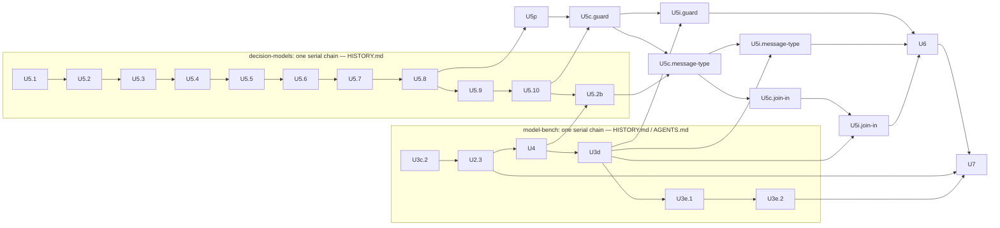

# Typed Decision Models — Implementation Plan, Subagent Labelling Amendments

> **Status:** active · **Owner:** `architect` · **Tracks:** — · **Version:** 1.2 · **Extends:** `docs/plans/typed-decision-models3.md` · **Reviews:** `docs/reviews/typed-decision-models4.md`

*2026-10-31 — v1.2: answers review Pass 2; note citations move to v1.9.*

## 1. Goal & scope

**Goal.** Absorb "Handed to architect" items 7–11 of `docs/plans/typed-decision-models-ml.md` v1.9
("the note"): generation and labelling run by Claude Code subagents through file exchange, with
the guard pilot, its stakeholder decision and the per-cell design effect. It also rules impl
review P8-m2 (between-item probe failures, `model-bench/docs/BACKLOG.md`).

**How to read it.** v1.3, plan2 and plan3 stay authoritative. Each section names what it amends;
where they disagree on a named point, this document wins. The note's §Q1.2, §Q1.3 and §Q6 are the
method and are cited, not restated. The stakeholder inputs are the requirements decision log's
2026-10-31 entries: no API key, opus generates and sonnet labels, full sizes with the pilot first,
spent point by point.

**Void.** v1.3 §3.4's `labeler.py`, its `ANTHROPIC_API_KEY` bullet, v1.3 U5's live `-m live` test,
and v1.3 §6's API assumption. Nothing in `decision-models/` calls a hosted API.

**Out of scope.** U6's fitting and everything plan3 rules. The method (vote rule, sizes, screen
threshold, ICC) is the note's and is not reopened.

## 2. Context & findings

CPG: considered, not relevant — no `cpg_modelbench` graph is loaded and `decision-models/` does not exist yet; the model-bench sites below were read from source.

- **Transcripts** (recorded by 2.1.314; the installed binary is 2.1.316, and the audit records
  the executing version per run). A subagent run is
  `~/.claude/projects/<slug>/<session>/subagents/agent-<id>.jsonl` plus `.meta.json`
  (`agentType`, `toolUseId`). `toolUseId` is the id of the parent session's `Agent` `tool_use`
  in `<session>.jsonl`, whose input holds `prompt` and `subagent_type`. Conversation entries
  carry `cwd` (`api-request-*` entries do not). The first `user` entry is the spawn prompt.
  Attachments include `instructions`, `session_context`, `mcp_instructions_delta`,
  `deferred_tools_record` and `hook_success` (with `toolUseID`). `api-request` entries carry
  `params.thinking` and `params.output_config.effort`. **One assistant message spans several
  entries sharing a `message.id`; their `usage` can differ, and the last entry's is final.**
  `<synthetic>` entries are `error: "rate_limit"`, `error: "authentication_failed"`, or a
  non-error placeholder.
- **Read tool.** A Read over 25,000 tokens fails and returns nothing; a single long line cannot
  be paged. Live probe (review Pass 2): 61,847 characters of pt-BR chat text were 31,020 tokens,
  about 2.0 characters per token.
- **Subagent frontmatter** (`code.claude.com/docs/en/sub-agents`, 2026-10-31). `tools` is an
  allowlist that excludes MCP tools unless listed. `model` takes a full id. `effort` is overridden
  by an `Agent` call's own `effort`, and both by `CLAUDE_CODE_EFFORT_LEVEL`. `omitClaudeMd` drops
  CLAUDE.md files (not managed-policy files). Hook input carries `agent_type`; the main agent's
  frontmatter hooks also fire inside its subagents. Frontmatter `hooks` fire
  **only in a trusted folder**. `Agent(a, b)` restricts what a `claude --agent` main agent may
  spawn. Project agents are found by walking up from the working directory.
- **model-bench.** `decision_stats.parity_cell(pairs, *, design_effect, …)` takes pairs
  `(candidate errs, incumbent errs)` and applies `design_effect` to the limits only.
  `decision_stats.PairedItems.outcomes` holds those pairs ordered by `itemId` but **without the
  ids**, and `report.DecisionPointPack` maps `itemId` only to `stratum`. U3c.2 (in
  flight) passes `run.designEffect` to it from its per-replicate renderer (`report._render_replicate`
  in the working tree). `compare_report` takes the max run-level `designEffect`.
  `stats.Basis` is closed. `packs.validate_pack` reads `labels.labeler.model`; the bar section
  reads `labels.labeler.provider` and `.model` for the caveat. Item keys are open.
- **Between-item probes.** `residency()` is called unguarded before each item in
  `runner._drive_single_call_items`, `_drive_decision_items` and `_drive_handoff_items`, and after
  each conversation in `_turn_timings`. `_within_load_basis` already maps the same three failures
  (`LMStudioUnreachable`, `LMStudioCallFailed`, `TimeoutError`) to `"assumed"`.
- **Probe and surfaces.** `probe()` returns `"api-v0"`, `"v1-only"` or `"unreachable"` and never
  raises. `run_pack` calls it once, at step 2, where anything but `"api-v0"` raises
  `RunRefused(exitCode=3)`. On the `decisions` and `handoff` surfaces a failed call is a kept item
  whose `withheldFor` comes from `_load_withheld_for(…, resident)`.

## 3. Design amendments

### 3.1 Layout and where the agent definitions live (v1.3 §3.4 tree)

`decision-models/` does not exist yet. `labeler.py` leaves v1.3's tree; these join it:

```
decision-models/
  agents/        dm-generator.md · dm-labeler.md · dm-driver.md · spawn-generator.txt ·
                 spawn-labeler.txt · guard_hook.py · settings.json      (sources, installed per campaign)
  decisionmodels/
    seeds.py     # note §Q1.1 seeds and design strata
    exchange.py  # request writer, closed schemas, answer parser (§3.2)
    audit.py     # transcript audit and void classes (§3.3)
    ingest.py    # ingester (§3.3)
    campaign.py  # append-only ledger, batch states, phases, top-up planner (§3.5, §3.6)
    driver.py    # CLI: install · init · next · ingest · resolve · status · finalize
    labels.py    # majority, labelVotes, message-type tranche
    screen.py    # generated-text screen (§3.6)
    diagnostics.py · pilot.py
```

**The agent definitions live in `decision-models/agents/`, not `claude/` or `.claude/agents/`.**
- They are dataset provenance: hashed into `promptSha256`, changed only with a dataset version.
  `claude/`'s rules (kaizen, catalogs, `cobb` promotion) govern team agents and do not apply.
- A repo-level `.claude/agents/` copy would make `dm-labeler` spawnable from any repo session,
  whose injected context is the one the note forbids.
- `driver install` byte-copies them into the campaign's `exchange/.claude/agents/`, and
  `settings.json` into `exchange/.claude/settings.json`, checking hashes. So the only session that
  can discover them is the driver session.
- **Authoring.** `coder` writes them in U5.7: the content is this plan's protocol, pinned by U5's
  tests. `cobb` is consulted at U5.7's gate because the frontmatter semantics are
  version-sensitive (trust-gated hooks, the effort override); it neither authors nor promotes.

### 3.2 Requests and answers (note §Q1.2 "Blind", "Batches")

- **Request file** `exchange/req/<opaque>.jsonl`, JSON Lines so that Read can page it:
  - line 1, the header: `{"schema": "dm-request/1", "role": "generate"|"label", "point",
    "answerPath", "bodySha256", "pages": [[offset, limit], …]}`;
  - line 2: `{"rubric"}` (labelling) or `{"instructions"}` (generating);
  - then one line per item: `{"key", "text"}`, where `text` is the item's §3.2 rendering from
    `render.py`; or one line per seed: `{"key", <the point's seed axes>}`. Seeds only (note §Q1.4).
  - Every line is a closed key set. `validate_request` refuses any other key, and the writer runs
    it before writing.
  - `bodySha256` is sha256 over the canonical JSON of the body `{"rubric"|"instructions",
    "items"|"seeds": [...]}` (`sort_keys=True`, `separators=(",", ":")`, `ensure_ascii=False`,
    UTF-8). It is independent of the file layout.
- **Paging, by a character budget.** The writer cuts lines 2… into pages of at most **40,000
  characters** of written text (after JSON escaping) and lists them in the header's `pages`. Page 1
  is `[1, 1]`, the header itself.
  - At the measured 2.0 characters per token (§2), 40,000 characters is about 20,100 tokens,
    under Read's 25,000-token cap.
  - At the 6,000-character render cap (about 6,210 characters escaped), a page holds 6 items,
    so 50 items are 9 pages plus the header page.
  - A batch is cut at the cap **or** at `P_max` pages, whichever comes first; `P_max` is 10 for
    labelling and 2 for generation. Overflow items go to the next batch of that vote.
  - The spawn template says how to page (§3.4), so the first Read is the index, never a failure.
- **Keys.** 10 characters of base32 from `secrets`, random per (item, vote) and per seed, unique
  across the campaign and redrawn on collision. A rerun gets fresh keys and a new opaque name.
- **Answer.** `exchange/ans/<opaque>.jsonl`, or parts `<opaque>.<k>.jsonl` (k = 1, 2, …) when one
  Write would be too long. Ingest concatenates the parts in order.
  - Line 1 is `{"bodySha256": …}`, copied from the header.
  - Then one line per key: `{"key", "answer"}` when labelling (`answer` in the point's `expected`
    vocabulary), or `{"key", "item"}` when generating (`item` is exactly the point's input fields,
    per `points/`).
  - The generator template forbids commentary outside the input fields.
- **One request at a time.** The driver writes a request only when it is about to be spawned. On
  ingest, or before any re-issue, it moves the request and every answer part to `store/`. So
  `exchange/` never holds another batch, a seed, or an earlier vote's answer.

### 3.3 Ingester and audit (note §Q1.2 "Ingest audit", "Reruns")

**Locating the run.** The audit never uses what it checks to find a run.
1. `driver ingest` reads the driver session's own transcript (`<slug>/<session>.jsonl` for the
   exchange directory) for the `Agent` `tool_use` whose `input.prompt` contains the request's
   opaque path.
2. It finds the `subagents/agent-<id>.meta.json` whose `toolUseId` equals that `tool_use`'s id, and
   reads `agent-<id>.jsonl`.

| Check | Class |
|---|---|
| no such `tool_use` | never spawned: re-issue, no attempt; the 2nd for one batch halts (driver) |
| a `tool_use` but no subagent transcript, or more than one | driver: halt |
| the driver transcript holds no `tool_result` for the `tool_use`, and the subagent transcript no `<synthetic>` (the driver session died mid-run) | incomplete: re-issue, no attempt; the 2nd for one batch halts (driver) |
| first `user` message ≠ the role's spawn template with the request path substituted | driver: halt |
| the `tool_use` input carries `model`, `effort`, `isolation` or `run_in_background`, or a `subagent_type` other than the role's | driver: halt |
| `.meta.json` `agentType` ≠ the role's (so never `fork`) | environmental: halt |
| any `message.model` ≠ the pinned id, outside `<synthetic>` entries | environmental: halt |
| `effort` ≠ the role's pin, with the `tool_use` carrying no `effort` (so the env var overrode it) | environmental: halt |
| `instructions` ≠ the declared set (§3.5), by path and sha256 | environmental: halt |
| any `mcp_instructions_delta` attachment, any `mcp__` name in `deferred_tools_record`, or a `gitStatus` key in `session_context` | environmental: halt |
| a tool use with no `hook_success` entry for its `toolUseID` (hooks inactive, e.g. an untrusted folder) | environmental: halt |
| a `hook_success` whose decision is `deny` | run-attributable |
| a `tool_result` is present but the run stopped at `maxTurns` (shape recorded by U5.7's smoke) | run-attributable (it finished and failed) |
| `<synthetic>` with `error` other than `rate_limit` (e.g. `authentication_failed`) | environmental: halt |
| `<synthetic>` with `error: "rate_limit"` | usage stop: re-issue next window, no attempt |
| a tool other than `Read`/`Write`, or a path other than its own request and answer parts | run-attributable |
| answer missing, `bodySha256` absent or ≠ the recomputed hash | run-attributable |
| a key missing, duplicated or unknown; an answer out of space; malformed JSON | run-attributable |
| a generated item hits the screen (note v1.9 §Q1.2 "Hits") | per seed, not a run void (§3.6) |

- A `<synthetic>` entry with no `error` is ignored.
- **Precedence** when several rows match: halt, then re-issue with no attempt, then
  run-attributable.
- **No-attempt caps.** "Never spawned" and "incomplete" are capped at one re-issue per batch; the
  second occurrence halts, so no batch loops. Usage stops are uncapped: they wait for the next
  window and spend nothing meanwhile.
- **Run-attributable** voids count. The batch is re-issued with fresh keys. A batch with 2 counted
  attempts is re-issued; after 3, its items or seeds drop as `retryCapExceeded`.
- **Halt** writes `halted` with the reason. `next` then refuses until a human runs `driver resolve
  --decision <text>` with at most one of `--repin-instructions` or `--repin-model <role> <id>`.
  A model re-pin is the stakeholder's call (note §Q1.2).
  - A **labeler** re-pin follows the same rule; its ledger event is `labelling-restart`.
  - A **generator** re-pin follows note v1.9 §Q1.2 "Reruns"; `resolve --repin-model generator`
    writes a `generation-restart` ledger event.
- **Idempotence.** Re-ingesting an ingested batch whose answer bytes hash the same is a no-op. A
  second, different answer to an ingested request is refused and changes nothing.
- The `session_context` sha256 is recorded per run (§3.7).

### 3.4 The three agent definitions

| | `dm-generator` | `dm-labeler` | `dm-driver` |
|---|---|---|---|
| `model` | `claude-opus-5-5` (full id) | `claude-sonnet-5-5` (full id) | session default |
| `effort` | `medium` | `high` | — |
| `tools` | `Read, Write` | `Read, Write` | `Agent(dm-generator, dm-labeler), Bash` |
| `maxTurns` | `P_max + 4` = 6 | `P_max + 4` = 14 | — |
| other | `omitClaudeMd: true`, `permissionMode: acceptEdits`, `hooks.PreToolUse` → `guard_hook.py` | same | `hooks.PreToolUse` → `guard_hook.py`; `initialPrompt` starts the loop |

- `maxTurns = P_max + 4`: one Read per page (§3.2, the header page included), up to three answer
  Writes, and the reply.
- **`guard_hook.py`** (stdlib) **always exits 0** and prints `{"hookSpecificOutput":
  {"hookEventName": "PreToolUse", "permissionDecision": "allow"|"deny",
  "permissionDecisionReason": …}}`. That is the form this repo's `claude/scripts/guard-*.sh` use,
  and it is recorded in `hook_success`. It never uses exit 2. It logs every call to
  `store/hook-log.jsonl` with `agent_type` and the tool-use id, and decides `deny` for:
  - for `dm-generator`/`dm-labeler`: a `Read` outside `exchange/req/`, a `Write` outside
    `exchange/ans/`, and any other tool;
  - for `dm-driver`'s `Bash`: any command whose `shlex` argv is not exactly the venv's
    `python -m decisionmodels.driver` plus one subcommand from `{next, ingest, status}`, or that
    contains a shell metacharacter;
  - for `dm-driver`'s `Agent`: a `subagent_type` other than the two; a `prompt` other than the
    ledger's pending spawn prompt; any `model`, `effort`, `isolation` or `run_in_background` key.
  - It prevents; the audit verifies (§3.3). It keys on `agent_type`, because the driver's hooks
    also fire inside its subagents.
- **Spawn templates.** One fixed text per role with a `{request_path}` slot: "Read
  {request_path} with offset 1, limit 1. Its `pages` field lists [offset, limit] pairs: read each
  remaining page with exactly that offset and limit. Follow the instructions on line 2, write the
  answer where the header says, then reply `done`."
- **No MCP tool** in any allowlist (FR-8, note §Q1.2).
- `promptSha256` covers each definition, each spawn template, the rubric, each request template
  and `guard_hook.py` (§3.7).

### 3.5 The run driver

**Which session.** A dedicated interactive session running as `dm-driver` in the campaign's
`exchange/`, outside the repo. It sees only `driver next`'s output (action, agent type, spawn
prompt), never a seed, intent or label. `teco` never spawns these runs: its working directory is
the repo, whose injected context the note forbids.

**How it starts: human-started, once per usage window.**

```
cd <campaign>/exchange && claude --agent dm-driver --strict-mcp-config \
  --mcp-config <campaign>/exchange/empty-mcp.json --permission-mode acceptEdits
```

- The first start in a campaign answers the folder-trust prompt; until then hooks are skipped
  and the audit halts (§3.3).
- **The loop:** `next` → spawn one foreground subagent → `ingest`, repeated until `next` returns
  `stop`. That happens when the phase is done, on a halt, or on a usage stop.
- It is stateless (state is in `store/ledger.jsonl`), so compaction or a dead session loses
  nothing. Unattended starts across windows are out of scope (§6, Q-1).
- `init`, `install`, `resolve` and `finalize` are run by a human from an ordinary shell, never by
  the driver session (§3.4's closed subcommand set).

**Campaign.**
- `driver init --point <role> --phase smoke|pilot|full --root <dir>` refuses a root inside a git
  work tree, or under any ancestor holding `CLAUDE.md`/`AGENTS.md`.
  - `smoke` takes `--fixture <items.jsonl>`: one label batch, no seeds, nothing kept (U5.7).
  - `full` refuses unless the guard pilot's report carries a recorded stakeholder decision
    (§3.8). For message type, guard's campaign must already be finalized; for join-in, message
    type's must be.
- It creates `exchange/`, holding `.claude/agents/` (the installed definitions),
  `.claude/settings.json` (allowing the driver command) and `empty-mcp.json`. It also creates
  `store/`, holding seeds, keys, answers, the ledger and the hook log.
- **Declared expectations, written at `install`**, never learned from a run: an empty
  `instructions` set for both subagents, no MCP attachment, no `gitStatus`, and the effort pins.
  §3.3's rows compare against them.

**Batch states**, folded from the append-only ledger (one fsync'd JSON line per event):
`pending → issued → ingested`, with `void` (re-issued as a new batch attempt) and `halted`.
- **On start, `next` reconciles first:** each `issued` batch is ingested, which applies §3.3's
  never-spawned, incomplete and usage-stop rows.
- `next` never returns an `ingested` batch.

### 3.6 Generation runs, labelling rounds and top-up (plan2 §3.5 "Labeling"; note §Q1.2–§Q1.3)

Each bullet names its owning unit (§4.1).
- **Generation runs (U5.8).** Seeds are shuffled and cut into runs of 25, so each run spans the
  point's design strata (note §Q1.3). Each run gets `genRunId`, unique in the dataset version.
  Every item it yields records that `genRunId` and the round's `genRound` (1 for round 1, 2+ for
  top-ups). Round 1 draws ⌈1.1 × target⌉ seeds, where the target is eval + calibration per note
  §Q1.3's table.
- **Generated-text screen (U5.8),** at generation ingest. The rules (hit tokens and meta
  positions, regeneration, drop, halt, `genRound`/`genRunId` of a regenerated item) are note v1.9
  §Q1.2 "Generated-text screen", "Hits" and "On a hit". The mechanism:
  - `screen.py`, a pure function over the rendered evidence fields, returns the hit reason or
    `None`. Its token lists come from `points/` (U5.3), and seed-axis ids are minted in a
    non-word form (`dom_07`).
  - A hit queues the seed in the ledger (`screen-hit` event). Regeneration batches are ordinary
    generation runs over queued seeds.
  - Drops are counted in `dropped.screenHits`. The round halt is a `template` halt.
- **Votes (U5.8).** For each (round, vote), the round's items are reshuffled with a fresh recorded
  RNG seed and cut into batches of at most the cap (50, or 25 if the pilot sets it) and at most
  `P_max` pages (§3.2). Votes run
  vote-major. `labels.py` takes the majority, writes `labelVotes` (summing to 3), and drops a
  choice item with three distinct labels as `voteTie`.
- **Message-type tranche (U5.9).** Round 1's labelling starts with 250 round-1 items drawn at
  random; all three votes complete before the rest. If `100·drops > 3·250`, the driver halts with
  a rubric halt; the fix is a recorded `resolve`, and the tranche is relabelled under the new
  rubric hash.
  - `finalize` rechecks the rule over the whole point. On failure it halts, and after the rubric
    fix the whole point is relabelled with all three votes. A second failure is a halt that
    `resolve` refuses to clear without `--stakeholder-ref` (note §Q1.2 "Majority of three blind
    votes").
- **Top-up planner (U5.9),** in `campaign.py`, after a round is labelled:
  - A cell is (label × design stratum): guard's evidence kind, none for the other points.
  - It finds short cells. Per short design stratum `s` it draws `max over its short cells ℓ of
    ⌈shortfall_ℓ / P̂(ℓ | s)⌉` new seeds from the **same design restricted to `s`**, with
    `P̂` from labels so far.
  - The sampler's signature takes `(design stratum, count, rng)` and nothing that names a label
    or intent.
  - A top-up run pools all of the round's short strata. Rounds repeat until every cell fills.
  - **Spend halt** per note v1.9 §Q1.3 "Spend halt": a pure `campaign.project_topup(...)` from the
    point's own round-1 ledger totals, compared before a top-up round is issued. Tokens on both
    sides are the four-class sum of §3.7. The driver halts with a `spend` halt, and `teco` takes
    the projection to the stakeholder.
  - **A stakeholder "no"** is `resolve --decline-topup`. `finalize --short` then applies note
    §Q1.3 "On a stakeholder 'no'": it fills eval cells first, and either finalizes with every n
    printed or refuses, leaving the store intact for a later round.
- **Cells, then splits (U5.10),** in `finalize`, amending plan2 §3.5's splits:
  - The side-check shingle drop runs first, on every generated item (note §Q1.4).
  - Each cell is then subsampled at random to its target; surplus items stay unused and counted.
  - Splits are assigned within each cell by `seedId`.
  - The eval-against-train/calibration shingle drop comes last and is counted. Nothing is
    refilled; the note's floors absorb it, and the printed n shows it.
- **Diagnostics (U5.9),** written by `diagnostics.py` to `diagnostics.json` beside
  `generation.json`: note §Q1.2's four, round 1 against top-up per cell on intent-label agreement
  and pair agreement, and screen hits by intent and difficulty.

### 3.7 `generation.json` and items (plan2 §3.5 amended)

```
{generator: {surface: "claude-code-subagent", tier: "opus", model, effort},
 labeler:   {surface: "claude-code-subagent", tier: "sonnet", model, effort},
 votesPerItem: 3, labelerTemperature: null, labelBatchCap,
 promptSha256: {agentDefinition: {generator, labeler, driver}, spawnTemplate: {generator, labeler},
                requestTemplate: {generator, labeler}, rubric, guardHook},
 generatedAt, itemCount,
 dropped: {voteTie, shingleSplit, shingleSideCheck, screenHits, retryCapExceeded: {seeds, items}},
 runs: [{runId, role, batchId, attempt, status: "ingested"|"void"|"usage-stop"|"incomplete",
         voidClass, voidReason, claudeCodeVersion, agentId, model, requestSha256,
         instructions: [{path, sha256}], sessionContextSha256, thinking, effort,
         tokens: {input, cacheWrite, cacheRead, output}}]}
```

- `model` comes from the transcript's `message.model`, never the tier alias. Generation still
  refuses equal generator and labeler ids. `labels.labeler` in the imported pack is the labeler.
- `tokens` sum, per `message.id`, the `usage` of the **last** entry carrying that id (§2).
- **Items** gain `genRunId` (string) and `genRound` (int ≥ 1). Like `seedId` and `labelVotes`,
  they stay outside `INPUT_FIELDS_BY_ROLE`. `genRunId` replaces v1.3 §3.4's "hash of the generator
  call": the run's `requestSha256` is in `runs[]`.

### 3.8 The guard pilot and its decision point (note §Q1.3 "Pilot")

- **Pilot campaign** (`--phase pilot`, guard): the runs of note §Q1.3 "Pilot".
- **Screen,** fixed before any label is seen: note v1.9 §Q1.3 pilot "Screen", including the
  blocks added while `n < 80`. `pilot.py screen` computes `n`, `Δ` and the cap from the ledger, and
  the driver issues each added block as pilot generation runs plus their votes.
- **`pilot.py report`** writes `decision-models/data/guard-judge/pilot/pilot-report.json`, counts
  only. It holds:
  - labeller F and c per token class (least squares over the runs at two batch sizes);
  - the generator's mean tokens per run (every run is 25 seeds, so F and c need not separate);
  - P̂(label | kind), `n`, `Δ` and the cap;
  - voids, reruns and screen hits;
  - reprojected tokens per point.
- **Pilot items and seeds are discarded.** The store is deleted after the report is committed,
  and the full campaign's seeds come from a different recorded RNG seed.
- **Decision point.** `teco` puts the report in the ledger and takes the projection to the
  stakeholder. `pilot.py record-decision --outcome proceed|stop --cap 25|50 --decided-on <date>
  --ref <ledger line>` writes `stakeholderDecision` into the report; `init --phase full` reads it
  (§3.5).

### 3.9 Per-cell design effect (plan2 §3.4 and §3.6; note §Q6 "Design effect")

- `decision_stats.design_effect(outcomes_by_run: Mapping[str, Sequence[bool]]) -> float`, pure:
  - `N = Σm`, `g` groups, one-way ANOVA mean squares `MSB` and `MSW`;
  - `n₀ = (N − Σm²/N)/(g − 1)` and `ICĈ = (MSB − MSW)/(MSB + (n₀ − 1)·MSW)`;
  - `m₀ = Σm²/N` (Kish), and the result is `max(1.0, 1 + (m₀ − 1)·ICĈ)`;
  - it returns 1.0 when `g < 2`, `N = g`, or the denominator is 0.
- **Interface changes** (by symbol, since U3c.2 is in flight):
  - `decision_stats.PairedItems` gains `outcome_ids: Mapping[str, tuple[str, ...]]`, the `itemId`
    of each pair, parallel to `outcomes[metric]`. `pair_items` fills both in one pass.
  - `report.DecisionPointPack` gains `gen_run_ids: Mapping[str, str]`, built where `strata` is
    built, for eval items.
  - U4's per-class FR-10 input gains the same parallel ids.
- **The report computes it per replicate and per cell.**
  - FR-1: the outcome is `cand ≠ inc` per pair, grouped through `outcome_ids` and `gen_run_ids`.
  - FR-10: per class, the agreement indicator.
  - The value goes to `parity_cell(design_effect=…)`, and to FR-10's Wilson interval as
    `wilson_interval(k/DE, n/DE)` (float arguments are safe there).
  - Each such line prints `DE <x.xx> (genRunId ICC)`.
- **Unchanged:** `RunResult.designEffect` (1.0), `RunResult.basis`, and `compare_report`'s
  max-`designEffect` rule. Plan2 §3.4's "final" `designEffect = 1.0` now holds for the run record
  only.
- **Call sites.** The `parity_cell` call in U3c.2's per-replicate renderer
  (`report._render_replicate`) switches from `run.designEffect` to the per-cell value, and so does
  U4's FR-10 class line.
- **Pack contract.** On a decision-point pack, `validate_pack` refuses an eval item without a
  non-empty string `genRunId`, and refuses a missing `labels.generator.model`. The caveat names
  both models: `Labels: {labeler}, inputs generated by {generator}, unreviewed (FR-5). …`.

### 3.10 Between-item probe failures (P8-m2; SMB plan §3.6)

**Ruling: a failed between-item probe re-probes, then counts as an empty snapshot.**
- `runner._between_item_residency(lmstudio) -> list[ResidentModel]` serves all four sites. It
  catches `LMStudioUnreachable`, `LMStudioCallFailed` and `TimeoutError` from `residency()`, then:
  - **Outage.** It calls `probe()`. Anything but `"api-v0"` raises `RunRefused(exitCode=3)` with
    `_PROBE_MESSAGES`' text, as step 2 does (SMB §3.6 clause (iv)). Nothing is stored.
  - **Otherwise** it returns `[]` ("not shown resident") and writes one stderr line naming the
    item and the exception class. The record schema is unchanged.
- **What `[]` does, per surface:**
  - **Chat/embeddings** (`_drive_single_call_items`, `_turn_timings`): a completed call gets
    `withheldFor="load"`. A failed call keeps its own `"timeout"`/`"no_response"`, because the
    load producer does not run on it (SMB §3.6 precedence).
  - **Decisions/handoff:** the item takes `withheldFor="load"` whether its call succeeded or was a
    kept failure (`_load_withheld_for` on the snapshot). The load rule then gives `"assumed"`, the
    replicate prints `not assessable`, and it is rerun.
- **Rejected options.**
  - *Refuse on any probe failure:* it discards finished items for a failure that may be transient.
  - *Treat the model as resident:* it fails open, letting a reloaded run pass as one load.
- An outage met by an item's own call is out of scope (R-21).

## 4. Units

### 4.1 U5, replaced by U5.1–U5.10 and the live units

v1.3's U5 brief and plan2's U5 addition are distributed below. The labeller-client bullet is void.
Splits follow the dispatch rule (more than about 3 steps or 5 files). Every unit gets an `analyst`
code gate. U5.x units serialize on `decision-models/docs/HISTORY.md` (§4.3).

| Unit | Owner | Brief | Done when |
|---|---|---|---|
| U5.1 scaffold | `coder` | v1.3 skeleton (`setup.sh`, `pyproject.toml`, `README.md`, `AGENTS.md`, `docs/`); the FR-8 import/path test; a **one-line** root `AGENTS.md` Structure bullet and a Component-docs row. Boilerplate counts as one step. | suite green; the FR-8 test reddens on a planted `import redis` |
| U5.2 guard contract copies | `coder` | `render.py` and `hashing.py`, against byte-copies of `render-guard.jsonl` and `input-hash.jsonl`, under v1.3 §3.2.2's guarded equality test | copies `cmp`-equal; every row passes |
| U5.3 points, rubrics, seeds | `coder`; `data-scientist` reviews the rubrics | `points/` per point: seed axes, input-field schema, `expected` vocabulary, rubric, generator request template (no commentary, §3.2); `seeds.py` (note §Q1.1, design strata) | seeds reproduce from a recorded RNG seed; rubric review recorded |
| U5.4 exchange and ingester | `tdd-engineer` | §3.2 in full; §3.3's answer checks, idempotence and second-answer refusal | §5 rows |
| U5.5 transcript audit | `tdd-engineer` | §3.3's location rule, table, precedence and classes; the `runs[]` record and token rule (§3.7) | §5 rows, on fixture transcripts |
| U5.6 campaign and driver CLI | `coder` | §3.5's ledger, states, reconciliation, halts and `resolve`; `init` with its three phases and refusals; `next`/`ingest`/`status` | §5 rows |
| U5.7 agent definitions and install | `coder`; `cobb` consulted at the gate | §3.4's three definitions, templates, `guard_hook.py`, `settings.json`; `driver install` with hash checks and declared expectations (§3.5) | §5 rows, plus a **human-started smoke** (`--phase smoke`): one label batch of 50 guard items of **pt-BR** text at the 6,000-character render cap ingests with no void, every page Read succeeds, and §3.3's injected-context rows pass on it. A second batch under a smoke-only `dm-labeler` copy with `maxTurns: 2` records what a `maxTurns` stop looks like; U5.5 adds it as a fixture |
| U5.8 generation, votes, pilot tooling | `coder` | §3.6's generation runs, screen and votes; `labels.py` majority and `labelVotes`; the pilot phase and `pilot.py` (§3.8) | §5 rows |
| U5.9 rounds and top-up | `coder` | §3.6's tranche, top-up planner, spend halt, decline path, `diagnostics.py` | §5 rows |
| U5.10 finalize | `coder` | §3.6's cells and splits, `--short`, the tranche re-check; `split.py`, `shingles.py`, `scripts/import_side_check_shingles.py` (plan2 §3.5); `generation.json` and `items.jsonl` per §3.7 | §5 rows |
| U5.2b new-ability contract copies | `coder` | the join-in and message-type rows and vectors once U4 has landed them | as U5.2 |
| **U5p guard pilot** | `teco` runs it; a human starts each window; the stakeholder decides | §3.8 | `pilot-report.json` committed with `stakeholderDecision` |
| U5c.guard → U5c.message-type → U5c.join-in (campaigns) | `teco`; a human starts each window | `--phase full`, through `finalize` | dataset version committed |
| U5i.\<point\> (imports) | `teco` | the point's U3d import | the pack validates (v1.3 U5's done-condition) |

The live units follow note §Q1.2–§Q1.3 (pilot first, point order, counts-only commits).
`teco` records each window's halts and resolutions in the coordination ledger.

### 4.2 Amended briefs

- **U3d** (adds to v1.3 and plan2).
  - Copy `genRunId`, `genRound`, `seedId`, `labelVotes` and `threadPosition` per eval item.
  - Write `labels.labeler` as `{provider: "anthropic", model, surface, effort}` from
    `generation.json`, and `labels.generator` likewise.
  - `PROVENANCE.md` carries both blocks and `labelBatchCap`.
- **U3e.1 — pack provenance** (`coder`, new).
  - §3.9's `validate_pack` refusals, `DecisionPointPack.gen_run_ids`, and the two-model caveat.
  - Every decision-point fixture pack gains `genRunId` and `labels.generator`.
- **U3e.2 — per-cell design effect** (`tdd-engineer`, new). This is the unit after U5 that
  handed item 11 asks for: `genRunId` enters model-bench only through U3d.
  - `decision_stats.design_effect` and `PairedItems.outcome_ids` (§3.9), plus the same ids on
    U4's FR-10 input.
  - The per-cell wiring at the two call sites, and the `DE` print.
- **U2.3 — between-item probe failures** (`tdd-engineer`, new).
  - §3.10's helper at the four sites.
  - Replace the P8-m2 item in `model-bench/docs/BACKLOG.md` with the item-call outage gap (R-21),
    and add a `HISTORY.md` entry.
- **U6.** Each point's U6 starts after that point's U5i. Nothing else changes.
- **U7.** Needs U2.3, U3e.2 and the point's U6.

### 4.3 Order



- The two chains run in parallel; `teco` enforces each chain's order at dispatch.
- The pilot needs U5.1–U5.8 only, and no model-bench unit. Guard's campaign needs U5.10 and the
  pilot decision; only its import waits on U3d.

## 5. Test strategy additions

These rows add to plan2 §5 and plan3 §5; plan2's U5 row moves to U5.10. Fixture transcripts are
hand-built from §2's shapes, plus one trimmed real transcript as a shape check.

| Unit | Behaviour |
|---|---|
| U5.4 | The writer's request passes `validate_request`, as JSON Lines with one item per line. **Positive control:** one planted key (`intent` on an item line, `seedId` on the rubric line, `split` on the header) is refused on each line kind. **Budget:** on 50 pt-BR items at the render cap, every listed page is ≤ 40,000 written characters, `pages` covers every line exactly once, and a batch that would exceed `P_max` pages is cut there. `bodySha256` matches an independent recomputation, and is unchanged by the file layout. A two-part answer ingests as one. Ingest voids, as run-attributable, a missing first line, a wrong hash, a missing, duplicate or unknown key, and an out-of-space answer. A re-sent identical answer leaves the ledger unchanged; a different second answer is refused and changes nothing. |
| U5.5 | **Location:** the transcript is found through the `Agent` `tool_use` and `.meta.json` `toolUseId`. A spawn prompt off by one byte is found, then halts as a driver void; it is not treated as never spawned. With no `tool_use`, the batch is re-issued with no attempt, and a second time halts. A `tool_use` with no transcript halts. No `tool_result` is incomplete (no attempt; a second time halts). A `tool_result` with the U5.7 `maxTurns` shape is counted. A `hook_success` with `deny` is counted. One fixture per remaining §3.3 row gives exactly its class and reason, including `rate_limit` (usage stop), `authentication_failed` (halt), a non-error `<synthetic>` (ignored), an `effort` key on the `tool_use` (driver halt) against an env-var effort (environmental), an `mcp_instructions_delta` and a tool use with no `hook_success`. A fixture matching a halt row and a counted row halts. **Tokens:** one `message.id` over three entries with `output_tokens` 3, 900, 2087 counts 2087, written by hand; a first-entry mutant reddens. |
| U5.6 | **Resume:** batches `ingested`, `issued` (complete transcript), `issued` (no `tool_use`), `pending` → `next` ingests the second, re-issues the third with no attempt counted, serves the fourth, and never returns the first. Before any re-issue, `exchange/` is empty. 2 counted voids re-issue and 3 drop (`retryCapExceeded`); environmental voids and usage stops count nothing; the second never-spawned or incomplete outcome for one batch halts, and ten usage stops do not. After a halt, `next` refuses until `resolve`. Each `init` refusal of §3.5 has its row, and `--phase smoke` needs `--fixture`. |
| U5.7 | The installed definitions and settings hash-equal the sources; a one-byte edit refuses install. The frontmatter pins §3.4's table. `guard_hook.py` exits 0 on every input and prints a JSON decision. It denies a `Read` outside `req/`, a `Write` outside `ans/`, a driver `Bash` with `; cat x` appended or an unlisted subcommand, and an `Agent` call with an `effort` key, another `subagent_type` or a non-pending prompt. It allows the exact calls. **Declared expectations, each with a planted-red fixture:** an empty `instructions` set; no `gitStatus` in `session_context`; no MCP attachment; `output_config.effort` equal to the pin. |
| U5.8 | **Screen** (note v1.9 §Q1.2): one hit fixture per hit kind (`near-miss` anywhere, `dom_07` anywhere, an ordinary word in brackets or after `label`/`answer`/`category`/`intent`); "had difficulty paying" and a plain answer word in prose pass. A regenerated item keeps its seed's `genRound` and takes the new `genRunId`; the third hit drops the seed; the halt threshold's equality case does not halt. **Votes and majority:** majority on the predicate (2–1, 3–0) and the choice (2–1; three distinct → `voteTie`). `labelVotes` sums to 3 over the whole answer space, zeros included. Each (round, vote) reshuffles, so the batch partitions differ across votes. Every item carries `genRunId` and `genRound`. Every round-1 guard run of 25 holds both evidence kinds (fixed RNG seed). **Pilot:** with `n = 100`, Δ = 10 gives cap 25 and Δ = 9 gives 50; with `n = 90`, Δ = 9 gives 25. `n = 79` issues one added block (note v1.9 §Q1.3) voted at 50 and screened at 10. F and c are recovered from synthetic runs at two batch sizes. The report holds no item text. |
| U5.9 | **No intent conditioning:** a short `yes` cell's top-up draws seeds whose intent mix equals the design's within `s`; a mutant sampler that filters on intent reddens. A top-up run with two short strata holds seeds from both. **Spend halt:** `project_topup` reproduces a hand-computed value from a fixture round 1 (per-point, four classes); exactly half of round 1 does not halt, one token more halts; a message-type fixture uses its own round 1, not guard's. After `--decline-topup`, no top-up run is issued. **Tranche:** 8 drops in 250 halt, and 7 pass. |
| U5.10 | As plan2's U5 row, plus: cells are filled by random subsampling with surplus counted, splits follow, and the eval shingle drop is last and is not refilled. `--short` finalizes when every cell meets its floor and refuses, store intact, when one does not. A failed tranche re-check halts; a second failure needs `--stakeholder-ref`. `generation.json` matches §3.7's keys exactly. |
| U3d | An imported eval item keeps `genRunId`, `genRound`, `seedId` and `labelVotes`; `input_hash` is unchanged by them. |
| U3e.1 | `validate_pack` refuses an eval item without `genRunId` and a pack without `labels.generator.model`. `gen_run_ids` covers every eval item. The caveat names both models. |
| U3e.2 | `design_effect` gives 1.0 for one run, for runs of size 1 and for constant outcomes. On a hand-computed two-run fixture it matches the ANOVA formula, and a negative ICĈ floors at 1.0. Unequal sizes use `m₀`; a mutant using the mean `m̄` reddens. `outcome_ids` stay aligned with `outcomes` after a pairwise drop. A cell whose items share one high-ICC run prints `DE > 1` and a larger `mdd`, with the same `p_worse` and decision. `RunResult.designEffect` stays 1.0 and `compare_report` is unchanged. |
| U2.3 | Per exception, with `probe()` returning `"api-v0"`, a probe raising before item 2 completes the run. **Chat:** a completed item 2 is `"load"`, and a timed-out item 2 stays `"timeout"`. **Decisions and handoff:** item 2 is `"load"` whether its call succeeded or failed, and the run is `"assumed"`. Items 1 and 3 are unchanged; one stderr line is written; `_turn_timings` behaves as chat. With `probe()` returning `"unreachable"`, the run exits 3 and stores nothing. A treat-as-resident mutant reddens. |

## 6. Risks & open questions

**Stakeholder question (non-blocking).**
- **Q-1:** may the driver be restarted unattended at each new usage window (a scheduler or
  `mcp-monitor` relaunching the session), or does a human start every window? This plan designs
  the human-started form. Because state is on disk and reconciliation is idempotent, an
  unattended relaunch could be added later without changing U5.

**Risks** (adding to plan2 §6 and plan3 §6):
- **R-17: environmental halts stall a campaign.** A Claude Code update can change transcript shape
  or attachments. The audit fails closed, so the cost is time; U5.7's smoke and the pilot check
  first.
- **R-18: hooks depend on folder trust.** Hooks are skipped in an untrusted folder. The
  `hook_success` check (§3.3) turns that into a halt, never a silent pass.
- **R-19: top-up cost on a rare label.** Cost scales as 1/P̂(ℓ | s). The spend halt (§3.6) brings
  any round above half of round 1 to the stakeholder.
- **R-20: the model id moves.** Agent definitions pin full ids, so a retired id fails loudly. A
  re-pin restarts a point's generation or labelling (§3.3), which costs spend.
- **R-21: an outage met by an item call is not re-probed** (§3.10). A dead server during a call
  gives timeouts scored as model failures, or a traceback. The between-item probe usually meets it
  first. U2.3 files the gap; it predates this plan.
- **R-22: claude.ai connectors may inject MCP context** despite `--strict-mcp-config`
  (unverified outside the repo). The audit halts on it, and U5.7's smoke shows it first; if it
  occurs, the start command goes back to `architect`.

## 7. Ready to implement

Plan: `docs/plans/typed-decision-models4.md`, extending plan3, plan2 and v1.3. **Next:** U5.1 now,
in parallel with U3c.2; U2.3 after U3c.2. Units and owners are §4; each design fact is stated once
in §3.
