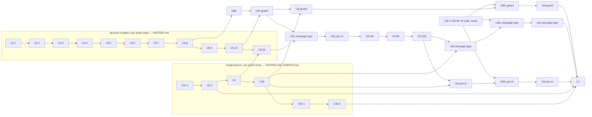

# Typed Decision Models — Implementation Plan, Subagent Labelling Amendments

> **Status:** active · **Owner:** `architect` · **Tracks:** — · **Version:** 1.8 · **Extends:** `docs/plans/typed-decision-models3.md` · **Reviews:** `docs/reviews/typed-decision-models4.md` · **Extended by:** `docs/plans/typed-decision-models5.md`, `docs/plans/typed-decision-models6.md`

*2026-11-12 — v1.8: `ScoredCall` and the `TextScore` carriers, `status` in the exemption, unhashable-value `malformed` cases, residency-read failure; restated fit-note text replaced by citations (Pass 41).*

## 1. Goal & scope

**Goal.** Absorb "Handed to architect" items 7–11 of `docs/plans/typed-decision-models-ml.md` v1.9
("the note"): generation and labelling run by Claude Code subagents through file exchange, with
the guard pilot, its stakeholder decision and the per-cell design effect. It also rules impl
review P8-m2 (between-item probe failures, `model-bench/docs/BACKLOG.md`).

**How to read it.** v1.3, plan2 and plan3 stay authoritative. Each section names what it amends;
where they disagree on a named point, this document wins. The note's §Q1.2, §Q1.3 and §Q6 are the
method and are cited, not restated. The stakeholder inputs are the requirements decision log's
2026-10-31 entries: no API key, opus generates and sonnet labels, full sizes with the pilot first,
spent point by point.

**Void.** v1.3 §3.4's `labeler.py`, its `ANTHROPIC_API_KEY` bullet, v1.3 U5's live `-m live` test,
and v1.3 §6's API assumption. Nothing in `decision-models/` calls a hosted API.

**Out of scope.** The fitting method (note §Q2) and everything plan3 rules; §3.11 only homes the fit's
inputs and decomposes U6. The method (vote rule, sizes, screen threshold, ICC) is the note's and is
not reopened.

## 2. Context & findings

CPG: considered, not relevant — no `cpg_modelbench` graph is loaded and `decision-models/` does not exist yet; the model-bench sites below were read from source.

- **Transcripts** (recorded by 2.1.314; the installed binary is 2.1.316, and the audit records
  the executing version per run). A subagent run is
  `~/.claude/projects/<slug>/<session>/subagents/agent-<id>.jsonl` plus `.meta.json`
  (`agentType`, `toolUseId`). `toolUseId` is the id of the parent session's `Agent` `tool_use`
  in `<session>.jsonl`, whose input holds `prompt` and `subagent_type`. Conversation entries
  carry `cwd` (`api-request-*` entries do not). The first `user` entry is the spawn prompt.
  Attachments include `instructions`, `session_context`, `mcp_instructions_delta`,
  `deferred_tools_record` and `hook_success` (with `toolUseID`); `api-request` entries carry
  `params.thinking` and `params.output_config.effort`. **One assistant message spans several
  entries sharing a `message.id`; their `usage` can differ, and the last entry's is final.**
  `<synthetic>` entries are `error: "rate_limit"`, `error: "authentication_failed"`, or a
  non-error placeholder.
- **Read tool.** A Read over 25,000 tokens fails and returns nothing; a single long line cannot
  be paged. Live probe (review Pass 2): pt-BR chat text is about 2.0 characters per token.
- **Subagent frontmatter** (`code.claude.com/docs/en/sub-agents`, 2026-10-31). `tools` is an
  allowlist that excludes MCP tools unless listed. `model` takes a full id. `effort` is overridden
  by an `Agent` call's own `effort`, and both by `CLAUDE_CODE_EFFORT_LEVEL`. `omitClaudeMd` drops
  CLAUDE.md files (not managed-policy files). Hook input carries `agent_type`; the main agent's
  frontmatter hooks also fire inside its subagents. Frontmatter `hooks` fire
  **only in a trusted folder**. `Agent(a, b)` restricts what a `claude --agent` main agent may
  spawn. Project agents are found by walking up from the working directory.
- **model-bench.** `decision_stats.parity_cell(pairs, *, design_effect, …)` takes pairs
  `(candidate errs, incumbent errs)` and applies `design_effect` to the limits only.
  `decision_stats.PairedItems.outcomes` holds those pairs ordered by `itemId` but **without the
  ids**, and `report.DecisionPointPack` maps `itemId` only to `stratum`. U3c.2 (in
  flight) passes `run.designEffect` to it from its per-replicate renderer (`report._render_replicate`
  in the working tree). `compare_report` takes the max run-level `designEffect`.
  `stats.Basis` is closed. `packs.validate_pack` reads `labels.labeler.model`; the bar section
  reads `labels.labeler.provider` and `.model` for the caveat. Item keys are open.
- **Between-item probes.** `residency()` is called unguarded before each item in
  `runner._drive_single_call_items`, `_drive_decision_items` and `_drive_handoff_items`, and after
  each conversation in `_turn_timings`. `_within_load_basis` already maps the same three failures
  (`LMStudioUnreachable`, `LMStudioCallFailed`, `TimeoutError`) to `"assumed"`.
- **Probe and surfaces.** `probe()` returns `"api-v0"`, `"v1-only"` or `"unreachable"` and never
  raises. `run_pack` calls it once, at step 2, where anything but `"api-v0"` raises
  `RunRefused(exitCode=3)`. On the `decisions` and `handoff` surfaces a failed call is a kept item
  whose `withheldFor` comes from `_load_withheld_for(…, resident)`.

## 3. Design amendments

### 3.1 Layout and where the agent definitions live (v1.3 §3.4 tree)

`decision-models/` does not exist yet. `labeler.py` leaves v1.3's tree; these join it:

```
decision-models/
  agents/        dm-generator.md · dm-labeler.md · dm-driver.md · spawn-generator.txt ·
                 spawn-labeler.txt · guard_hook.py · settings.json      (sources, installed per campaign)
  decisionmodels/
    seeds.py     # note §Q1.1 seeds and design strata
    exchange.py  # request writer, closed schemas, answer parser (§3.2)
    audit.py     # transcript audit and void classes (§3.3)
    ingest.py    # ingester (§3.3)
    campaign.py  # append-only ledger, batch states, phases, top-up planner (§3.5, §3.6)
    driver.py    # CLI: install · init · next · ingest · resolve · status · finalize
    labels.py    # majority, labelVotes, message-type tranche
    screen.py    # generated-text screen (§3.6)
    diagnostics.py · pilot.py
```

**The agent definitions live in `decision-models/agents/`, not `claude/` or `.claude/agents/`.**
- They are dataset provenance: hashed into `promptSha256`, changed only with a dataset version.
  `claude/`'s rules (kaizen, catalogs, `cobb` promotion) govern team agents and do not apply.
- A repo-level `.claude/agents/` copy would make `dm-labeler` spawnable from any repo session,
  whose injected context is the one the note forbids.
- `driver install` byte-copies them into the campaign's `exchange/.claude/agents/`, and
  `settings.json` into `exchange/.claude/settings.json`, checking hashes. So the only session that
  can discover them is the driver session.
- **Authoring.** `coder` writes them in U5.7, pinned by U5's tests; `cobb` is consulted at its gate
  (version-sensitive frontmatter semantics) and neither authors nor promotes.

### 3.2 Requests and answers (note §Q1.2 "Blind", "Batches")

- **Request file** `exchange/req/<opaque>.jsonl`, JSON Lines so that Read can page it:
  - line 1, the header: `{"schema": "dm-request/1", "role": "generate"|"label", "point",
    "answerPath", "bodySha256", "pages": [[offset, limit], …]}`;
  - line 2: `{"rubric"}` (labelling) or `{"instructions"}` (generating);
  - then one line per item: `{"key", "text"}`, where `text` is the item's §3.2 rendering from
    `render.py`; or one line per seed: `{"key", <the point's seed axes>}`. Seeds only (note §Q1.4).
  - Every line is a closed key set. `validate_request` refuses any other key, and the writer runs
    it before writing.
  - `bodySha256` is sha256 over the canonical JSON of the body `{"rubric"|"instructions",
    "items"|"seeds": [...]}` (`sort_keys=True`, `separators=(",", ":")`, `ensure_ascii=False`,
    UTF-8). It is independent of the file layout.
- **Paging, by a character budget.** The writer cuts lines 2… into pages of at most **40,000
  characters** of written text (after JSON escaping) and lists them in the header's `pages`. Page 1
  is `[1, 1]`, the header itself.
  - At §2's 2.0 characters per token, 40,000 characters is about 20,100 tokens, under Read's cap;
    at the 6,000-character render cap a page holds 6 items, so 50 items are 9 pages plus the header.
  - A batch is cut at the cap **or** at `P_max` pages, whichever comes first; `P_max` is 10 for
    labelling and 2 for generation. Overflow items go to the next batch of that vote.
  - The spawn template says how to page (§3.4), so the first Read is the index, never a failure.
- **Keys.** 10 characters of base32 from `secrets`, random per (item, vote) and per seed, unique
  across the campaign and redrawn on collision. A rerun gets fresh keys and a new opaque name.
- **Answer.** `exchange/ans/<opaque>.jsonl`, or parts `<opaque>.<k>.jsonl` (k = 1, 2, …) when one
  Write would be too long. Ingest concatenates the parts in order.
  - Line 1 is `{"bodySha256": …}`, copied from the header.
  - Then one line per key: `{"key", "answer"}` when labelling (`answer` in the point's `expected`
    vocabulary), or `{"key", "item"}` when generating (`item` is exactly the point's input fields,
    per `points/`).
  - The generator template forbids commentary outside the input fields.
- **One request at a time.** The driver writes a request only when it is about to be spawned. On
  ingest, or before any re-issue, it moves the request and every answer part to `store/`. So
  `exchange/` never holds another batch, a seed, or an earlier vote's answer.

### 3.3 Ingester and audit (note §Q1.2 "Ingest audit", "Reruns")

**Locating the run.** The audit never uses what it checks to find a run.
1. `driver ingest` reads the driver session's own transcript (`<slug>/<session>.jsonl` for the
   exchange directory) for the `Agent` `tool_use` whose `input.prompt` contains the request's
   opaque path.
2. It finds the `subagents/agent-<id>.meta.json` whose `toolUseId` equals that `tool_use`'s id, and
   reads `agent-<id>.jsonl`.

| Check | Class |
|---|---|
| no such `tool_use` | never spawned: re-issue, no attempt; the 2nd for one batch halts (driver) |
| a `tool_use` but no subagent transcript, or more than one | driver: halt |
| the driver transcript holds no `tool_result` for the `tool_use`, and the subagent transcript no `<synthetic>` (the driver session died mid-run) | incomplete: re-issue, no attempt; the 2nd for one batch halts (driver) |
| first `user` message ≠ the role's spawn template with the request path substituted | driver: halt |
| the `tool_use` input carries `model`, `effort`, `isolation` or `run_in_background`, or a `subagent_type` other than the role's | driver: halt |
| `.meta.json` `agentType` ≠ the role's (so never `fork`) | environmental: halt |
| any `message.model` ≠ the pinned id, outside `<synthetic>` entries | environmental: halt |
| `effort` ≠ the role's pin, with the `tool_use` carrying no `effort` (so the env var overrode it) | environmental: halt |
| `instructions` ≠ the declared set (§3.5), by path and sha256 | environmental: halt |
| any `mcp_instructions_delta` attachment, any `mcp__` name in `deferred_tools_record`, or a `gitStatus` key in `session_context` | environmental: halt |
| a tool use with no `hook_success` entry for its `toolUseID` (hooks inactive, e.g. an untrusted folder) | environmental: halt |
| a `hook_success` whose decision is `deny` | run-attributable |
| a `tool_result` is present but the run stopped at `maxTurns` (shape recorded by U5.7's smoke) | run-attributable (it finished and failed) |
| `<synthetic>` with `error` other than `rate_limit` (e.g. `authentication_failed`) | environmental: halt |
| `<synthetic>` with `error: "rate_limit"` | usage stop: re-issue next window, no attempt |
| a tool other than `Read`/`Write`, or a path other than its own request and answer parts | run-attributable |
| answer missing, `bodySha256` absent or ≠ the recomputed hash | run-attributable |
| a key missing, duplicated or unknown; an answer out of space; malformed JSON | run-attributable |
| a generated item hits the screen (note v1.9 §Q1.2 "Hits") | per seed, not a run void (§3.6) |

- A `<synthetic>` entry with no `error` is ignored.
- **Precedence** when several rows match: halt, then re-issue with no attempt, then
  run-attributable.
- **No-attempt caps.** "Never spawned" and "incomplete" are capped at one re-issue per batch; the
  second occurrence halts, so no batch loops. Usage stops are uncapped: they wait for the next
  window and spend nothing meanwhile.
- **Run-attributable** voids count: the batch is re-issued with fresh keys after 2 counted
  attempts and its items or seeds drop as `retryCapExceeded` after 3.
- **Halt** writes `halted` with the reason. `next` then refuses until a human runs `driver resolve
  --decision <text>` with at most one of `--repin-instructions` or `--repin-model <role> <id>`.
  A model re-pin is the stakeholder's call (note §Q1.2).
  - A **labeler** re-pin follows the same rule; its ledger event is `labelling-restart`.
  - A **generator** re-pin follows note v1.9 §Q1.2 "Reruns"; `resolve --repin-model generator`
    writes a `generation-restart` ledger event.
- **Idempotence.** Re-ingesting an ingested batch whose answer bytes hash the same is a no-op. A
  second, different answer to an ingested request is refused and changes nothing.
- The `session_context` sha256 is recorded per run (§3.7).

### 3.4 The three agent definitions

| | `dm-generator` | `dm-labeler` | `dm-driver` |
|---|---|---|---|
| `model` | `claude-opus-4-8` (full id; Opus 5.5's safeguards flagged generation before any seed was visible, `docs/reviews/typed-decision-models-safeguard-rca.md`) | `claude-sonnet-5-5` (full id) | session default |
| `effort` | `medium` | `high` | — |
| `tools` | `Read, Write` | `Read, Write` | `Agent(dm-generator, dm-labeler), Bash` |
| `maxTurns` | `P_max + 4` = 6 | `P_max + 4` = 14 | — |
| other | `omitClaudeMd: true`, `permissionMode: acceptEdits`, `hooks.PreToolUse` → `guard_hook.py` | same | `hooks.PreToolUse` → `guard_hook.py`; `initialPrompt` starts the loop |

- `maxTurns = P_max + 4`: one Read per page (§3.2, the header page included), up to three answer
  Writes, and the reply.
- **`guard_hook.py`** (stdlib) **always exits 0** and prints `{"hookSpecificOutput":
  {"hookEventName": "PreToolUse", "permissionDecision": "allow"|"deny",
  "permissionDecisionReason": …}}`. That is the form this repo's `claude/scripts/guard-*.sh` use,
  and it is recorded in `hook_success`. It never uses exit 2. It logs every call to
  `store/hook-log.jsonl` with `agent_type` and the tool-use id, and decides `deny` for:
  - for `dm-generator`/`dm-labeler`: a `Read` outside `exchange/req/`, a `Write` outside
    `exchange/ans/`, and any other tool;
  - for `dm-driver`'s `Bash`: any command whose `shlex` argv is not exactly the venv's
    `python -m decisionmodels.driver` plus one subcommand from `{next, ingest, status}`, or that
    contains a shell metacharacter;
  - for `dm-driver`'s `Agent`: a `subagent_type` other than the two; a `prompt` other than the
    ledger's pending spawn prompt; any `model`, `effort`, `isolation` or `run_in_background` key.
  - It prevents; the audit verifies (§3.3). It keys on `agent_type`, because the driver's hooks
    also fire inside its subagents.
- **Spawn templates.** One fixed text per role with a `{request_path}` slot: "Read
  {request_path} with offset 1, limit 1. Its `pages` field lists [offset, limit] pairs: read each
  remaining page with exactly that offset and limit. Follow the instructions on line 2, write the
  answer where the header says, then reply `done`."
- **No MCP tool** in any allowlist (note §Q1.2).
- `promptSha256` covers each definition, each spawn template, the rubric, each request template
  and `guard_hook.py` (§3.7).

### 3.5 The run driver

**Which session.** A dedicated interactive session running as `dm-driver` in the campaign's
`exchange/`, outside the repo; it sees only `driver next`'s output (action, agent type, spawn
prompt), never a seed, intent or label. `teco` never spawns these runs (its repo context is forbidden by the note).

**How it starts: human-started, once per usage window.**

```
cd <campaign>/exchange && claude --agent dm-driver --strict-mcp-config \
  --mcp-config <campaign>/exchange/empty-mcp.json --permission-mode acceptEdits
```

- The first start in a campaign answers the folder-trust prompt; until then hooks are skipped
  and the audit halts (§3.3).
- **The loop:** `next` → spawn one foreground subagent → `ingest`, repeated until `next` returns
  `stop`. That happens when the phase is done, on a halt, or on a usage stop.
- It is stateless (state is in `store/ledger.jsonl`), so a dead session loses nothing. Unattended
  starts across windows are plan6's (§6, Q-1).
- `init`, `install`, `resolve` and `finalize` are run by a human from an ordinary shell, never by
  the driver session (§3.4's closed subcommand set).

**Campaign.**
- `driver init --point <role> --phase smoke|pilot|full --root <dir>` refuses a root inside a git
  work tree, or under any ancestor holding `CLAUDE.md`/`AGENTS.md`.
  - `smoke` takes `--fixture <items.jsonl>`: one label batch, no seeds, nothing kept (U5.7).
  - `full` refuses unless the guard pilot's report carries a recorded stakeholder decision
    (§3.8). For message type, guard's campaign must already be finalized; for join-in, message
    type's must be.
- It creates `exchange/` (`.claude/agents/`, `.claude/settings.json` allowing the driver command,
  `empty-mcp.json`) and `store/` (seeds, keys, answers, the ledger, the hook log).
- **Declared expectations, written at `install`**, never learned from a run: an empty
  `instructions` set for both subagents, no MCP attachment, no `gitStatus`, and the effort pins.
  §3.3's rows compare against them.

**Batch states**, folded from the append-only ledger (one fsync'd JSON line per event):
`pending → issued → ingested`, with `void` (re-issued as a new batch attempt) and `halted`.
- **On start, `next` reconciles first:** each `issued` batch is ingested, which applies §3.3's
  never-spawned, incomplete and usage-stop rows.
- `next` never returns an `ingested` batch.

### 3.6 Generation runs, labelling rounds and top-up (plan2 §3.5 "Labeling"; note §Q1.2–§Q1.3)

Each bullet names its owning unit (§4.1).
- **Generation runs (U5.8).** Seeds are shuffled and cut into runs of 25, so each run spans the
  point's design strata (note §Q1.3). Each run gets `genRunId`, unique in the dataset version.
  Every item it yields records that `genRunId` and the round's `genRound` (1 for round 1, 2+ for
  top-ups). Round 1 draws ⌈1.1 × target⌉ seeds, where the target is eval + calibration per note
  §Q1.3's table.
- **Generated-text screen (U5.8),** at generation ingest; the rules are note v1.9 §Q1.2
  "Generated-text screen", "Hits" and "On a hit". The mechanism: `screen.py`, a pure function over
  the rendered evidence fields, returns the hit reason or `None` (token lists from `points/` (U5.3);
  seed-axis ids minted in a non-word form, `dom_07`). A hit queues the seed (`screen-hit` event);
  regeneration batches are ordinary generation runs over queued seeds; drops count in
  `dropped.screenHits`; the round halt is a `template` halt.
- **Votes (U5.8).** For each (round, vote), the round's items are reshuffled with a fresh recorded
  RNG seed and cut into batches of at most the cap (50, or 25 if the pilot sets it) and at most
  `P_max` pages (§3.2). Votes run vote-major. `labels.py` takes the majority, writes `labelVotes`
  (summing to 3), and drops a choice item with three distinct labels as `voteTie`.
- **Message-type tranche (U5.9).** Round 1's labelling starts with 250 round-1 items drawn at
  random; all three votes complete before the rest. If `100·drops > 3·250`, the driver halts with
  a rubric halt; the fix is a recorded `resolve`, and the tranche is relabelled under the new
  rubric hash. `finalize` rechecks the rule over the whole point; on failure it halts, the whole
  point is relabelled with all three votes after the rubric fix, and a second failure needs
  `resolve --stakeholder-ref` (note §Q1.2 "Majority of three blind votes").
- **Top-up planner (U5.9),** in `campaign.py`, after a round is labelled:
  - A cell is (label × design stratum): guard's evidence kind, none for the other points. Per short
    design stratum `s` it draws `max over its short cells ℓ of ⌈shortfall_ℓ / P̂(ℓ | s)⌉` new seeds
    from the **same design restricted to `s`**, with `P̂` from labels so far. The sampler's signature
    takes `(design stratum, count, rng)` and nothing that names a label or intent.
  - A top-up run pools all of the round's short strata; rounds repeat until every cell fills.
  - **Spend halt** (note v1.9 §Q1.3 "Spend halt"): a pure `campaign.project_topup(...)` from the
    point's own round-1 ledger totals, compared before a top-up round is issued, tokens being the
    four-class sum of §3.7. The driver halts with a `spend` halt and `teco` takes the projection to
    the stakeholder.
  - **A stakeholder "no"** is `resolve --decline-topup`; `finalize --short` then applies note
    §Q1.3 "On a stakeholder 'no'": eval cells fill first, and it either finalizes with every n
    printed or refuses, leaving the store intact.
- **Cells, then splits (U5.10),** in `finalize`, amending plan2 §3.5's splits:
  - The side-check shingle drop runs first, on every generated item (note §Q1.4).
  - Each cell is then subsampled at random to its target; surplus items stay unused and counted.
  - Splits are assigned within each cell by `seedId`.
  - The eval-against-train/calibration shingle drop comes last and is counted (`dropped.shingleSplit`: the eval-assigned items it removes, nothing else). **A dropped eval slot is refilled from the same cell's surplus** (note §Q1.4, `docs/reviews/typed-decision-models-refill-ml.md` §1):
    - `subsample_cells` returns each cell's unused candidates. After `assign_splits`, they are walked in seed-sorted, then `rng`-shuffled order; one sharing an 8-token span with any calibration or train item is a counted **refill drop**, any other joins eval until the cell is at its size or the walk ends.
    - Calibration and train never change, and a refill passes the same test as the eval items it replaces, so held-out purity is unchanged. The shuffle follows `assign_splits` and draws nothing when no eval item dropped, so a run with no drop equals today's output.
    - `SplitResult.surplus` is the **remaining** unused count. New fields: `refilled` (per cell) and `refill_dropped` (seed ids). `generation.json` and the contract vector are unchanged.
    - The per-cell line prints: eval-assigned, assigned drops, refill candidates walked, refill drops, refilled, final eval, floor, remaining surplus, and the drop rate `d` (assigned drops / eval-assigned; `d > 0.25` flags a generation-diversity signal).
  - **Floors gate every finalize, not only `--short`.** After the refill, an eval or calibration
    cell below `evalFloorPerCell` refuses and writes no dataset (join-in's floor equals its eval size, 100, so without the refill one drop breaks FR-11's 200 at the importer).
  - **A floor refusal records `floor-short`.** `finalize()` catches the refusal inside `camp.locked()` (as `_recheck` does), appends the event, then re-raises; `build_dataset` stays pure. The `--short` refusal records it too. Per short cell it holds `n` (items labelled now), `need` = `⌈deficit / (1 − d)⌉` more (`deficit` = floor − final eval; calibration cells have none), and the trial's RNG seed, which joins `held_rng_seeds` so a later finalize refuses it. It raises no halt; `State` folds it plainly, the newest event replacing the older.
  - **Drop-aware top-up.** A cell with a `floor-short` record has the target `max(cell_target, n + need)`, so a cell already below `cell_target` is not counted twice. `topup_counts` takes those targets (`extra`: cell → target) and keeps its draw `⌈shortfall / P̂(ℓ | s)⌉`; `_short_cells` uses the same function. The next `driver run` plans the round through the ordinary path (spend halt, `--decline-topup`, `--reopen-topup` unchanged). Finalize again as a new version with a fresh seed (`--rng-seed <n>`, written in the coordination ledger before any score exists; never retried on a result). Each version is a whole new split with its own `d`, so a second `floor-short` is possible and nothing caps it automatically; the spend halt, a decline, or the stakeholder ends it. The earlier version stays, unconsumed.
- **Diagnostics (U5.9),** written by `diagnostics.py` to `diagnostics.json` beside
  `generation.json`: note §Q1.2's four, round 1 against top-up per cell on intent-label agreement
  and pair agreement, and screen hits by intent and difficulty.

### 3.7 `generation.json` and items (plan2 §3.5 amended)

```
{generator: {surface: "claude-code-subagent", tier: "opus", model, effort},
 labeler:   {surface: "claude-code-subagent", tier: "sonnet", model, effort},
 votesPerItem: 3, labelerTemperature: null, labelBatchCap,
 promptSha256: {agentDefinition: {generator, labeler, driver}, spawnTemplate: {generator, labeler},
                requestTemplate: {generator, labeler}, rubric, guardHook},
 generatedAt, itemCount,
 dropped: {voteTie, shingleSplit, shingleSideCheck, screenHits, retryCapExceeded: {seeds, items}},
 runs: [{runId, role, batchId, attempt, status: "ingested"|"void"|"usage-stop"|"incomplete",
         voidClass, voidReason, claudeCodeVersion, agentId, model, requestSha256,
         instructions: [{path, sha256}], sessionContextSha256, thinking, effort,
         tokens: {input, cacheWrite, cacheRead, output}}]}
```

- `model` comes from the transcript's `message.model`, never the tier alias. Generation still
  refuses equal generator and labeler ids. `labels.labeler` in the imported pack is the labeler.
- `tokens` sum, per `message.id`, the `usage` of the **last** entry carrying that id (§2).
- **Items** gain `genRunId` (string) and `genRound` (int ≥ 1). Like `seedId` and `labelVotes`,
  they stay outside `INPUT_FIELDS_BY_ROLE`. `genRunId` replaces v1.3 §3.4's "hash of the generator
  call": the run's `requestSha256` is in `runs[]`.

### 3.8 The guard pilot and its decision point (note §Q1.3 "Pilot")

- **Pilot campaign** (`--phase pilot`, guard): the runs of note §Q1.3 "Pilot".
- **Screen,** fixed before any label is seen: note v1.9 §Q1.3 pilot "Screen", including the
  blocks added while `n < 80`. `pilot.py screen` computes `n`, `Δ` and the cap from the ledger, and
  the driver issues each added block as pilot generation runs plus their votes.
- **`pilot.py report`** writes `decision-models/data/guard-judge/pilot/pilot-report.json`, counts
  only: labeller F and c per token class (least squares over the runs at two batch sizes), the
  generator's mean tokens per run (every run is 25 seeds), P̂(label | kind), `n`, `Δ` and the cap,
  voids, reruns, screen hits, and reprojected tokens per point.
- **Pilot items and seeds are discarded:** the store is deleted after the report is committed, and
  the full campaign's seeds use a different recorded RNG seed.
- **Decision point.** `teco` puts the report in the ledger and takes the projection to the
  stakeholder. `pilot.py record-decision --outcome proceed|stop --cap 25|50 --decided-on <date>
  --ref <ledger line>` writes `stakeholderDecision` into the report; `init --phase full` reads it
  (§3.5).

### 3.9 Per-cell design effect (plan2 §3.4 and §3.6; note §Q6 "Design effect")

Note §Q6 "Design effect" is the one home of the estimator (one ICC pooled per family, each cell's
own Kish `m₀`), the empty-cell and non-contributing-cell values, the two not-estimable reasons and
the print. This section names the interface and the call sites only. U3e.2 built a per-cell form;
U3e.3 replaces it.

- **Interface** (`decision_stats.py`, pure). `design_effect(outcomes_by_run)` is removed, and its
  tests are rewritten against the new function; there is one estimator.
  - `family_design_effect(cells: Mapping[str, Mapping[str, Sequence[bool]]]) -> FamilyDesignEffect`
    takes a whole family at once: cell (or class) → `genRunId` → that run's outcomes in the cell.
    An empty cell is an empty mapping. A run with no outcomes, or a non-bool outcome, raises
    `ValueError`, as U3e.2's function did.
  - `FamilyDesignEffect` is a frozen dataclass with `icc: float | None` (the unfloored `ICĈ`;
    `None` when not estimable), `reason: str | None` (set iff `icc is None`), `contributing: int`
    (§Q6's `<k>`), and `effects: Mapping[str, float]`, one DE for every input key, empty cells
    included.
  - The two reason texts are module constants, `NOT_ESTIMABLE_NO_CONTRIBUTING` and
    `NOT_ESTIMABLE_CONSTANT`, holding §Q6's strings verbatim.
- **`DESIGN_EFFECT_SOURCE`** keeps its value `"genRunId ICC"`, the note's `designEffectSource`.
  It is printed once, in the family line, and no longer on a cell line.
- **Report and call sites** (`report.py`). `_cell_design_effect` becomes
  `_family_design_effect(outcomes, ids, gen_run_ids)`, grouping per-key outcomes and their parallel
  ids through `gen_run_ids` into the nested mapping; `_design_effect_text` prints `DE <x.xx>` only;
  `_family_design_effect_line(family, unit)` renders §Q6's family line (`unit` is `"cells"` or
  `"classes"`).
  - Each family is computed once per replicate, and its line goes directly under the bar's heading
    line at cell-line indentation (`  - design effect: …`), ahead of the first cell or class line.
    The early-return branches print no family line.
  - FR-1, in `_render_replicate`: one call over the four cells' discordance (`cand ≠ inc`); its
    `effects` feed `parity_cell(design_effect=…)` and `_parity_text`. FR-10, in
    `_render_fr10_replicate`: one call over every class in `agreement.outcomes`, empty ones
    included; the class's DE feeds `wilson_interval(k/DE, n/DE)` and its line.
- **Ids and provenance** (U3e.1/U3e.2, unchanged): `PairedItems.outcome_ids`,
  `AgreementItems.outcome_ids`, `DecisionPointPack.gen_run_ids`, and `validate_pack`'s `genRunId`
  and `labels.generator` refusals with the two-model caveat.
- **Unchanged:** `RunResult.designEffect` (1.0), `RunResult.basis`, and `compare_report`'s
  max-`designEffect` rule. Plan2 §3.4's "final" `designEffect = 1.0` holds for the run record only.

### 3.10 Between-item probe failures (P8-m2; SMB plan §3.6)

**Ruling: a failed between-item probe re-probes, then counts as an empty snapshot.**
- `runner._between_item_residency(lmstudio) -> list[ResidentModel]` serves all four sites. It
  catches `LMStudioUnreachable`, `LMStudioCallFailed` and `TimeoutError` from `residency()`, then:
  - **Outage.** It calls `probe()`. Anything but `"api-v0"` raises `RunRefused(exitCode=3)` with
    `_PROBE_MESSAGES`' text, as step 2 does (SMB §3.6 clause (iv)). Nothing is stored.
  - **Otherwise** it returns `[]` ("not shown resident") and writes one stderr line naming the
    item and the exception class. The record schema is unchanged.
- **What `[]` does, per surface:**
  - **Chat/embeddings** (`_drive_single_call_items`, `_turn_timings`): a completed call gets
    `withheldFor="load"`. A failed call keeps its own `"timeout"`/`"no_response"`, because the
    load producer does not run on it (SMB §3.6 precedence).
  - **Decisions/handoff:** the item takes `withheldFor="load"` whether its call succeeded or was a
    kept failure (`_load_withheld_for` on the snapshot). The load rule then gives `"assumed"`, the
    replicate prints `not assessable`, and it is rerun.
- **Rejected:** refusing on any probe failure (it discards finished items for a possibly transient
  failure) and treating the model as resident (it fails open on a reloaded run).
- An outage met by an item's own call is out of scope (R-21).

### 3.11 Fitting: inputs, candidates, residency (plan2 §3.5, plan3 §3.5; note §Q2, §Q6)

The rulings the note leaves open are in `docs/plans/typed-decision-models-fit-ml.md` ("the fit note"):
§1 the decision-only family, §2 the `t` carried when no quality rung is reached, §3 selection among
texts, §4 abort accounting and the dispositions' method. This section states only the plan's own
mechanics: inputs, typed records, failure taxonomy, flag, report, residency.

**Fit inputs are data under `decision-models/fit/<role>/`**, outside `points/`: `points/` is the
blind generation and labelling material (`points.py`'s closed file set, scanned for side-check
shingles), and a hand-off prompt carries example sentences by design (`diagnostics.HANDOFF_EXAMPLES`).
- **`handoff.md`** is a byte-copy of the system prompt of the point's model-bench pack
  (`model-bench/packs/<role>-synthetic/`, the file `pack.json` `prompt.systemPrompt` names; the
  guard's is the incumbent's judge prompt). **`questions.json`** is
  `{"questions": [{"id", "control": bool, "spec": <the question spec as sent in questions[]>}]}`.
- **`decisionmodels/handoff.py`** owns the parity constants `HANDOFF_TEMPERATURE = 0.0`,
  `HANDOFF_MAX_TOKENS = 256`, `HANDOFF_CHAT_TIMEOUT_SECONDS = 180.0`;
  `handoff_messages(role, rendered_input)` (system = `handoff.md`, user = the §3.2.1 rendering, as
  the bench's `build_messages`); and the role's hand-off parse, a port of the bench's
  `extract_own_line_json_object` and verdict rules, pinned by byte-copies of
  `handoff-parse-{guard,join-in,message-type}.jsonl` (whose rows are raw reply strings).
- **Guarded equality tests** (v1.3 §3.2.2 skip rule; R-10): each `handoff.md` equals its pack's
  prompt file byte for byte; the two constants equal the pack's `prompt.temperature`/`maxTokens`; the
  180 equals `decisions.DECISION_POINT_CHAT_TIMEOUT_SECONDS` (source regex). So fit and eval send the
  same messages and budget.
- **Pack against runtime prompt.** Nothing in model-bench or falkor-chat compares a pack prompt with
  a served one. For the guard, U6f.3c adds a guarded test that parses `_JUDGE_SYSTEM_PROMPT` out of
  `falkor-chat/server/falkorchat/app.py` with `ast` and asserts it equals `judge.md` after `strip()`
  (the two differ by one trailing newline today). It sits in `tests/`, outside FR-8's scan, and reads
  source, not data. **It skips only when the sibling checkout is absent; it fails when `app.py` exists
  and `_JUDGE_SYSTEM_PROMPT` is not a module-level assignment.** It is a prior on whether the fit
  transfers, not a gate. Join-in and message type have no runtime prompt yet: U6f.3c files the
  equivalent parity check as an item in `decision-models/docs/BACKLOG.md` (created there if absent),
  owned by whichever unit adds that prompt.
- **Question texts.** `coder` drafts them from the point's `rubric.md` only, never from items of any
  split; at most 5, exactly one `control` (a bare label name per choice, a one-line question for a
  predicate; note §Q2.3), ids unique, every spec valid under the question rules below and the
  point's answer space. `data-scientist` reviews each point's file once before its first fit, as for
  rubrics. They are fixed before the first decision call and their sha256 is in the fit report; an
  edit is a new fit.
  - **The question rules are a copy** of `model-bench/modelbench/decisions.py:_question_problem`
    (FR-8 bars the import). U6f.4b pins it with a hand-written vector, one row per branch: not an
    object; `score`; unknown type; empty or non-string name; non-string instructions; a predicate
    with `choices`; `choices` missing, empty or not a list; a choice that is not an object, has an
    empty value or non-string instructions; repeated values; a valid predicate and a valid choice.
    A guarded differential test runs every row through the bench's real `_question_problem` (loaded
    by path; tests are outside FR-8's scan), so an edit to it, to `_one_of`/`_nonempty_str` or to
    `_POLICY_KIND_BY_QUESTION_TYPE` that changes a vector verdict reddens, and a reformat does not.
  - **Answer space** is the loader's own rule, beyond the copy: a predicate point takes only
    `predicate` questions; a choice point takes only `choice` questions whose values equal the
    point's `expected` vocabulary as a set.
- `fit/` text gets the forbidden-fragment scan (`test_points.py`'s): U6f.3b for `handoff.md`, U6f.4c
  for `questions.json`, which also gets the side-check shingle scan.

**Two candidates per point** (reads plan1 U6, plan3 §3.5 and plan2 §4.1 U7 together):
- `<role>-<datasetVersion>-handoff-f<N>` (`handoffModel` = H) and `<role>-<datasetVersion>-only-f<N>`
  (`handoffModel: null`); `N` is the point's fit ordinal, since the importer refuses an id re-imported
  with other bytes.
- **H is `qwen/qwen3-4b-2507` for every point**: the guard's incumbent (required by FR-3's pairing)
  and plan1 §6's default for the new abilities. Measuring another LLM is a new fit series and the
  stakeholder's call.
- **Searches.** The hand-off candidate runs note §Q2.1's ladder (guard) or §Q2.2's (new abilities).
  The decision-only candidate runs the same ladder code over the **empty-band family** (fit note §1),
  where an over-limit item is scored by note §Q4.3's "no hand-off model" row (plan3 §3.5).
- **No quality rung reached (guard, decision-only):** the carried `t` and the pair are fit note §2's;
  the name loads because `_fit_problem` (`model-bench/modelbench/decisions.py:463`) tests outcome and
  target independently. Note §Q2.1's "rung 4 always exists" holds for the hand-off family only.
- **Selection is per candidate** (fit note §3, which also rules eligibility): the two candidates may
  ship different texts. **Calls are shared:** one decision call per text and one hand-off call per
  calibration item; both searches read the same `ScoredCall` records.

**Typed records** (one home; the joins between units U6f.5–U6f.9b):

| Record | Defined in | Fields |
|---|---|---|
| `LadderResult`, one per (candidate, text) | `fitstats.py`, U6f.5; filled by U6f.6/6f.7 | `family` (`handoff`/`decision-only`); `rung` (1–4, `None` on fit note §2's fallback); `qualityTarget`; `policy` (band or `c`, and `s`); `key` (the rung's sort key, integers and exact fractions); `agreementUnmet`, `latencyUnmet` (independent bools: the ladder reports both and decides no precedence); `barValues` (each bar's calibration value) |
| `ScoredCall`, one per (item, call kind, text) | `fitstats.py`, U6f.5; read by U6f.6/6f.7, produced by the collector (U6f.8a) | `(itemId, callKind, textId \| None, outcome: "ok" \| "over-limit" \| "failed", answer, elapsedSeconds)`. `failed` is a call scored under a `Disposition`: a hand-off scores fail-closed and its `elapsedSeconds` enters `t̄_{L\|H}`; a decision scores concordant (guard) or fail-closed (new abilities) |
| `TextScore`, `Selection`, one `Selection` per candidate | `fit.py`, U6f.8b (the producer of every field) | `TextScore(candidate, textId, auc, maxProbAuc (choice, exploratory: ROC-AUC of `max(probabilities)`, U6f.5's AUC), overLimit (k, n), splitHalf (the shifts), ladder, leftSelection: None \| "auc" \| "decision-failure")`; `Selection(candidate, textId, noEligibleText: bool)`. A text with `leftSelection="decision-failure"` does not count toward "any text has AUC above 0.5" |
| `AbortRecord` | `fitcalls.py`, U6f.8a | `schema`, `runId` (random; in the file name `fits/abort-<UTC ts>-<runId>.json`), `itemId`, `callKind` (`handoff`/`decision`), `textId` (`None` for a hand-off), `failureKind`, `status` (HTTP status or `None`), `elapsedSeconds`, `inputs` (`role`, `datasetVersion`, `questionsSha256`, `handoffSha256`, `decisionModel`, `handoffModel`, `decisionTimeoutSeconds`), `residencyStart`, `residencyNow` (a fresh read at abort time, `None` if that read raises). No item text, and no end snapshot: it does not exist at abort time |
| `Disposition` | `fitcalls.py`, U6f.8a; built by U6f.8c | `(itemId, callKind, textId, failureKind, status)`, `reason`, the two record file names |

**A fit aborts on any chat failure or timeout and on any `decide` failure other than `OverLimit`**,
unless the call is exactly a `Disposition`'s `(itemId, callKind, textId, failureKind, status)`. An abort
writes one `AbortRecord` file and no candidate, manifest or report; there is no retry. A parse
failure is data (its parse fallback). The method's reasons and the operator procedure are fit note §4.

**`failureKind`** is closed, and is read from the exception, never from message text:

| `failureKind` | Raised as (`lmstudio.py`, after U6f.1c) |
|---|---|
| `timeout` | `LMStudioCallTimeout` |
| `connection` | `LMStudioCallFailed(kind="connection")`: `URLError` other than a timeout, `HTTPException`, `OSError` |
| `http` | `LMStudioCallFailed(kind="http")`, `status` set (`decide`'s over-limit 500 returns `OverLimit` and is never raised) |
| `malformed` | `LMStudioCallFailed(kind="malformed")`: a 2xx body that is not JSON, a chat reply without content, a `decide` answer that breaks the contract, including an unhashable `type`, `choice` or `probabilities[].value` (U6f.1c guards `_parse_answers`' membership tests, which raise a bare `TypeError`) |

Evidence kinds for a disposition: fit note §4.

**Recorded dispositions** (method and per-class effects: fit note §4). The operator may rerun with
`--exclude-item <id>:<callKind>[:<textId>] --reason <text>`, repeatable, never a default, with a `teco`
ledger line written before the rerun; `textId` is required exactly when the call kind is `decision`. `fit` accepts it only when two `AbortRecord` files exist that
(a) are distinct files with distinct `runId`; (b) agree with the flag on item, call kind and text, and
with each other on `failureKind` and `status`; (c) carry `inputs` equal to the current run's; (d) have an
evidence `failureKind`; and (e) each show both models resident in `residencyNow`. `reason`
cites both file names. **The exemption is exactly that `Disposition`, `status` included; any other failure on the same
item aborts as for any item.** The effects, per role and call kind, are fit note §4's "Recorded item
disposition"; U6f.8c applies them, and a guard hand-off exclusion re-checks each cell against `CALIBRATION_FLOOR_PER_CELL` (`fitstats.py`; a cell under it refuses).

**Fit report** (`data/<role>/<datasetVersion>/fits/`; one home of its contents; U6f.8a computes the call fields, U6f.9b writes it). Per
candidate and text: the `TextScore` fields (§3.11 table), each bar's calibration value, and the chosen text and rung. Per call kind: the count, median and maximum wall clock, `k` (calls scored
under a disposition, with item ids), `n`, the Wilson 95% upper bound and the half-budget count (fit note §4, which defines both). The dispositions: each listed item with
its reason, record names and effect, plus fit note §4's per-class `k`, `n_class` and ceiling. Also both residency snapshots, the
`questions.json` and `handoff.md` sha256 and `decisionTimeoutSeconds`. The call fields are descriptive,
never gating.

**Outcome assembly** (`fit-infeasible: <bar>` when a requirement value is unmet) is the pure U6f.9a
function over the chosen text's `LadderResult` and `Selection.noEligibleText`, in note §Q2.0's order: `ranking`
iff `noEligibleText`, else `agreement` iff `agreementUnmet`, else `latency` iff `latencyUnmet`; the
pair's target is the ladder's `qualityTarget`, from plan2 §3.2's closed sets.

**Residency.** The fit's latency terms are targets, never bars (note §Q2.0); the bar's latency is the
bench's, under explicit loading.
- A human loads the decision model and H before `fit` (`lms load`).
- `lmstudio.residency()` is a port of the bench's (`GET /api/v0/models`, `state != "not-loaded"`).
  `fit` refuses to start unless both are resident, re-reads at the end, and refuses to emit if either
  is gone (the bench's "load changed mid-run" discipline); an end refusal writes nothing. A start or
  end read that raises (`LMStudioUnreachable`, `LMStudioCallFailed`, `TimeoutError`) refuses the same
  way and writes nothing: no snapshot exists to record.
- The report holds both snapshots. A reload and a re-load between them is undetectable; the maximum
  wall clock is the tell.
- Premise not verified here: that `/api/v0/models` lists the decision model with a `state`. The bench
  relies on it (plan2 §3.4); U6f.1b's live test confirms it.

## 4. Units

### 4.1 U5, replaced by U5.1–U5.10 and the live units

v1.3's U5 brief and plan2's U5 addition are distributed below. The labeller-client bullet is void.
Splits follow the dispatch rule (more than about 3 steps or 5 files). Every unit gets an `analyst`
code gate. U5.x units serialize on `decision-models/docs/HISTORY.md` (§4.3).

| Unit | Owner | Brief | Done when |
|---|---|---|---|
| U5.1 scaffold | `coder` | v1.3 skeleton (`setup.sh`, `pyproject.toml`, `README.md`, `AGENTS.md`, `docs/`); the FR-8 import/path test; a **one-line** root `AGENTS.md` Structure bullet and a Component-docs row. Boilerplate counts as one step. | suite green; the FR-8 test reddens on a planted `import redis` |
| U5.2 guard contract copies | `coder` | `render.py` and `hashing.py`, against byte-copies of `render-guard.jsonl` and `input-hash.jsonl`, under v1.3 §3.2.2's guarded equality test | copies `cmp`-equal; every row passes |
| U5.3 points, rubrics, seeds | `coder`; `data-scientist` reviews the rubrics | `points/` per point: seed axes, input-field schema, `expected` vocabulary, rubric, generator request template (no commentary, §3.2); `seeds.py` (note §Q1.1, design strata) | seeds reproduce from a recorded RNG seed; rubric review recorded |
| U5.4 exchange and ingester | `tdd-engineer` | §3.2 in full; §3.3's answer checks, idempotence and second-answer refusal | §5 rows |
| U5.5 transcript audit | `tdd-engineer` | §3.3's location rule, table, precedence and classes; the `runs[]` record and token rule (§3.7) | §5 rows, on fixture transcripts |
| U5.6 campaign and driver CLI | `coder` | §3.5's ledger, states, reconciliation, halts and `resolve`; `init` with its three phases and refusals; `next`/`ingest`/`status` | §5 rows |
| U5.7 agent definitions and install | `coder`; `cobb` consulted at the gate | §3.4's three definitions, templates, `guard_hook.py`, `settings.json`; `driver install` with hash checks and declared expectations (§3.5) | §5 rows, plus a **human-started smoke** (`--phase smoke`): one label batch of 50 guard items of **pt-BR** text at the 6,000-character render cap ingests with no void, every page Read succeeds, and §3.3's injected-context rows pass on it. A second batch under a smoke-only `dm-labeler` copy with `maxTurns: 2` records what a `maxTurns` stop looks like; U5.5 adds it as a fixture |
| U5.8 generation, votes, pilot tooling | `coder` | §3.6's generation runs, screen and votes; `labels.py` majority and `labelVotes`; the pilot phase and `pilot.py` (§3.8) | §5 rows |
| U5.9 rounds and top-up | `coder` | §3.6's tranche, top-up planner, spend halt, decline path, `diagnostics.py` | §5 rows |
| U5.10c refill, floor gate, generator pin | `tdd-engineer`; `data-scientist` reads the §3.6 rule once | `split.subsample_cells`, `make_splits`, `SplitResult`; `finalize.build_dataset`'s floor check; `finalize()`'s `floor-short` append, `State`'s plain fold and `--rng-seed`; the sentences that say nothing is refilled or that a refusal writes nothing (`split.py` and `test_split.py` docstrings, `finalize.py:10`, `driver.py:28`, `decision-models/AGENTS.md` lines 72-76 (both sentences), `README.md`); `agents/dm-generator.md`'s `model:` line to `claude-opus-4-8` with `tests/test_install.py` lines 118, 245, 476 | §5's U5.10c done list |
| U5.9b drop-aware top-up | `coder`, after U5.10c | `topup_counts(extra=…)`, the fold's reader in `campaign`, `finalize._short_cells` | §5's U5.9b done list |
| U5.10d re-finalize | `teco` (operator commands, no code) after U5.9b | per §3.6: join-in `finalize v2`; message-type `finalize v2` is expected to refuse and record `floor-short` for `escalation` (about 48 of 52 after the refill; a refusal writes no `v2`), then `driver run` plans the top-up and `finalize v2` runs again; guard needs nothing (`analyst` Pass 33). The stakeholder approved the top-up spend in principle (2026-11-12); the spend halt still applies. **Before a v2 import** the operator deletes the untracked v1 pack files under `model-bench/packs/<role>-synthetic/` (the importer overwrites in place and v2 renumbers item ids; no scores exist on them); re-import with a new `--pack-version` | dataset versions committed; `HISTORY.md` entry naming the superseded `v1` |
| U5.10 finalize | `coder` | §3.6's cells and splits, `--short`, the tranche re-check; `split.py`, `shingles.py`, `scripts/import_side_check_shingles.py` (plan2 §3.5); `generation.json` and `items.jsonl` per §3.7 | §5 rows |
| U5.2b new-ability contract copies | `coder` | the join-in and message-type rows and vectors once U4 has landed them | as U5.2 |
| **U5p guard pilot** | `teco` runs it; a human starts each window; the stakeholder decides | §3.8 | `pilot-report.json` committed with `stakeholderDecision` |
| U5c.guard → U5c.message-type → U5c.join-in (campaigns) | `teco`; a human starts each window | `--phase full`, through `finalize` | dataset version committed |
| U5i.\<point\> (imports) | `teco` | the point's U3d import | the pack validates (v1.3 U5's done-condition) |

The live units follow note §Q1.2–§Q1.3 (pilot first, point order, counts-only commits).
`teco` records each window's halts and resolutions in the coordination ledger.

### 4.2 Amended briefs

- **U3d** (adds to v1.3 and plan2).
  - Copy `genRunId`, `genRound`, `seedId`, `labelVotes` and `threadPosition` per eval item.
  - Write `labels.labeler` as `{provider: "anthropic", model, surface, effort}` from
    `generation.json`, and `labels.generator` likewise.
  - `PROVENANCE.md` carries both blocks and `labelBatchCap`.
- **U3e.1 — pack provenance** (`coder`, new).
  - §3.9's `validate_pack` refusals, `DecisionPointPack.gen_run_ids`, and the two-model caveat.
  - Every decision-point fixture pack gains `genRunId` and `labels.generator`.
- **U3e.2 — per-cell design effect** (`tdd-engineer`, new). This is the unit after U5 that
  handed item 11 asks for: `genRunId` enters model-bench only through U3d.
  - `decision_stats.design_effect` and `PairedItems.outcome_ids` (§3.9), plus the same ids on
    U4's FR-10 input.
  - The per-cell wiring at the two call sites, and the `DE` print.
- **U2.3 — between-item probe failures** (`tdd-engineer`, new).
  - §3.10's helper at the four sites.
  - Replace the P8-m2 item in `model-bench/docs/BACKLOG.md` with the item-call outage gap (R-21),
    and add a `HISTORY.md` entry.
- **U6.** Replaced by §4.4, whose units are `U6f.<n>` (`U6.<n>` is plan6's, `docs/plans/typed-decision-models6.md` §4).
- **U7.** Needs U2.3, U3e.3 (after U3e.2) and the point's U6i, and plan2 §4.1's U6a before that
  point's U7 when its fit is `fit-infeasible: agreement` (message type).

### 4.3 Order



- U5.10c, U5.9b and U5.10d follow the finished U5c campaigns (their stores are the input); the message-type and join-in imports wait on U5.10d, and guard's does not.
- The two chains run in parallel; `teco` enforces each chain's order at dispatch.
- The pilot needs U5.1–U5.8 only, and no model-bench unit. Guard's campaign needs U5.10 and the
  pilot decision; only its import waits on U3d.

### 4.4 U6f: fit units

Every unit gets an `analyst` code gate, and all serialize on `decision-models/docs/HISTORY.md`.
`tdd-engineer` takes the pure ones (U6f.5–U6f.7, U6f.9a). Each unit is at most about 3 steps and 5 files.
Downstream units call `policy.check_handoff_rule(policy, handoffModel)` on any policy they did not
validate, never the bare `can_hand_off`, which assumes in-bounds values.

| Unit | Owner | Brief | Done when |
|---|---|---|---|
| U6f.1 | `coder` | the fit-only client `lmstudio.py` (`decide`, `chat`) | §5 U6f.1 |
| U6f.1b | `coder` | `lmstudio.residency()` (§3.11) and its live test; replaces the stale texts: `lmstudio.py`'s docstring ("no residency probe"), `decision-models/AGENTS.md` lines 24-25 ("no load/residency"), the `docs/HISTORY.md` entry title and `README.md:60` ("U6.1", now U6f.1) | §5 |
| U6f.1c | `coder` | `LMStudioCallFailed` gains a required keyword `kind` (`http`/`connection`/`malformed`) at each raise site of `lmstudio.py` and its tests (§3.11's `failureKind` table); guards `_parse_answers`' membership tests against unhashable values; replaces the `status=None` docstring text of `lmstudio.py` and of `LMStudioCallFailed` (`kind` now says what `status=None` did) | §5 |
| U6f.2 | `coder` | `policy.py`: the policy types, `apply_policy`, the bounds and one-way hand-off refusals (plan3 §3.2), against a byte-copy of `apply-policy.jsonl` | §5 |
| U6f.3a | `coder` | `handoff.py`'s hand-off parse (the bench's `extract_own_line_json_object` and verdict rules) against the three `handoff-parse-*.jsonl` byte-copies | §5 |
| U6f.3b | `coder` | `fit/<role>/handoff.md` x3, their guarded byte-equality tests and the forbidden-fragment scan (§3.11) | §5 |
| U6f.3c | `coder` | `handoff.py`'s three constants and `handoff_messages`, their guarded tests, the guard's pack-against-runtime prompt test and the `decision-models/docs/BACKLOG.md` item for the other two points (§3.11) | §5 |
| U6f.4a | `coder` | `manifest.py` against a copy of `fit-manifest.jsonl` (bytes, sha256, `size`) | §5 |
| U6f.4b | `coder` | `questions.py` (loader, answer-space rule, the question-rule copy), the vector rows and the differential test, whose test module puts `model-bench/` on `sys.path` (`decisions.py` imports `modelbench.lmstudio`; §3.11) | §5 |
| U6f.4c | `coder`; `data-scientist` reviews | `fit/<role>/questions.json` x3 with their two scans | §5; review recorded per point |
| U6f.5 | `tdd-engineer` | `fitstats.py`: one-sided exact McNemar, ROC-AUC with ties at 0.5, the `s_2`/`s_350` ceilings (fit note §1), the split-half helper, `LadderResult`, `ScoredCall` and `CALIBRATION_FLOOR_PER_CELL` (§3.11) | §5, hand-computed literals |
| U6f.6 | `tdd-engineer` | the guard ladder (note §Q2.1) over `ScoredCall`s, with its decision-only family and the fallback `t` (fit note §2), returning `LadderResult` | §5 |
| U6f.7 | `tdd-engineer` | the new-ability ladder (note §Q2.2) over `ScoredCall`s, predicate and choice, with its decision-only family, returning `LadderResult` | §5 |
| U6f.8a | `coder` | `fitcalls.py`: the residency check, `AbortRecord` and `Disposition`, the call collector (over-limit, abort; a call that is exactly a `Disposition` is recorded, not aborted), the call summaries (§3.11 report) | §5 |
| U6f.8b | `coder` | `fit.py` and its CLI (`python -m decisionmodels.fit`; flags recorded in its `HISTORY.md` entry, `--decision-timeout-seconds` required, no default): `TextScore`/`Selection` per candidate (fit note §3), computing the over-limit `k/n`, the `max(probabilities)` AUC and the split-half shifts | §5 |
| U6f.8c | `coder`, after U6f.8b | `exclusion.py` and the `--exclude-item` flag in `fit.py`: the record check (a)–(e), the guard floor re-check, the three dispositions (§3.11) | §5 |
| U6f.9a | `tdd-engineer` | `outcome.py`: outcome assembly (§3.11) over `LadderResult` and `Selection`, pairs from the closed sets | §5 |
| U6f.9b | `coder` | emission under `data/<role>/<datasetVersion>/fits/`: candidates, manifest and the fit report with every key of §3.11; ids per §3.11; **each emitted candidate's policy and `handoffModel` pass `check_handoff_rule` before anything is written** | §5 |
| U6fL.\<point\> | `teco`; a human loads the models | the live fit per point, after that point's U5i (message type and join-in: after U5.10d's v2) | candidates, manifests and reports committed |
| U6i.\<point\> | `teco` | `import_decision_pack.py --candidate` for both candidates | both load in model-bench |

## 5. Test strategy additions

These rows add to plan2 §5 and plan3 §5; plan2's U5 row moves to U5.10. Fixture transcripts are
hand-built from §2's shapes, plus one trimmed real transcript as a shape check.

| Unit | Behaviour |
|---|---|
| U5.4 | The writer's request passes `validate_request`, as JSON Lines with one item per line. **Positive control:** one planted key (`intent` on an item line, `seedId` on the rubric line, `split` on the header) is refused on each line kind. **Budget:** on 50 pt-BR items at the render cap, every listed page is ≤ 40,000 written characters, `pages` covers every line exactly once, and a batch that would exceed `P_max` pages is cut there. `bodySha256` matches an independent recomputation and ignores the file layout. A two-part answer ingests as one. Ingest voids, as run-attributable, a missing first line, a wrong hash, a missing, duplicate or unknown key, and an out-of-space answer. A re-sent identical answer changes nothing; a different second answer is refused. |
| U5.5 | **Location:** the transcript is found through the `Agent` `tool_use` and `.meta.json` `toolUseId`. A spawn prompt off by one byte is found, then halts as a driver void, not as never spawned. No `tool_use`: re-issue with no attempt, a second time halts. A `tool_use` with no transcript halts. No `tool_result` is incomplete (no attempt; a second time halts). A `tool_result` with the U5.7 `maxTurns` shape counts, as does a `hook_success` with `deny`. One fixture per remaining §3.3 row gives exactly its class and reason, including `rate_limit` (usage stop), `authentication_failed` (halt), a non-error `<synthetic>` (ignored), an `effort` key on the `tool_use` (driver halt) against an env-var effort (environmental), an `mcp_instructions_delta`, and a tool use with no `hook_success`. A fixture matching a halt row and a counted row halts. **Tokens:** one `message.id` over three entries with `output_tokens` 3, 900, 2087 counts 2087; a first-entry mutant reddens. |
| U5.6 | **Resume:** batches `ingested`, `issued` (complete transcript), `issued` (no `tool_use`), `pending` → `next` ingests the second, re-issues the third with no attempt counted, serves the fourth, and never returns the first; `exchange/` is empty before any re-issue. 2 counted voids re-issue and 3 drop (`retryCapExceeded`); environmental voids and usage stops count nothing; a second never-spawned or incomplete outcome for one batch halts, and ten usage stops do not. After a halt, `next` refuses until `resolve`. Each `init` refusal of §3.5 has its row, and `--phase smoke` needs `--fixture`. |
| U5.7 | The installed definitions and settings hash-equal the sources; a one-byte edit refuses install. The frontmatter pins §3.4's table. `guard_hook.py` exits 0 on every input and prints a JSON decision; it denies a `Read` outside `req/`, a `Write` outside `ans/`, a driver `Bash` with `; cat x` appended or an unlisted subcommand, and an `Agent` call with an `effort` key, another `subagent_type` or a non-pending prompt, and allows the exact calls. **Declared expectations (§3.5), each with a planted-red fixture:** an empty `instructions` set; no `gitStatus`; no MCP attachment; `output_config.effort` equal to the pin. |
| U5.8 | **Screen** (note v1.9 §Q1.2): one hit fixture per hit kind (`near-miss` anywhere, `dom_07` anywhere, an ordinary word in brackets or after `label`/`answer`/`category`/`intent`); "had difficulty paying" and a plain answer word in prose pass. A regenerated item keeps its seed's `genRound` and takes the new `genRunId`; the third hit drops the seed; the halt threshold's equality case does not halt. **Votes:** majority on the predicate (2–1, 3–0) and the choice (2–1; three distinct → `voteTie`); `labelVotes` sums to 3 over the whole answer space, zeros included; each (round, vote) reshuffles, so batch partitions differ across votes; every item carries `genRunId` and `genRound`; every round-1 guard run of 25 holds both evidence kinds (fixed RNG seed). **Pilot:** `n = 100`: Δ = 10 gives cap 25, Δ = 9 gives 50; `n = 90`, Δ = 9 gives 25; `n = 79` issues one added block (note v1.9 §Q1.3) voted at 50 and screened at 10; F and c are recovered from synthetic runs at two batch sizes; the report holds no item text. |
| U5.9 | **No intent conditioning:** a short `yes` cell's top-up draws seeds whose intent mix equals the design's within `s` (an intent-filtering sampler mutant reddens); a run with two short strata holds seeds from both. **Spend halt:** `project_topup` reproduces a hand-computed value from a fixture round 1 (per-point, four classes); exactly half of round 1 does not halt, one token more halts; a message-type fixture uses its own round 1. After `--decline-topup`, no top-up run is issued. **Tranche:** 8 drops in 250 halt, 7 pass. |
| U5.10c | **Done when (each a named test; the rule is §3.6's):** (1) an eval item overlapping a calibration item, in a cell with surplus, leaves eval at its size, the replacement disjoint from every calibration and train shingle; (2) an overlapping candidate is a refill drop and the walk continues; (3) a walk that ends prints the short n; a cell with no surplus is unchanged; (4) `surplus` is the remaining count and `shingleSplit` counts assigned drops only; (5) with no drop the output equals today's (digest pin), and `calibration`/`train` equal the no-refill run's for the same seed; (6) an under-floor cell refuses, writes no dataset and appends `floor-short` (`n`, `need` = 3 for deficit 2 and d = 1/3, the seed), which `held_rng_seeds` then refuses; (7) a cell at its floor passes; (8) `--rng-seed` fixes the seed; (9) the `refused` helper (`test_finalize.py` ~583-592) allows exactly one `floor-short` append and still demands byte-equal otherwise; (10) the tests that asserted no refill are rewritten (`test_split.py` `..._not_refilled`, `test_finalize.py` `test_short_with_no_short_cell_holds_no_cell_to_the_floor` and the `--short` floor tests); (11) the install test passes with the new model line and fails with the old. **Mutants that redden:** refill from calibration, no shingle test on a refill, shuffle before `assign_splits`, side-check-dropped surplus used, seed not held. |
| U5.9b | **Done when:** (1) no `floor-short` gives today's `topup_counts`; (2) `n` = 132, `need` = 6 (target 120) plans `⌈(138 − 132) / P̂⌉` seeds; (3) a cell below `cell_target` with a record has the target `max(cell_target, n + need)`, not both; (4) a newer `floor-short` replaces the older; (5) the spend halt, `--decline-topup` and `--reopen-topup` act as for any top-up; (6) a cell that reaches its raised target plans nothing; (7) a null `need` (every assigned eval item dropped) records the `unboundedCell` halt naming the cell, as P̂ = 0 does. **Mutant:** ignoring `extra`, or using `cell_target + need`, reddens (2). |
| U5.10 | As plan2's U5 row, plus: cells are filled by random subsampling with surplus counted, splits follow, and the eval shingle drop is last and refilled per §3.6. `--short` finalizes when every cell meets its floor and refuses, store intact, when one does not. A failed tranche re-check halts; a second failure needs `--stakeholder-ref`. `generation.json` matches §3.7's keys exactly. |
| U6f.1 / U6f.1b | The success-path clock of `decide` and `chat` equals an exact patched value; both questions and every chat choice reach the payload. `residency()` returns exactly the non-`not-loaded` rows; no answer raises. **Live (the one home):** both models appear with a `state`. The four stale texts of §4.4's U6f.1b row are replaced, not appended to. |
| U6f.1c | A fake opener raising `URLError` (non-timeout), `http.client.HTTPException` and `OSError` gives `kind="connection"`; an `HTTPError` 503 gives `kind="http"` with its status; a non-JSON 2xx, a chat reply without content and a contract-breaking `decide` body give `kind="malformed"`, including a body whose `type`, `choice` or `probabilities[].value` is `[]`; a start or end `residency()` read that raises refuses and writes nothing; a decide over-limit 500 still returns `OverLimit`; a timeout stays `LMStudioCallTimeout`. |
| U6f.2 | Every `apply-policy.jsonl` row passes. A band with a null `handoffModel`, and bounds outside `0 ≤ l ≤ h ≤ 1`, refuse; an empty band with a hand-off model loads. A `p == l`/`p == h` mutant reddens. |
| U6f.3a | Every `handoff-parse-*.jsonl` row passes, the copies `cmp`-equal to model-bench's. |
| U6f.3b | Each `handoff.md` equals its pack's prompt file and reddens on a one-byte edit; the pack path is read from `pack.json`, not hard-coded. A planted forbidden fragment in `handoff.md` is refused. |
| U6f.3c | `handoff_messages` is `[system = handoff.md, user = the render]`; the constants tests redden on a changed constant. The guard's prompt check passes on `strip()`-equal text and reddens on a one-word edit; with `app.py` present and the symbol renamed it **fails** (not skips), and it skips only with the checkout absent. The backlog item exists. |
| U6f.4a | The manifest matches every `fit-manifest.jsonl` row. |
| U6f.4b | The loader refuses 6 texts, no control, two controls, a duplicate id, a question type other than the point's and, on a choice point, values that differ from `expected` as a set. Every §3.11 vector row passes (a list-valued `type` among them), a planted wrong verdict on any row reddens, and the differential test (with `model-bench/` on `sys.path`) reddens when a row's verdict differs from the bench's real function. |
| U6f.4c | A planted forbidden fragment, and a planted side-check shingle in `questions.json`, are refused; each file loads through U6f.4b's loader. |
| U6f.5 | McNemar and AUC against hand-computed values; ties; AUC 0.5 for a constant score. `s_x` for a hand fixture, with `t̄_{L|H}` over band items and over every hand-off call. `LadderResult` carries each field of §3.11's table; `CALIBRATION_FLOOR_PER_CELL` is the literal 50. |
| U6f.6 | The note's (2,0) over (3,1) over (19,16) example selects (2,0). Each rung is reached by its own fixture; on the hand-off family rung 4 always exists. An over-limit item is a hand-off in every band, adds 0 to every `D_c` and enters `t̄_{L|H}` with the failed call's time; on the decision-only family it is concordant and is no hand-off. Fit note §2's fixtures (a)–(c), and its latency-only fallback (first attainable target, `rung` `None`) as a fixture of its own; (d) is U6f.9a's. A fixture with both an agreement and a latency miss gives both flags true. A `failed` hand-off `ScoredCall` (guard fixture) is scored fail-closed with its elapsed time in `t̄_{L|H}`, and a `failed` decision call is concordant. |
| U6f.7 | Each rung of §Q2.2 by fixture, a predicate and a choice; rung 4 maximises the minimum per-class agreement, ties to the smaller `s`; over-limit is fail-closed on the decision-only family; a `failed` hand-off and a `failed` decision `ScoredCall` are fail-closed with the elapsed time in `t̄_{L|H}`. |
| U6f.8a | A fake client raising each `failureKind` on each call kind: exactly one `AbortRecord` file and nothing else, its keys equal §3.11's table, its `failureKind` right, `residencyNow` `None` when the fake read raises; a success run leaves none; a parse failure is counted and scored on its fallback. A start with a model absent refuses; a model gone at the end refuses to emit and writes nothing. **Exemption scope:** a `Disposition` call is recorded and the run continues; mutants that abort: the same item on another call kind, another text, another `failureKind`, or the same call with another `status`. Summaries: fit note §4's Wilson literals (`k = 0`, `k = 1` at `n = 300`) and the half-budget fake-clock fixture. |
| U6f.8b | Fit note §3's fixtures (a)–(e) and its tie/control and both-or-neither `noEligibleText` fixtures, per candidate; two candidates whose families select different texts each ship their own; `noEligibleText` is true exactly when no text still in selection has AUC above 0.5, so a text that left on `decision-failure` does not count (a fixture where it alone is above 0.5 gives `noEligibleText` on both). Each `TextScore` field is asserted, `maxProbAuc` against a literal. |
| U6f.8c | Refused: a record whose item, call kind or text differs from the flag, a `decision` flag without `textId`, fewer than two files, two records with one `runId`, any `inputs` field differing from the run's (each of the seven), `failureKind` `timeout` or `connection`, a `residencyNow` of `None` or missing a model, two records disagreeing on `failureKind` or `status` (a 500 and a 503 are not pooled), no `--reason`. Dispositions: fit note §4's evaluation fixtures. The report's `k` and Wilson bound count the listed calls, and its exclusion line agrees with them. |
| U6f.9a | Precedence by fixture: `noEligibleText` gives `ranking` even where a quality rung is reached and where `agreement` or `latency` is also unmet; with eligible texts `agreement` outranks `latency`; every pair is in the closed sets. |
| U6f.9b | The candidate carries exactly plan2 §3.2's keys, `fit.outcome` and `qualityTarget` from the closed sets, `handoffModel: null` on the `only` candidate and H on the other; `check_handoff_rule` runs on each before the write (a band with a null `handoffModel` refuses and writes nothing); the manifest holds each calibration item's `input_hash` and nothing else; the fit report holds every key of §3.11's list and is not in the manifest. The real check is U6i, which loads both through `Candidate.load`. |
| U3d | An imported eval item keeps `genRunId`, `genRound`, `seedId` and `labelVotes`; `input_hash` is unchanged by them. |
| U3e.1 | `validate_pack` refuses an eval item without `genRunId` and a pack without `labels.generator.model`. `gen_run_ids` covers every eval item. The caveat names both models. |
| U3e.2 | `design_effect` gives 1.0 for one run, for runs of size 1 and for constant outcomes; on a hand-computed two-run fixture it matches the ANOVA formula, and a negative ICĈ floors at 1.0. Unequal sizes use `m₀` (a mean-`m̄` mutant reddens). `outcome_ids` stay aligned with `outcomes` after a pairwise drop. A cell whose items share one high-ICC run prints `DE > 1` and a larger `mdd`, with the same `p_worse` and decision. `RunResult.designEffect` stays 1.0 and `compare_report` is unchanged. |
| U3e.3 (`tdd-engineer`; after U3e.2, before U2.4) | §3.9's interface and call sites, against note §Q6. **Hand fixture** (`docs/reviews/typed-decision-models.md` Pass 13), asserted as literals, never recomputed by the code under test: A = {[1,0,0], [0,0], [1,1]}, B = {[0,0,0,1], [0]}, C = {[1,0]}, D = {[1], [0]} give `icc` = 721/2557 (1e-12), `contributing` = 2, DE A 1.403, B 1.677, C 1.282, D 1.000 (1e-3); an empty cell E = {} takes 1.000. **Mutants, each red:** per-cell estimation (A goes to 1.691); sums of squares about the grand mean; `n₀ = N/g`. **Not estimable** (every cell single-run; every contributing cell constant): `icc` None, its reason constant, 1.00 everywhere; a negative `ICĈ` keeps its value and floors each DE at 1.00. **Print:** the FR-1 and FR-10 golden strings show the family line once per replicate under the bar's heading, ahead of the first cell or class line; each cell line ends with `DE <x.xx>` and none carries `DESIGN_EFFECT_SOURCE`; an early-return replicate prints no family line; an FR-10 class at `0/0` prints `DE 1.00`. `RunResult.designEffect`, `RunResult.basis` and `compare_report` are unchanged. |
| U2.3 | Per exception, with `probe()` returning `"api-v0"`, a probe raising before item 2 completes the run. **Chat:** a completed item 2 is `"load"`, a timed-out one stays `"timeout"`. **Decisions and handoff:** item 2 is `"load"` whether its call succeeded or failed, and the run is `"assumed"`. Items 1 and 3 are unchanged; one stderr line is written; `_turn_timings` behaves as chat. With `probe()` returning `"unreachable"`, the run exits 3 and stores nothing. A treat-as-resident mutant reddens. |

## 6. Risks & open questions

**Q-1** (unattended relaunch per usage window): answered yes, 2026-11-01
(`docs/requirements/typed-decision-models.md` decision log); designed in
`docs/plans/typed-decision-models6.md` §3.1–§3.2.

**Risks** (adding to plan2 §6 and plan3 §6):
- **R-17: environmental halts stall a campaign.** A Claude Code update can change transcript shape
  or attachments; the audit fails closed, so the cost is time (U5.7's smoke and the pilot check first).
- **R-18: hooks depend on folder trust.** The `hook_success` check (§3.3) turns skipped hooks into a halt.
- **R-19: top-up cost on a rare label** scales as 1/P̂(ℓ | s); the spend halt (§3.6) brings any round
  above half of round 1 to the stakeholder.
- **R-20: the model id moves.** A retired id fails loudly; a re-pin restarts a point's generation or
  labelling (§3.3), which costs spend.
- **R-21: an outage met by an item call is not re-probed** (§3.10): timeouts are scored as model
  failures or a traceback. The between-item probe usually meets it first; U2.3 files the gap.
- **R-22: claude.ai connectors may inject MCP context** despite `--strict-mcp-config` (unverified
  outside the repo). The audit halts on it and U5.7's smoke shows it first; the start command then
  goes back to `architect`.
- **R-23: the fit's latency does not transfer** (§3.11 "Residency").
- **R-24: the hand-off prompt drifts from the served one** (§3.11 "Pack against runtime prompt").

## 7. Ready to implement

Plan: `docs/plans/typed-decision-models4.md`, extending plan3, plan2 and v1.3. **Next:** U5.1 now,
in parallel with U3c.2; U2.3 after U3c.2. Units and owners are §4; each design fact is stated once
in §3. **U6 (fitting):** §3.11 and §4.4, from U6f.1b; the U5.10d/U6fL order is §4.3.
