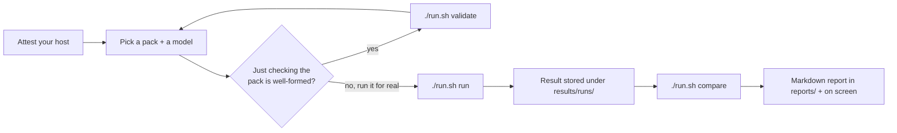
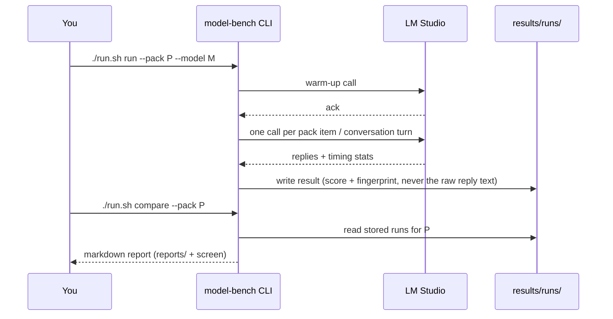
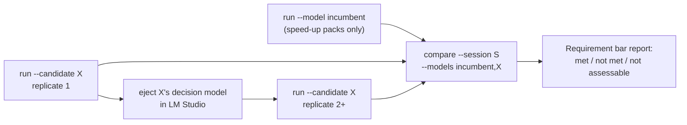
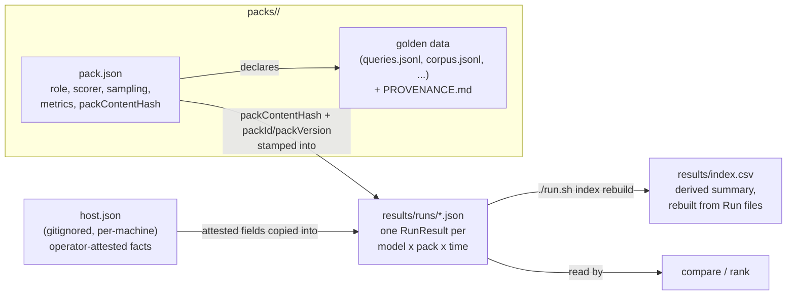

# Small-Model Benchmarking — User Manual

> **Status:** active · **Owner:** `tico` · **Tracks:** — · **Last updated:** 2026-11-20

## Who this is for

Anyone who wants to know, on their own machine, whether one local model does a job better than
another — "does this new model answer support questions more accurately than the one we're using
now?", "which of these embedding models retrieves better for our data?" — and wants that answer
tied to real evidence instead of a published leaderboard number. You need LM Studio running
locally with at least one model downloaded; no cloud account, no CI, nothing else running.

## Overview

`model-bench` measures **one local model** against **one versioned task pack** (a fixed set of
test items for one job — e.g. "call the right tool in a shop-assistant conversation," or "embed
these documents so the right one comes back first"). Every result is stored together with a
fingerprint of the exact environment it ran under, so a result from today can be honestly compared
against a result from three months ago on the same hardware — never against a different pack, a
different role, or a different machine's numbers.

Three things it deliberately does **not** do, because it's easy to expect them from a "benchmark"
tool: it never runs on its own (no CI hook, no scheduler — only a person typing a command starts
it); it never declares a model "passing" or "failing" (no threshold of its own, no gate — on the three
decision-point packs the report states a requirement bar and records whether it was met, but never
changes the command's exit code); and it never adds
scores across different jobs into one leaderboard number (a `tool-caller` score and an `embedder`
score aren't the same kind of thing, so nothing adds them together).



## Walkthroughs

### 1. One-time setup

```bash
cd model-bench
./setup.sh                        # creates .venv, installs the tool
./run.sh --help                   # confirms it's working
```

### 2. Attest your host (once per machine, redo if hardware/LM Studio changes)

A few facts about your setup — LM Studio's own app version, its KV-cache setting, how much RAM
your machine has, what else is running alongside it — can't be read from LM Studio automatically,
so you tell the tool once and it remembers:

```bash
./run.sh attest
```

This writes `host.json` (not checked into git — it's specific to your machine) and prompts you for
anything it can't fill in on its own. If you already know the values you want to set, pass them
directly: `./run.sh attest --set hostRamGb=16`. `--set` is repeatable over four keys —
`lmStudioAppVersion`, `kvCacheSetting`, `hostRamGb`, `otherResidentWorkloads` — and any key you
leave out is still prompted for on the terminal, so a script or non-interactive shell must pass all
four. Every later run copies these facts into its own
result record, so a result stays self-contained even if you attest again later. If `host.json` is
missing or stale (LM Studio itself changed since you last attested), `run` refuses rather than
silently recording something that's no longer true.

### 3. Pick a pack and a model

A **pack** is one job to test. Right now there are eight: five "plain" packs (below), and three
**decision-point** packs (listed after the table, with their own walkthrough in step 9).

| Pack id | Tests the job of… | Needs a model that can… |
|---|---|---|
| `embedder-graphrag-retrieval` | embedding text for retrieval | produce embeddings |
| `guard-judge-understanding` | judging/classifying content | chat |
| `nlq-structured-query` | turning a question into a structured query | chat |
| `tool-caller-shop-assistant` | holding a conversation and calling tools correctly | chat — a model that explicitly advertises no tool-calling capability is refused; most models don't declare either way, and for those the pack also recognizes tool calls written out in prose |
| `chat-responder-grounded-answers` | answering questions grounded in given context | chat |

The three decision-point packs are `guard-judge-synthetic`, `join-in-judge-synthetic` and
`message-type-classifier-synthetic`. They are not run like the five above — they test a small
*decision model* candidate rather than a chat model on its own; see step 9 before using them.

Ask Tico ("list all available models for the bench mark") at any time for the live list of what
LM Studio currently has on hand, since that list is whatever's loaded in LM Studio on your machine
right now — model-bench doesn't keep its own copy of it. Match the model's type to the pack: the
embedder pack needs one of LM Studio's `embeddings`-type models, everything else needs a chat
(`llm`/`vlm`-type) model.

### 4. (Optional) Validate a pack before spending a live run on it

No LM Studio connection needed — just checks the pack's own files are well-formed:

```bash
./run.sh validate --pack packs/tool-caller-shop-assistant
```

Useful mainly if you're building a new pack; skip it for an existing shipped pack, it's already
valid.

### 5. Run one model against one pack

```bash
./run.sh run --pack tool-caller-shop-assistant --model qwen/qwen3-4b-2507
```

This drives that model through every item (or, for `tool-caller`, every scripted conversation) in
the pack, talking to your live LM Studio, and — if it succeeds — stores the result under
`results/runs/`. A few optional flags:

- `--session <id>` — tag this run so you can pull it back out later with `--session` on `compare`.
- `--candidate <id>` — instead of `--model`, run a **candidate** (a small decision model plus its
  policy) on a decision-point pack; see step 9. Give exactly one of `--model` or `--candidate`.
- `--reference <key>` — accepted for compatibility but **ignored by `run`**: nothing records it.
  The comparison against a named reference model is done later, with `rank --reference` (step 7a).
- `--warmup <n>` — extra throwaway calls before the timed ones, if you want the model "warmed up"
  first.
- `--first-call-timeout <s>` / `--request-timeout <s>` — how long to wait for the first (warm-up)
  call and for each scored call, if the defaults are too tight for your hardware.

Nothing about the score decides whether this command "succeeds" — a run only fails for operational
reasons (see Troubleshooting below), never because a model scored badly.

### 5a. Testing several models in one sweep

There's no built-in "run N models" command — `run` is deliberately one model per invocation (see
Overview: no scheduler, no batch mode). The easiest way to sweep a subset is a plain shell loop,
tagging every run with the same `--session` so you can pull the whole batch back out together
afterward:

```bash
MODELS=("qwen/qwen3-4b-2507" "mistralai/ministral-3-3b" "qwen2.5-3b-instruct")
for m in "${MODELS[@]}"; do
  ./run.sh run --pack tool-caller-shop-assistant --model "$m" --session batch-20260918 || \
    echo "!! $m failed operationally, continuing"
done
./run.sh compare --pack tool-caller-shop-assistant --session batch-20260918
```

That final `compare` lists all three models in its arms table, but its verdict covers only the first
two by file-name order; for the whole field use `./run.sh rank --pack tool-caller-shop-assistant
--session batch-20260918`. The `|| echo ...` matters: a `run` only exits non-zero for an operational reason (see
Troubleshooting), never a bad score, but that's still enough to stop a loop that isn't guarded
against it. Every model in the loop needs to be the right type for the pack (see the table in step
3), and each run is a full live pass through the pack, so N models costs roughly N× one pack's
runtime.

### 6. See what's already been tested

Before running a model again, check whether it already has a stored result:

```bash
./run.sh models --tested --pack tool-caller-shop-assistant
```

### 7. Compare two runs

```bash
./run.sh compare --pack tool-caller-shop-assistant --models qwen/qwen3-4b-2507,mistralai/ministral-3-3b
```

This reads the stored runs for that pack, renders a markdown report to both `reports/` and your
screen, and never overwrites an earlier same-day report for the same pack (it appends a sequence
number instead). Each model you name uses its **newest** stored run, and a model with no stored
run is a usage error (exit `2`, nothing written). Leave off `--models` and every valid stored run
of the pack becomes an arm, in file-name order (alphabetical by model key, then start time); use
`--session <id>` to compare only runs you tagged together in step 5.

**The verdict covers only two arms.** If more than two arms are in play, the arms table lists all of
them, but the verdict section compares only the **first two** (by the order you gave in `--models`,
or by file-name order if you left it off). To compare a different pair, name them with `--models`;
to see the whole field at once, use `rank` (step 7a). (A decision-point pack works differently —
see step 9.)



### 7a. Ranking every model tested against a pack, not just two

On a plain pack, `compare` renders a verdict for one pair of arms. Once three or more models have a
stored result for the same pack, `rank` gives you the whole field in one table instead of running
`compare` repeatedly:

```bash
./run.sh rank --pack embedder-graphrag-retrieval
```

This prints (and saves to `reports/`) one row per model with a stored result — its point estimate,
a descriptive confidence interval, p95 latency, and footprint — sorted, never as a pairwise
matrix. A pack with two co-equal metrics and no single headline (e.g. `guard-judge-understanding`)
gets one table per metric instead of one overall table.

`rank` does not work on the three decision-point packs — it refuses with exit `2`, nothing
written, and points you to `compare` (step 9). Two optional flags change what the table can claim:

- **`--reference <modelKey>`** adds a statistically-corrected verdict column against that one named
  model — `distinguishable` or `not distinguishable` (on a boolean metric a row can also read `not tested
(Holm stops here)`, meaning the correction procedure stopped before reaching it; direction, when distinguishable, comes from
  the row's own signed diff column, not from the word "better"/"worse" itself), corrected for
  testing every other model at once (a Holm-Bonferroni family), never a raw uncorrected p-value per
  row. Leave it off and the table states only descriptive intervals — no verdict column, no p-value
  anywhere. Naming a model with no stored result for this pack is a usage error (exit `2`) —
  nothing is written.

  This works the same way on a *continuous* headline metric (e.g. `embedder-graphrag-retrieval`'s
  `mrr`) as on a boolean one (e.g. `guard-judge-understanding`) — same command, same idea (a
  per-candidate diff, interval, and decision against the named reference). The continuous table
  itself is a touch simpler (no per-row Holm threshold column — every candidate is decided at the
  same family-wide `alpha_used`, printed once above the table: `alpha_family=0.05, k=4,
  alpha_used=0.0125 (98.75% CI)` for a 4-candidate family, say):

  ```bash
  ./run.sh rank --pack embedder-graphrag-retrieval --reference bm25
  ```

  A candidate with no paired data against the reference reads `no verdict — no paired data` rather
  than being silently dropped (true on either metric kind); a continuous-metric family adds one
  more state, `no verdict — one paired unit`, for a candidate with exactly one pair — too few to
  form an interval from. Neither is an error — both just mean this particular candidate has no
  comparison to make against this reference model with what's stored so far.
- **`--footprints <path.json>`** — a flat `{"<modelKey>": "<display string>"}` map, e.g.
  `{"qwen/qwen3-4b-2507": "4B, Q4_K_M, 2.4 GB"}`, rendered verbatim in its own column. A missing or
  malformed value just shows as a dash or its raw string — never parsed as a number; a malformed
  *file* is a usage error, exit `2`.

Like `compare`, a same-day re-run never overwrites an earlier report — `rank` uses its own
`-rank-` sequence in the filename, so `compare` and `rank` reports for the same pack and day don't
collide.

### 8. Recovering the results index

`results/index.csv` is an **optional, on-demand** flat summary of everything under
`results/runs/` — nothing else writes it or reads it. `compare`, `rank`, and `models --tested` all
read the actual result files under `results/runs/` directly, never this file; the only way
`index.csv` ever gets created or refreshed is by asking for it explicitly:

```bash
./run.sh index rebuild
```

This reads every file in `results/runs/` and regenerates `results/index.csv` from scratch — it
never edits a stored run record, only this derived file. Useful if you want one flat file to skim
or feed to something else (a spreadsheet, a quick `grep`); model-bench itself never needs it to
exist.

### 9. Testing a decision-point candidate (guard, join-in, message type)

Three packs test a different kind of thing: a **candidate** — a small, fast *decision model* that
answers a yes/no or pick-a-label question about a conversation, plus a **policy** that decides when
it answers by itself and when it hands the item to a chat model.

| Pack id | The question | Kind of bar |
|---|---|---|
| `guard-judge-synthetic` | should the workflow advance? (yes/no) | **speed-up**: the candidate replaces a named chat model (the *incumbent*) and must not be shown less accurate (per kind of error) and must be at least twice as fast |
| `join-in-judge-synthetic` | should the agent reply to this message? (yes/no) | **new ability**: no incumbent; each answer class must agree with the reference labels at least 90% of the time, with mean latency at most 350 ms |
| `message-type-classifier-synthetic` | which kind of message is this? (`order`, `question`, `complaint`, `escalation`, `other`) | **new ability**, as above, per label |

Candidates are files already in `candidates/`; each candidate's name ends `-only-f<n>` (the decision
model answers alone) or `-handoff-f<n>` (it may hand items to a chat model). List them with
`./run.sh models --tested --pack guard-judge-synthetic`, which prints one name per line for
everything with a stored result — candidates and chat models alike.

**Step by step**, shown for the guard. Every command below uses one shared `--session` tag:
`run` accepts a missing tag, but `compare` on these packs requires `--session`, so a run without
one can never be read back.

```bash
# 1. the incumbent chat model - exactly one run in the session
./run.sh run --pack guard-judge-synthetic --model qwen/qwen3-4b-2507 --session guard-1
# 2. each candidate - run it twice or more (replicates, see below)
./run.sh run --pack guard-judge-synthetic --candidate guard-judge-v1-handoff-f1 --session guard-1
#    now eject the candidate's DECISION model in LM Studio (model-bench never unloads models for
#    you); without this the next run is a "same-load" replicate and the bar can't reach `met`
./run.sh run --pack guard-judge-synthetic --candidate guard-judge-v1-handoff-f1 --session guard-1
# 3. read the bars
./run.sh compare --pack guard-judge-synthetic --session guard-1 \
    --models qwen/qwen3-4b-2507,guard-judge-v1-handoff-f1
```

For `join-in-judge-synthetic` and `message-type-classifier-synthetic` there is no incumbent: run the
candidates only, and `compare --session <id> --models <candidate>[,<candidate>...]` (you may add one
chat model as a reference; no bar reads it).



What to know before you run:

- **A candidate needs LM Studio to hold both its decision model and, for a `-handoff-` candidate,
  its chat model.** The tool loads absent models itself. The decision model must show up in LM
  Studio's catalog as a `decision`-type model; if not, the run is refused (exit `4`) before any call.
- **Leakage is refused, not reported.** If any item in the pack was used to train or tune the
  candidate, `run` refuses (exit `4`).
- **The request timeout is fixed at 180 seconds** on these packs; passing a different
  `--request-timeout` is refused (exit `4`). Leave the flag off.
- **`compare` needs `--session` and `--models`** on these packs, and refuses (exit `2`, nothing
  written) when: either is missing; a name has no run in that session; a name is repeated; you name
  more than one chat model, or (on the guard, the only pack with an incumbent) a chat model other
  than the incumbent; the chat model has other than exactly one run in the session; one candidate name has been run with different
  candidate files in the session; the arms were run with different request timeouts; or you add
  `--negative-control`.
- **Every run of a candidate in the session counts as a replicate** — none is picked as "the" run.
  This is why you run each candidate more than once.

**Reading the report.** A decision-point `compare` also prints a generic `## Arms` table with only
the incumbent and a `## Verdicts` section reading "None: fewer than two arms were selected…". That
is expected on these packs — it is not telling you that you named the wrong arms. The bar results
are the answer. The `## Requirement bar` section opens the report, after a caveat that the
reference labels were produced by a model and not human-reviewed — so "agreement" means agreement
with that labeler on synthetic inputs, not verified correctness. For each candidate and replicate
it prints the numbers behind each bar, then an `#### Across the replicates` summary with one state
per bar:

| State | Meaning |
|---|---|
| `met` | the bar held, in every replicate that counts, and at least two of those replicates were separate loads of the decision model |
| `not met` | the bar did not hold; `unstable across replicates — not met` means some replicates met it and some did not |
| `not assessable` | the evidence can't support either answer; the reason is printed beside it (examples: fewer than 200 scored items, a class with no scored item, only one load replicate, a non-180-second stored timeout, or the pack content changing between runs) |

The tool states the bar and never acts on it: the command still exits `0` whatever the states.
For the guard the bars are "not shown less accurate than the incumbent" (per kind of error — a
one-sided test, so `met` means no worsening was demonstrated, not that the two are proven equal)
and a measured speed-up of at least 2x over the paired items; for the new abilities, every class's agreement at least 0.90
and mean latency at most 350 ms.

**Basis: by-construction versus assumed.** Each replicate's header says `basis by-construction` or
`basis assumed`. A decision model must stay loaded (the same "load") through a whole run for its
latency to mean anything. At the end of a run the tool checks this by re-asking the warm-up
question and comparing the answer: an identical answer makes the run `by-construction` (shown to
be one load); anything else — the model was missing, an item was skipped for a load, the re-check
failed or differed — makes it `assumed`. An `assumed` replicate is never counted as a load and its
bars read `not assessable (load changed mid-run)`. A `same-load` replicate (a later run on a model
that was already loaded) is reported but not counted as a load either, so to reach `met` you need
at least two runs where the model was freshly loaded. In practice: eject the decision model in LM
Studio before each replicate after the first (the first replicate counts as a load even if the model
was already loaded). The hand-off chat model's state doesn't matter.

## On-disk data shapes

`model-bench` has no database and no server — every "record" is a plain JSON (or CSV) file. The
three that matter, and how they relate:



- **`pack.json`** — one job's declaration. Key fields: `packId`, `packVersion`, `role` (one of the
  seven roles), `scorer` (the module that judges this pack's results), `environment.requires`
  (what the model must support — e.g. `lmstudio-embeddings`), `data` (paths to the golden files
  under the same pack directory), `sampling` (`seed`, `pairingKey`, `analysisUnit` — what makes two
  runs comparable at all), and `metrics` (`verdictMetrics`, `headlineMetric`). `packContentHash`
  covers the pack directory's content — a golden item, a prompt, or a tool schema changing all
  produce a new, distinguishable hash (its one deliberate exclusion is `PROVENANCE.md` itself) — a
  stored result always names the exact pack version it was measured against, never just a pack id.
- **`host.json`** — one file per machine, never checked into git (it describes *your* hardware, not
  the project). Its `attested` block holds four fields (`lmStudioAppVersion`, `kvCacheSetting`,
  `hostRamGb`, `otherResidentWorkloads`) that nothing in LM Studio exposes programmatically, so
  `attest` asks you once and remembers. Written by `./run.sh attest`; every later `run` copies these
  into its own result record.
- **`results/runs/*.json`** (one file per model × pack × timestamp) — the result itself. Three parts:
  a **`fingerprint`** block (pack identity + version, the model's own reported capabilities, every
  `host.json` field, timing of the run) that makes the record self-contained and honestly
  comparable later; an **`aggregates`** block (the scored metrics — shape depends on the pack's
  scorer, e.g. `mrr`/`recallAtK`/`precisionAt1` for an embedder pack); and an **`items`** list (one
  scored entry per pack item — never the model's raw reply text, only outcome/score detail). A
  top-level `sessionId` (not inside `fingerprint`) is what `--session` groups runs by.
- **`results/index.csv`** — a flat, derived summary of every file in `results/runs/`, written only
  by `index rebuild`, on demand — no other command creates, refreshes, or reads it. `compare`/
  `rank`/`models --tested` all go straight to `results/runs/`, never this file. Purely an optional
  convenience export; model-bench itself works the same whether it exists or not.

## Configuration & integration

**There is no environment-variable configuration** — deliberately, per the project's "zero runtime
dependencies, standalone" design: every setting is either a CLI flag (this manual's Walkthroughs)
or a file you can inspect directly (`host.json`, a pack's `pack.json`). Nothing here reads
`falkor-chat`'s own configuration, its model gateway, or its golden data live — any data that
originated in `falkor-chat` (e.g. the eval corpus behind `embedder-graphrag-retrieval`) was copied
in once, with its origin recorded in that pack's `PROVENANCE.md`, and stays a versioned, static
copy from then on.

**Integration with `falkor-chat`'s embedding-model migration workflow.** Before committing a
workspace to a new embedding model (see `falkor-chat`'s embedding-migration manual), the
recommended path is to validate the candidate here first, using the `embedder-graphrag-retrieval`
pack — no real workspace touched, no migration risked on a model that turns out to underperform.
This has already been exercised for real: a catalog sweep run against this pack found that
`granite-embedding-278m-multilingual` (the embedding-migration feature's lead replacement
candidate) scores within ~2-3 percentage points of MRR of the top-ranked model in the sweep, while
running at roughly **1/8th the footprint and ~4.6x lower p95 latency** — well inside the pack's own
statistical resolving power, so no model in the top cluster can be called definitively better or
worse than another from that data alone, but footprint/latency become the deciding factor once
quality is indistinguishable (`reports/catalog-sweep-2026-09-19-consolidated.md`, "embedder"
section). That is exactly the kind of evidence FR-6 of the embedding-migration feature asks for
before touching production data.

## FAQ / troubleshooting

**Should I use `compare` or `rank`?** `compare` is for a specific two-model question ("is A better
than B for this job?") — or, on a decision-point pack, for reading the requirement bars (step 9).
`rank` is for "how does everything I've already tested stack up?" — one
table across every model with a stored result, and it's the only one of the two that can name a
single `--reference` model and get corrected verdicts against the whole rest of the field at once
— on any pack, continuous headline metric (e.g. `embedder-graphrag-retrieval`'s `mrr`) or boolean
one alike (see Walkthrough 7a). `rank` does not work on decision-point packs.

**What are all the exit codes?** `0` — ran and reported, whatever the scores (a `compare`/`rank`
that finds every stored record invalid still exits `0`; that's a report, not a failure). `2` — bad
arguments/usage (including a `rank --reference` naming a model with no stored result, or a
malformed `--footprints` file). `3` — LM Studio unreachable, or didn't answer within
`--first-call-timeout`; on a decision-point pack also a failed explicit model load, a model of the
arm no longer loaded after the warm-ups, or the decision model's settings unreadable. `4` — an
invalid pack, an environment requirement the model doesn't meet, or (for `tool-caller`) a
conversation cut short by a tool-dispatch failure; on a decision-point pack also a refused
candidate (unreadable or mismatched candidate file or fit list, wrong role, the decision model
missing or not `decision`-type, a hand-off model that isn't a chat model or, on the guard, isn't
the incumbent), leakage, or a `--request-timeout` other than 180. `5` — `host.json` missing or
stale, or LM Studio's loaded-model list couldn't be read at the end of the run. Nothing here is
score-driven — see Overview. (`validate --strict` is not implemented yet: it crashes with a
Python traceback and exit `1` — run `validate` without it.)

**How do I view a report after it's written?** You don't need to hunt for it — `compare` prints
the same markdown to your screen as it runs. The saved copy is plain text at
`reports/<pack-id>-<date>-<NN>.md` (the two-digit suffix is a same-day sequence number, so a
re-run never overwrites an earlier report); open it in any markdown viewer or editor, or `cat` it.
Pass `--out <path>` on `compare` if you'd rather it land somewhere else entirely.

**"LM Studio unreachable" / exit code 3.** LM Studio isn't running, isn't answering its
`/api/v0/models` catalog endpoint, or didn't respond to the warm-up call in time. Start LM Studio
(or load the model) and try again; if it's slow to warm up, raise `--first-call-timeout`.

**"Invalid pack" / exit code 4.** Usually means the model you picked doesn't match what the pack
needs (e.g. you pointed the embedder pack at a chat model), or — for `tool-caller` specifically —
a conversation had to be cut short because a tool call couldn't be dispatched. In that last case
the partial result is still written to `results/runs/` before the tool reports the failure, so
nothing is silently lost.

**"Fingerprint incomplete" / exit code 5.** Run `./run.sh attest` again — either you haven't
attested this host yet, or something about your LM Studio setup changed since you last did. If
`attest` doesn't fix it, the cause may be LM Studio's loaded-model list not being readable at the
end of the run; in that case the finished run is **not stored**, so once LM Studio is responsive
you must redo the whole run. A known quirk: the message for this case
mentions a `results/transcripts/<runId>.jsonl` file that the tool never writes — ignore it.

**My decision-point `compare` was refused with exit 2 — what do I fix?** The message names the
cause; it's one of the cases listed in step 9 (most often a missing `--session` or `--models`, a
model name with no run in that session, or more than one chat model). Nothing is written, so fix
the command and rerun.

**A decision-point run failed or came out `assumed` on a busy machine.** A shared or busy LM Studio
can evict or reload the decision model mid-run, degrading a replicate to `assumed`, and a slow
catalog response can give exit `3`, or occasionally a Python traceback with exit `1`; either way
nothing is stored. Close other LM Studio users and re-run.

**Why is every bar `not assessable`?** The reason is printed in parentheses. The common ones: fewer
than 200 scored items; only one fresh-load replicate (run the candidate again after unloading its
model); an `assumed` replicate (see "by-construction versus assumed"); or a run whose request
timeout wasn't 180 seconds.

**Why doesn't a bad score make the command fail?** By design. There's no "passing" score in this
tool, and even a decision-point report's `not met` only states a bar — see Overview. A non-zero exit always means something operational went wrong, never that a
model did poorly.

**What does `--negative-control` on `compare` actually prove?** It compares one stored run against
a copy of *itself*, so the two "arms" are guaranteed identical — it's a smoke check that the
comparison machinery is wired correctly, not a real result. Two genuinely independent runs of the
same model is the real version of that check.

**Can I see the model's actual replies afterward?** No — a stored result never keeps the raw reply
text, only the score and a small scoring detail block. To see what a model actually said for a
particular item, you'd need to run it again live.

**Where do the numbers in a report come from — is a small difference between two models
meaningful?** The report accounts for run-to-run noise with confidence intervals and flags when a
difference isn't large enough to be sure of; if you want the statistical reasoning behind that,
ask Tico or see `docs/plans/small-model-benchmarking-ml.md` at the repo root.
